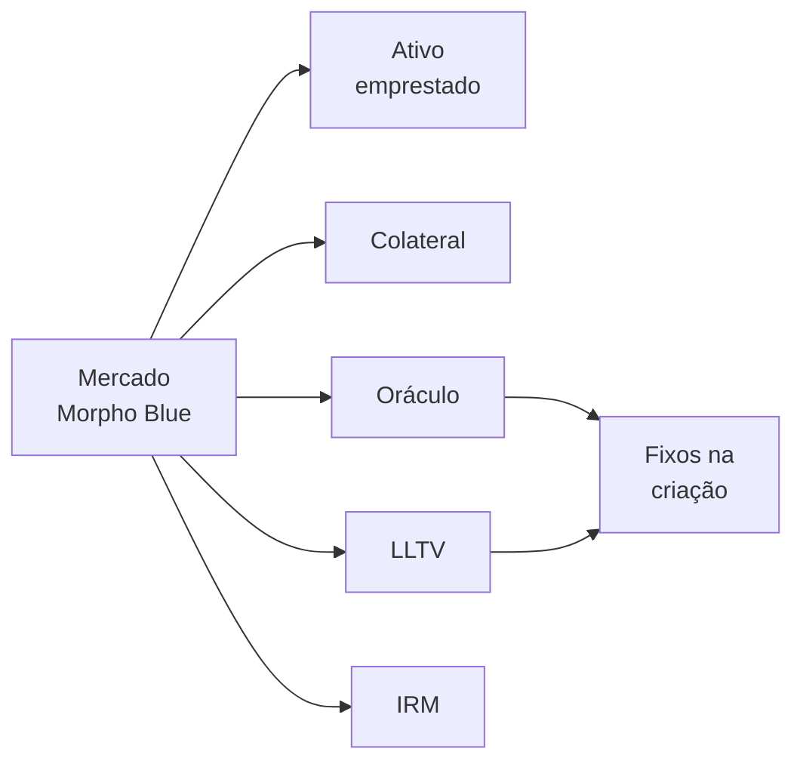
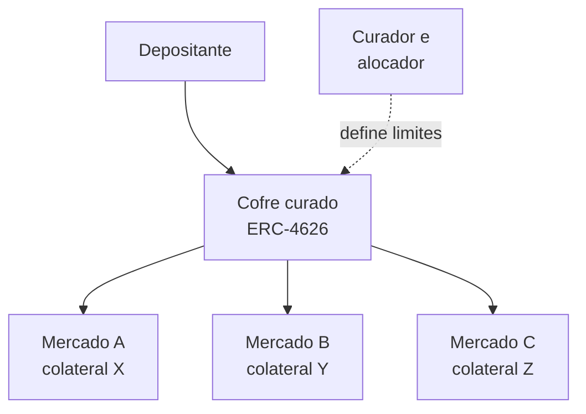
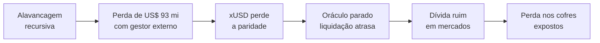

# Capítulo 59: Morpho, Mercados Isolados e Cofres Curados

O Capítulo 12 mostrou o empréstimo em pool, em que todos os depositantes de um ativo dividem o mesmo caixa e o mesmo risco, e as regras são decididas pela governança do protocolo. Existe um desenho quase oposto, em que o núcleo do protocolo é pequeno, imutável e sem opinião, e a escolha de onde aplicar o dinheiro fica com terceiros. É o caso do Morpho. Este capítulo explica como o Morpho Blue organiza mercados de empréstimo isolados, o que são os cofres curados que ficam por cima deles, e o que um episódio de 2025 envolvendo a Stream Finance ensinou sobre onde o risco se desloca. Nada aqui é recomendação de compra, venda ou uso de qualquer protocolo.

**De otimizador a camada base.** Segundo o material público sobre a empresa, o Morpho foi fundado em 2021 por Paul Frambot e outros, e seu primeiro produto, lançado em 2022, era o chamado Morpho Optimizer, uma camada que casava credores e tomadores diretamente sobre o Aave e o Compound para estreitar a diferença entre as taxas de depósito e de empréstimo. Em entrevista, Frambot disse que o sistema havia chegado ao seu limite, e a equipe passou a construir o Morpho Blue, descrito como uma camada de empréstimo minimalista, com poucas centenas de linhas de código imutável, na qual qualquer pessoa pode criar o equivalente de um Aave ou de um Compound com os parâmetros que quiser. O Aave e o Compound seguem explicados no Capítulo 12.

**Um mercado é cinco números.** Na documentação oficial, cada mercado do Morpho Blue é definido por cinco parâmetros escolhidos na criação e que não podem mais ser alterados: o ativo emprestado, o ativo dado em garantia, o oráculo de preço, o LLTV (a razão máxima entre dívida e colateral antes da liquidação) e o modelo de taxa de juros, o IRM. Criar um mercado não exige votação de governança, e cada um é isolado: um problema com o colateral de um mercado não contamina os outros. Há um filtro, porém. A documentação informa que o LLTV e o IRM precisam fazer parte de listas habilitadas pela governança do Morpho, e que o oráculo é escolhido por quem cria o mercado. Isso conecta o tema ao Capítulo 25: o oráculo é a peça em que a segurança do mercado mais depende, e aqui a escolha dele passa a ser de quem cria o mercado, e não do protocolo.


*Os cinco parâmetros que definem um mercado ficam fixos desde a criação; para mudar qualquer um deles, é preciso criar outro mercado.*

**Liquidação com incentivo calculado.** No Capítulo 12, a liquidação aparece com um bônus definido pelo protocolo. No Morpho Blue, a documentação oficial fornece uma fórmula para o fator de incentivo de liquidação (LIF), que depende do LLTV do mercado e vai inteiro para quem liquida. Com os parâmetros publicados, β igual a 0,3 e teto M de 1,15, o resultado é:

```latex
LIF = min( 1,15 ; 1 / (0,3 × LLTV + 0,7) )

exemplo: LLTV = 0,80  ->  LIF = 1 / 0,94 ≈ 1,06
         (o liquidador recebe cerca de 6% a mais em colateral do que a dívida que quita)
```

Quanto menor o LLTV, maior o bônus, até o teto de 15%. A lógica é que um mercado que liquida mais cedo tem mais folga para pagar o liquidador, enquanto um mercado com LLTV alto tem pouca margem entre a liquidação e a insolvência, e por isso o bônus é menor.

**Cofres curados.** Cada mercado do Blue é isolado, o que é bom para a segurança e ruim para a experiência de quem só quer depositar. Quem deposita num mercado isolado fica exposto a um único colateral e precisa avaliar sozinho o oráculo e o LLTV. A resposta do ecossistema foram os cofres, que seguem o padrão ERC-4626 citado no Capítulo 22. Num cofre, o depositante entrega um ativo e recebe cotas, e um gestor distribui o dinheiro entre vários mercados do Blue. Na primeira geração, chamada MetaMorpho, a documentação oficial descreve um cofre com um único ativo emprestado e no máximo 30 mercados habilitados, com o limite de depósito de cada mercado começando em zero. Os papéis são separados:

| Papel | O que pode fazer, segundo a documentação |
| --- | --- |
| Dono (owner) | Trocar o dono, definir o curador, gerir alocadores, definir taxas |
| Curador (curator) | Decidir quais mercados entram e com que limite; reduzir um limite a qualquer momento, enquanto aumentar ou habilitar mercado novo passa por uma espera (timelock) |
| Alocador (allocator) | Mover o dinheiro do cofre entre mercados já habilitados, dentro dos limites |
| Guardião (guardian) | Pode vetar certas mudanças durante a espera, conforme a configuração do cofre |

*A separação de papéis limita o que cada função pode fazer, e a espera obrigatória para aumentar risco dá tempo para quem depositou reagir.*

Na geração mais nova, a documentação descreve os Vaults V2, que se conectam a protocolos por adaptadores, como um que fala com mercados do Morpho e outro que fala com cofres V1. O curador define limites absolutos e relativos por adaptador, e adicionar um adaptador é uma ação com espera. Os detalhes de cada versão mudam, e a configuração de cada cofre deve ser lida na própria documentação e na página dele.


*O depositante só vê o cofre; a escolha dos mercados e dos limites é feita pelo curador, e cada mercado por trás segue isolado.*

**O deslocamento do risco.** Compare com o Capítulo 12. No pool do Aave, a governança escolhe os ativos aceitos e os parâmetros, e o depositante confia nesse processo coletivo. No Morpho, o núcleo é neutro, e o depositante de um cofre confia em uma entidade, o curador, que decide a lista de colaterais, os oráculos e os limites. O risco não desapareceu, mudou de lugar: de um comitê de governança para uma decisão de gestão de risco que se parece mais com a de um gestor de fundo, e que também ganha taxa de performance. O modelo oferece mais variedade e rapidez, e exige do depositante uma pergunta a mais: quem é o curador, o que ele aceita como colateral e como foi o histórico dele.

| Aspecto | Pool (Aave, Cap. 12) | Mercado Blue | Cofre curado |
| --- | --- | --- | --- |
| Quem escolhe colaterais | Governança do protocolo | Quem cria o mercado | Curador do cofre |
| Isolamento do risco | Parcial, com limites e modos especiais | Total, um colateral por mercado | Depende dos mercados escolhidos |
| Parâmetros mudam depois? | Sim, por governança | Não | Limites sim, com espera para aumentar |
| Esforço do depositante | Baixo | Alto | Médio, concentrado em avaliar o curador |

*Quanto menos o núcleo decide, mais a análise de risco fica por conta de quem escolhe os mercados.*

**O caso da Stream Finance.** O episódio de novembro de 2025 mostra o modelo sob estresse. De acordo com a imprensa especializada, a Stream Finance, que oferecia o xUSD como produto de rendimento anunciado como neutro ao mercado, informou uma perda de cerca de 93 milhões de dólares atribuída a um gestor externo de fundos, e o xUSD caiu com força, chegando a negociar em torno de 0,26 dólar em algum momento. Um analista já havia apontado antes o uso de alavancagem recursiva, com ativos de apoio na ordem de 170 milhões e empréstimos na ordem de 530 milhões. Pesquisadores estimaram cerca de 285 milhões de dólares de exposição direta distribuída entre Euler, Silo, Morpho e Gearbox, número que os próprios autores descrevem como não exaustivo e que exclui exposição indireta por cofres secundários. No Morpho, o impacto relatado ficou concentrado em um cofre de um curador, com dívida ruim estimada entre cerca de 650 mil e 700 mil dólares segundo fontes diferentes. Um detalhe técnico chama atenção: o oráculo do xUSD teria ficado parado em 1,26 dólar enquanto o preço de mercado desabava, o que atrasou liquidações. É a lição do Capítulo 25 em ação, pois um oráculo desatualizado ou mal escolhido transforma uma queda de preço em dívida ruim. Já a Elixir, que havia emprestado cerca de 68 milhões de dólares em USDC à Stream, anunciou o encerramento do deUSD. Os valores por curador divulgados em diferentes fontes não coincidem e não são reproduzidos aqui.


*A cadeia mostra como a falha em um produto de rendimento chega aos cofres de empréstimo: pelo colateral, e agravada por um oráculo que não acompanhou o preço.*

**O que fica de aprendizado.** O isolamento de mercados funcionou como projetado, no sentido de que a perda ficou nos mercados e cofres que aceitaram o xUSD, e não se espalhou por todo o protocolo. Ao mesmo tempo, o caso mostra que isolar não equivale a proteger: quem depositou num cofre exposto assumiu o risco da decisão do curador. As perguntas práticas são sempre as mesmas: o que o cofre aceita como colateral, que oráculo cada mercado usa, qual o limite por mercado, como o curador respondeu a eventos anteriores e se o rendimento prometido faz sentido, tema já tratado no Capítulo 58 para a Ethena. Rendimento muito acima do mercado costuma ter uma fonte de risco por trás.

**Fato e interpretação.** São fatos documentados os cinco parâmetros imutáveis do mercado, a fórmula do LIF, a separação de papéis dos cofres e a existência dos Vaults V2 com adaptadores. A queda do xUSD e a exposição de cofres foram apuradas por imprensa e pesquisadores, com números que divergem entre fontes e que aqui valem como ordem de grandeza. Não foi possível confirmar em fonte aberta a data de lançamento do Morpho Blue na mainnet nem os valores atuais de depósitos no protocolo, e por isso ficam de fora.

**Glossário do capítulo.**

- **Morpho Blue**: camada base de empréstimo do Morpho, minimalista e imutável, em que cada mercado é definido por cinco parâmetros fixos.
- **Mercado isolado**: mercado de empréstimo com um único par de ativo emprestado e colateral, cujo risco não se mistura com o de outros mercados.
- **LLTV**: razão máxima entre dívida e valor do colateral, a partir da qual a posição pode ser liquidada.
- **IRM**: modelo de taxa de juros, contrato externo que calcula a taxa cobrada dos tomadores.
- **LIF**: fator de incentivo de liquidação, que define quanto colateral extra o liquidador recebe em relação à dívida quitada.
- **Cofre curado**: contrato ERC-4626 que recebe depósitos e os distribui entre mercados escolhidos por um gestor.
- **Curador**: papel que define quais mercados um cofre pode usar e com que limites.
- **Alocador**: papel que move o dinheiro do cofre entre os mercados já habilitados.
- **Timelock**: espera obrigatória entre o anúncio e a execução de uma mudança, que dá tempo de reação a quem depositou.
- **Dívida ruim (bad debt)**: dívida que não é coberta pelo colateral após a liquidação.

**Fontes.**

Observação de transparência: nesta execução o ambiente não conseguiu abrir páginas diretamente. As informações abaixo vieram dos resultados e trechos devolvidos pela busca web para estes endereços, e não de leitura integral das páginas.

- https://docs.morpho.org/contracts/metamorpho/reference/overview
- https://docs.morpho.org/contracts/metamorpho/guides/role-and-capabilities
- https://docs.morpho.org/faq/morpho-blue-faq
- https://docs.morpho.org/concepts/morpho-blue/core-concepts/liquidation
- https://docs.morpho.org/learn/concepts/vault-v2
- https://docs.morpho.org/curate/tutorials-v2/listing-adapters/
- https://en.wikipedia.org/wiki/Morpho_Labs
- https://app.thebigwhale.io/article/paul-frambot-morpho-aave-has-its-limits-and-we-re-here-to-push-them-back
- https://decrypt.co/347285/stream-finance-stablecoin-plunges-77-protocol-fund-manager-loses-93-million
- https://cointelegraph.com/news/defi-sleuths-trace-284m-stream-finance-exposure
- https://forum.arbitrum.foundation/t/update-stream-finance-xusd-situation-and-impact-assessment/30206
- https://reports.tiger-research.com/p/collapse-of-the-defi-jenga-the-stream-eng
