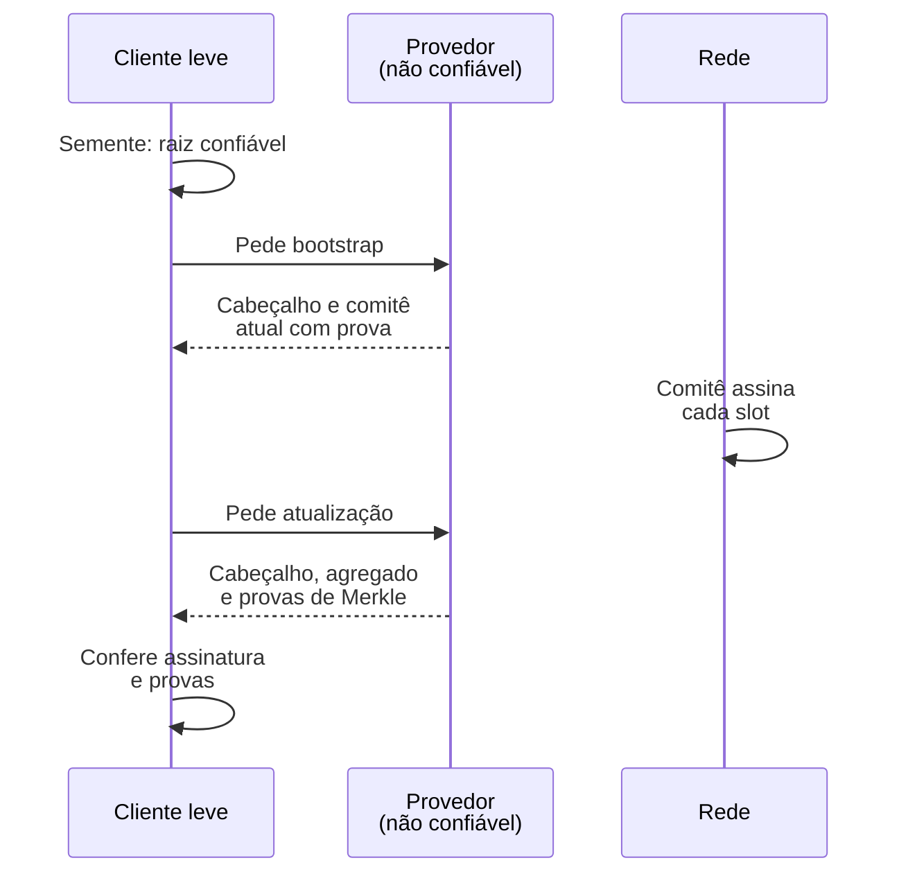
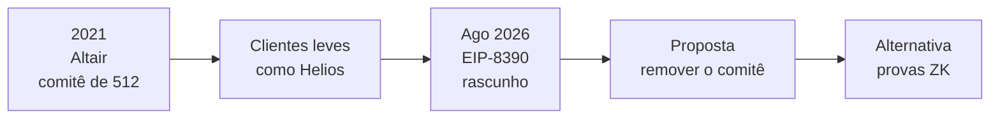

# Capítulo 60: Clientes Leves e Comitês de Sincronização, Verificar o Ethereum sem Rodar um Nó

O Capítulo 28 mostrou que rodar um nó completo exige dois programas, um cliente de execução e um de consenso, e que isso pesa em disco, memória e banda. O Capítulo 37 mostrou por que o estado e o histórico crescem. Para a maioria das pessoas, então, a pergunta prática é: como saber que o saldo mostrado na carteira é real sem manter uma cópia da rede inteira? Na prática, quase todo mundo consulta um provedor de RPC e simplesmente confia na resposta. O cliente leve é a tentativa de trocar essa confiança por verificação. Este capítulo explica como ele funciona, qual é o papel do comitê de sincronização introduzido na atualização Altair e por que um rascunho de proposta de 2026 sugere removê-lo. Nada aqui é recomendação de compra, venda ou uso de qualquer produto.

**O problema da confiança no RPC.** Quando uma carteira pergunta "qual é o saldo deste endereço?", o provedor responde com um número. Nada na resposta prova que ele corresponde ao estado real da cadeia. Um provedor falho, malicioso ou comprometido poderia mostrar um saldo falso, esconder uma transação ou apresentar uma versão antiga do estado. O mesmo raciocínio aparece no Capítulo 23: uma ponte que confia em um pequeno grupo de assinantes herda o risco desse grupo. Aqui o grupo é um único servidor.

**O que um cliente leve faz.** Um cliente leve não executa as transações nem guarda o estado. Ele acompanha apenas os cabeçalhos de bloco da camada de consenso e verifica provas. A ideia tem duas partes. Primeiro, o cliente precisa saber qual cabeçalho é legítimo. Segundo, com um cabeçalho legítimo em mãos, qualquer dado do estado pode ser conferido por uma prova de Merkle: o cabeçalho contém a raiz do estado, e quem fornece o dado entrega junto o caminho que o liga a essa raiz. Se o caminho confere, o dado é autêntico, venha de onde vier. É esse o papel de chamadas como `eth_getProof`, que devolvem a prova junto do valor.

**Ponto de partida: a raiz confiável.** A especificação do cliente leve da Altair deixa claro que o cliente é inicializado com uma raiz de bloco confiável (`trusted_block_root`) fornecida de fora, e a própria especificação não define de onde ela vem. É a mesma lógica de subjetividade fraca vista de passagem no Capítulo 2: quem entra na rede precisa de um checkpoint recente obtido por um canal razoavelmente confiável, como outros clientes, fontes públicas ou o conhecimento de várias pessoas. Depois dessa semente, o cliente avança sozinho, sem repetir a confiança.

**O comitê de sincronização.** Verificar a assinatura de todos os validadores a cada slot seria caro demais para um celular ou um navegador. A Altair resolveu isso com uma amostra: o comitê de sincronização. Segundo a especificação de consenso, ele tem 512 membros e dura 256 epochs, algo em torno de 27 horas com as epochs de 6,4 minutos do Capítulo 2. A seleção é sorteada entre os validadores ativos, com probabilidade proporcional ao saldo efetivo, e o mesmo validador pode aparecer mais de uma vez. O comitê só muda nas fronteiras do período: o "próximo" comitê vira o "atual" e um novo próximo é derivado.

Em cada slot, os membros assinam o cabeçalho que consideram o topo da cadeia, e as assinaturas são agregadas em uma só, o `sync_aggregate`, que vai dentro do bloco seguinte. Para o cliente leve, isso é barato: uma única verificação de assinatura agregada contra as 512 chaves do comitê, que ele já conhece. Quem participa recebe uma recompensa por assento; quem deixa o bit desmarcado perde o valor do assento. Esse peso é o "2" da lista 14/26/14/2/8 do Capítulo 48, e é por isso que o comitê aparece na conta do rendimento do staking.


*O provedor entrega os dados, mas só o que passa pela verificação do cliente é aceito; a confiança fica na raiz inicial e na honestidade do comitê.*

**Os objetos do protocolo.** A especificação define quatro pacotes. O `LightClientBootstrap` traz um cabeçalho, o comitê atual e a prova de que esse comitê pertence ao estado daquele cabeçalho. O `LightClientUpdate` traz o cabeçalho atestado, o próximo comitê com sua prova, o cabeçalho finalizado com a prova de finalidade, o agregado de assinaturas e o slot em que foi assinado. As variantes `FinalityUpdate` e `OptimisticUpdate` são versões enxutas, com e sem a parte de finalidade. A diferença entre as duas últimas é a seguinte.

| Atualização | O que prova | Velocidade | Observação |
| --- | --- | --- | --- |
| Otimista | Que o comitê assinou um cabeçalho | Quase a cada slot | O cliente só avança se a participação passar de um limiar de segurança |
| De finalidade | Que um cabeçalho foi finalizado (Capítulo 2) | Atrasa alguns minutos | Mais forte, depende de a finalidade ocorrer |

*A atualização otimista dá rapidez com menos garantia; a de finalidade dá garantia maior com atraso.*

O limiar de segurança da atualização otimista, segundo a especificação, é a metade do maior número de participantes ativos observado nos períodos recente e anterior. Já a regra mínima para aceitar uma atualização é só um participante, e por isso essa regra sozinha não protege: a segurança vem da combinação com o limiar e com a verificação das assinaturas.

```latex
limiar_de_seguranca = max(participantes_max_anterior, participantes_max_atual) / 2

exemplo: se o máximo recente foi 500 de 512 assentos, o limiar é 250
         (o cliente só avança o cabeçalho otimista com mais de 250 assinaturas)
```

**Onde a confiança de fato está.** Aqui está o ponto central do tema. Um cliente leve não confia no provedor, mas confia que a maioria do comitê de 512 sorteados é honesta. Como a especificação de consenso não define nenhuma condição de slashing para mensagens do comitê (o Capítulo 2 explicou o slashing para os demais deveres), um comitê corrompido poderia assinar um cabeçalho falso sem perder stake por isso, apenas deixando de ganhar a recompensa. Corromper uma maioria de uma amostra sorteada, por sua vez, exige controlar muita gente ao mesmo tempo, e a amostra muda a cada 27 horas, o que torna o ataque difícil, mas não pune quem o tenta. Essa assimetria é a crítica mais conhecida ao desenho, e ela vem sendo repetida desde a época da Altair.

**Uso na prática.** O exemplo mais citado de implementação é o Helios, cliente leve escrito em Rust e lançado pela a16z crypto. Segundo o post de lançamento, ele sincroniza em cerca de dois segundos, não exige armazenamento relevante e compila para WebAssembly, o que permite embuti-lo em carteiras e aplicações. Ele funciona como um "RPC local verificável": aponta-se para um provedor que ofereça `eth_getProof`, e o Helios confere cada resposta contra o cabeçalho que ele mesmo validou. A nota de maturidade que acompanhava o projeto na época do lançamento era de software experimental, e o estado atual de cada versão deve ser conferido no repositório oficial. Outro uso é entre chains: uma ponte que verifica o cliente leve do Ethereum em outra rede reduz a dependência de assinantes externos, o que dialoga com o Capítulo 23 e com a discussão de intenções do Capítulo 45.

**Um rascunho que propõe remover o comitê.** Em agosto de 2026 foi publicado o rascunho EIP-8390, de autoria de Lion (@dapplion), com o título "Remove the Sync Committee". Segundo o texto, o comitê foi uma solução de contorno de 2021 para um cliente leve que não conseguia verificar o conjunto completo de validadores, e as provas de conhecimento zero (Capítulo 55) tornaram essa verificação plausível. O rascunho aponta também a ausência de slashing. A proposta remove o processamento do agregado de sincronização, a rotação do comitê, os tópicos de gossip e os métodos de requisição do cliente leve, o que quebraria todos os clientes leves da Altair já implantados. Haveria ainda um efeito econômico: sem redistribuir o peso, a emissão da camada de consenso cairia em cerca de 1/32, o que a imprensa especializada estimou em cerca de 33.800 ETH por ano, uma estimativa e não um número confirmado. O status é de rascunho, sem época de ativação definida, e o texto deixa o calendário para as equipes de clientes. Como em qualquer proposta nesse estágio, nada garante que ela seja adotada.


*A linha mostra a trajetória de um mecanismo criado como atalho e questionado depois que as provas ZK ficaram mais viáveis; o último passo é uma hipótese, não uma decisão.*

**Fato e interpretação.** São fatos documentados na especificação: o tamanho de 512, o período de 256 epochs, os quatro objetos do protocolo, o limiar de segurança e a ausência de condição de slashing. É fato que o EIP-8390 existe como rascunho. São interpretações, e ficam como tal, a gravidade da assimetria de incentivos e a conveniência de remover o comitê. As datas exatas do rascunho variam entre as fontes (a página da proposta indica 22 de agosto de 2026 e uma reportagem fala em 24 de agosto), e a estimativa de emissão é aproximada.

**Glossário do capítulo.**

- **Cliente leve**: programa que acompanha cabeçalhos e verifica provas, sem executar transações nem guardar o estado completo.
- **Comitê de sincronização**: grupo de 512 validadores sorteados por 256 epochs, cujas assinaturas servem de atalho para clientes leves.
- **Sync aggregate**: assinatura agregada do comitê incluída no bloco, com um bit por assento indicando quem assinou.
- **Raiz de bloco confiável**: ponto de partida fornecido de fora ao cliente leve, a partir do qual ele passa a se verificar sozinho.
- **Prova de Merkle**: caminho que liga um dado à raiz do estado contida no cabeçalho, permitindo conferir sua autenticidade.
- **eth_getProof**: chamada de RPC que devolve um valor do estado junto da prova de Merkle correspondente.
- **Atualização otimista**: pacote que prova só a assinatura do comitê sobre um cabeçalho, sem a prova de finalidade.
- **Limiar de segurança**: metade do maior número de participantes recente, abaixo do qual o cliente não avança o cabeçalho otimista.
- **Helios**: cliente leve em Rust, compilável para WebAssembly, que age como RPC local verificável.
- **EIP-8390**: rascunho que propõe remover o comitê de sincronização e o cliente leve da Altair.

**Fontes.**

Observação de transparência: nesta execução o ambiente só conseguiu abrir diretamente os dois arquivos de especificação do GitHub listados primeiro. Os demais endereços foram usados pelos trechos devolvidos pela busca web, sem leitura integral das páginas.

- https://raw.githubusercontent.com/ethereum/consensus-specs/master/specs/altair/light-client/sync-protocol.md
- https://raw.githubusercontent.com/ethereum/consensus-specs/master/specs/altair/beacon-chain.md
- https://eips.ethereum.org/EIPS/eip-8390
- https://cryptoslate.com/ethereum-proposal-would-cut-33800-eth-issuance-and-break-every-deployed-altair-light-client/
- https://a16zcrypto.com/building-helios-ethereum-light-client/
- https://prestwich.substack.com/p/altair
- https://docs.beaconcha.in/api-reference/sync-committees/sync-committee-for-a-period
