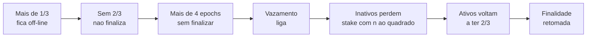
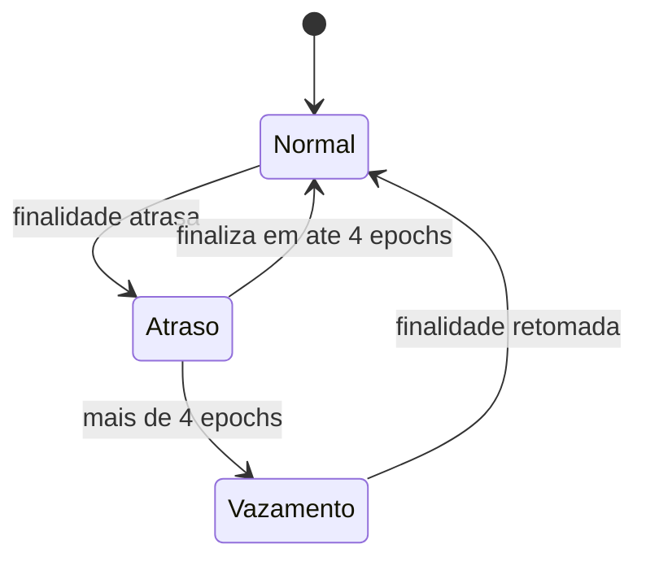

# Capítulo 61: O Vazamento por Inatividade, Quando a Finalidade Para e a Rede Precisa se Curar

O Capítulo 2 apresentou a finalidade: quando validadores que somam pelo menos dois terços do ETH em stake votam em um checkpoint, ele é justificado, e o seguinte o finaliza. O mesmo capítulo dedicou um único parágrafo ao que acontece quando isso falha, o inactivity leak. O Capítulo 28 voltou ao assunto pelo ângulo dos clientes: um bug em um programa dominante pode derrubar participação suficiente para ameaçar a finalidade. Este capítulo abre a engrenagem desse mecanismo de emergência, mostra os números da especificação, faz uma conta própria de quanto tempo ele leva para agir e discute por que ele é ao mesmo tempo elegante e polêmico. Nada aqui é recomendação de compra, venda ou uso de qualquer produto.

**O problema que o mecanismo resolve.** Em um sistema que exige dois terços para finalizar, existe um dilema clássico: se mais de um terço dos validadores some, os que restam não conseguem mais atingir o limiar e a finalidade trava. Esperar que os ausentes voltem pode não funcionar, porque eles podem estar fora do ar por tempo indeterminado. A saída do protocolo é fazer a ausência custar. Os inativos perdem stake aos poucos, o que reduz o peso deles na soma, até que os ativos voltem a representar dois terços do total e a finalidade seja retomada. A rede continua produzindo blocos o tempo todo (o Capítulo 2 explicou que propostas e atestações seguem), mas as transações deixam de ter a garantia forte de irreversibilidade.

**Quando o vazamento liga.** A especificação da camada de consenso define o atraso de finalidade como a diferença entre a época anterior e a época do último checkpoint finalizado. O vazamento está ativo quando esse atraso passa de `MIN_EPOCHS_TO_INACTIVITY_PENALTY`, que vale 4. Em tempo corrido, são pouco mais de 25 minutos sem finalizar (quatro epochs de 6,4 minutos), contra os cerca de 13 minutos que a finalização normal leva. Enquanto o atraso não passa de 4 epochs, nada de especial acontece.

**A pontuação de inatividade.** Desde a atualização Altair, cada validador carrega uma pontuação de inatividade. A cada epoch, a especificação aplica a regra abaixo, que depende de o validador ter feito uma atestação de alvo (target) correta e pontual na epoch anterior:

| Situação do validador na epoch | Efeito na pontuação |
| --- | --- |
| Atestou o alvo corretamente | Cai 1 ponto, com piso em zero |
| Não atestou (ou atestou errado) | Sobe 4 pontos (`INACTIVITY_SCORE_BIAS`) |
| Rede fora do vazamento, qualquer validador | Cai mais 16 pontos (`INACTIVITY_SCORE_RECOVERY_RATE`), com piso em zero |

*Durante o vazamento, só quem atesta consegue segurar a pontuação; fora dele, a recuperação é rápida (16 pontos por epoch).*

**A conta da penalidade.** A penalidade de uma epoch é proporcional ao saldo efetivo e à pontuação, dividida por uma constante. Na especificação da Bellatrix, que ajustou o valor da Altair para ficar mais severo após The Merge, o quociente `INACTIVITY_PENALTY_QUOTIENT_BELLATRIX` vale 2^24 (16.777.216). Só são penalizados os validadores que não atestaram o alvo na epoch anterior. Em forma de fórmula:

```latex
penalidade_da_epoch = saldo_efetivo * pontuacao / (4 * 2^24)

pontuacao apos n epochs seguidas sem atestar = 4 * n
perda acumulada ~ saldo * (4 * n(n+1)/2) / (4 * 2^24)
                ~ saldo * n^2 / 2^25
```

*Como a pontuação cresce linearmente e a penalidade é proporcional a ela, a perda acumulada cresce com o quadrado do tempo; por isso o mecanismo é chamado de vazamento quadrático.*

Isso explica a combinação de brandura e firmeza do desenho. Nas primeiras horas a perda é minúscula. Quem teve uma queda curta de energia ou de conexão paga quase nada. Só uma ausência prolongada, de dias, torna a perda relevante.

**Uma conta própria: quanto tempo leva.** A tabela abaixo foi calculada para este capítulo com a aproximação da fórmula acima, supondo que o validador fique inativo desde o início do vazamento, sem recuperar nenhuma atestação e com o saldo efetivo constante. É uma estimativa didática, não uma medição, e a simulação epoch a epoch com a regra da especificação dá resultados praticamente iguais (3.107 e 4.822 epochs, respectivamente).

| Fração do saldo que sobra | Epochs de inatividade | Tempo aproximado |
| --- | --- | --- |
| 90% | cerca de 1.880 | cerca de 8,4 dias |
| 75% | cerca de 3.107 | cerca de 13,8 dias |
| 50% | cerca de 4.822 | cerca de 21,4 dias |

*A perda é lenta no início e acelera: perder os primeiros 10% leva cerca de 8 dias, e metade do saldo leva pouco mais de três semanas.*

Para ver o efeito sobre a finalidade, imagine que 40% do stake some de uma vez. Os ativos (60%) não alcançam os dois terços. Para que os inativos caiam a menos de um terço do total, o peso deles precisa encolher até cerca de 75% do valor original, o que, pela conta acima, leva em torno de 14 dias. Só então os ativos passam de dois terços e a finalidade volta. Quanto maior a ausência, mais longo o caminho; se os inativos forem pouco mais de um terço, a cura é bem mais rápida.


*O desenho mostra o ciclo de autocura: a ausência de um terço trava a finalidade, o vazamento reduz o peso dos ausentes e os ativos recuperam a supermajoria.*

**Casos reais e quase-casos.** O vazamento foi acionado na testnet Medalla, quando menos de dois terços dos validadores conseguiram concordar com a cabeça da cadeia, e a finalidade acabou sendo recuperada. Na mainnet, o episódio de 11 e 12 de maio de 2023 é o mais citado. Segundo a análise publicada pelos desenvolvedores à época, atestações válidas porém antigas (com alvo em epochs anteriores) forçaram os clientes Prysm e Teku a recomputar estados, esgotando CPU e cache. Os resumos das versões corretivas, Prysm v4.0.4 e Teku 23.5.0, falam em atrasos de finalização de 4 epochs no dia 11 e de 9 epochs no dia 12, com mais de 40 minutos no total. Pelo critério da especificação, o atraso de 9 epochs ultrapassa o limite de 4 que liga o vazamento, mas os textos consultados não detalham quanto stake foi de fato penalizado, então esse ponto fica sem número. Os usuários de execução não foram afetados: blocos e transações seguiram normais. O episódio ilustra o argumento do Capítulo 28 sobre diversidade de clientes: se o programa com defeito tivesse sido o de maior fatia, a perda de finalidade teria sido mais séria.

**Por que o desenho é debatido.** O mecanismo pune a ausência sem saber a razão dela. Para o protocolo, um validador que caiu por um bug de cliente, uma falha de nuvem ou um ataque é igual. Pesquisas recentes discutem duas fragilidades. Primeiro, o vazamento pode atingir validadores honestos que ficaram do lado errado de uma partição de rede, algo apontado já em trabalhos anteriores. Segundo, um artigo de 2024 descreve cenários em que validadores bizantinos podem usar a própria lógica de penalidades para acelerar a finalização de duas ramificações conflitantes. Essas são análises acadêmicas, e o artigo de 2024 descreve cenários teóricos, não um ataque ocorrido. Vale lê-las como mapa de riscos, não como falha confirmada na rede.

**Como isso se conecta ao restante do caderno.** A concentração em poucos operadores, vista no Capítulo 3 e no Capítulo 57, importa aqui porque um erro correlacionado entre grandes provedores é justamente o caminho mais plausível para passar de um terço. O Capítulo 40 mostrou a consolidação de validadores em saldos de até 2.048 ETH: menos validadores grandes significam que a falha de um operador pesa mais no total. Já o Capítulo 49 tratou de saída em massa: quando muitos validadores pedem saída ao mesmo tempo, a fila limita o ritmo, e é bom não confundir saída voluntária com inatividade. Quem sai por saída voluntária não é penalizado como inativo, e quem fica ausente sem sair é.


*A rede só entra em modo de vazamento depois de mais de 4 epochs sem finalizar e só sai quando a finalidade volta; antes disso, os atrasos curtos não custam nada além das recompensas perdidas.*

**O que fica de lição.** O vazamento por inatividade é uma garantia de vitalidade (liveness): a rede nunca deve ficar travada para sempre. Em contrapartida, ela aceita uma troca, a de penalizar quem some, justo ou não, em nome de recuperar a finalidade. Entender os números ajuda a calibrar o risco de operar um validador (uma interrupção de horas custa muito pouco, mas dias de ausência durante um vazamento custam de forma crescente) e a ler corretamente notícias sobre atrasos de finalização, que nem sempre são sinal de ataque, mas de falha de software.

**Glossário do capítulo.**

- **Finalidade**: ponto a partir do qual um bloco não pode ser revertido sem que pelo menos um terço do stake seja punido.
- **Inactivity leak (vazamento por inatividade)**: mecanismo que drena o stake de validadores ausentes quando a finalidade fica parada por mais de 4 epochs.
- **Pontuação de inatividade**: contador por validador que sobe 4 pontos por epoch sem atestar durante o vazamento e desce quando ele volta a participar.
- **Vitalidade (liveness)**: propriedade de a rede continuar progredindo e, no caso, retomar a finalização depois de uma crise.
- **Atraso de finalidade**: número de epochs entre a anterior e o último checkpoint finalizado; acima de 4, o vazamento é acionado.
- **Atestação de alvo (target)**: voto do validador sobre o checkpoint alvo, usado pela especificação para decidir se ele conta como ativo.
- **Saldo efetivo**: saldo usado nos cálculos de recompensa e penalidade, que varia em degraus e não a cada gwei.
- **Vazamento quadrático**: nome informal do comportamento em que a perda acumulada cresce com o quadrado do tempo de inatividade.
- **Supermaioria de dois terços**: limiar de stake necessário para justificar e finalizar um checkpoint.
- **Partição de rede**: situação em que grupos de nós ficam sem se comunicar, o que pode fazer validadores honestos parecerem ausentes.

**Fontes.**

Observação de transparência: neste ambiente só foi possível abrir diretamente os arquivos de especificação hospedados no GitHub; os demais domínios retornaram bloqueio. Os dados sobre o episódio de maio de 2023, Medalla e as pesquisas acadêmicas vêm dos trechos devolvidos pela busca web, sem leitura integral das páginas. As tabelas de tempo do vazamento são cálculo próprio a partir das constantes abaixo.

- Especificação da camada de consenso, fase 0 (MIN_EPOCHS_TO_INACTIVITY_PENALTY, is_in_inactivity_leak): https://raw.githubusercontent.com/ethereum/consensus-specs/master/specs/phase0/beacon-chain.md
- Especificação da Altair (pontuação de inatividade, INACTIVITY_SCORE_BIAS e RECOVERY_RATE): https://raw.githubusercontent.com/ethereum/consensus-specs/master/specs/altair/beacon-chain.md
- Especificação da Bellatrix (INACTIVITY_PENALTY_QUOTIENT_BELLATRIX): https://raw.githubusercontent.com/ethereum/consensus-specs/master/specs/bellatrix/beacon-chain.md
- Resumo das versões Prysm v4.0.4 e Teku 23.5.0 (via busca): https://midchains.atlassian.net/wiki/spaces/CS/pages/660996097
- Recompensas e penalidades, ethereum.org (via busca): https://ethereum.org/developers/docs/consensus-mechanisms/pos/rewards-and-penalties.md
- Explaining the liveness guarantee, ethresear.ch (via busca): https://ethresear.ch/t/explaining-the-liveness-guarantee/4228
- Artigo de 2024 sobre ataques bizantinos explorando penalidades (via busca): https://arxiv.org/html/2404.16363v1
