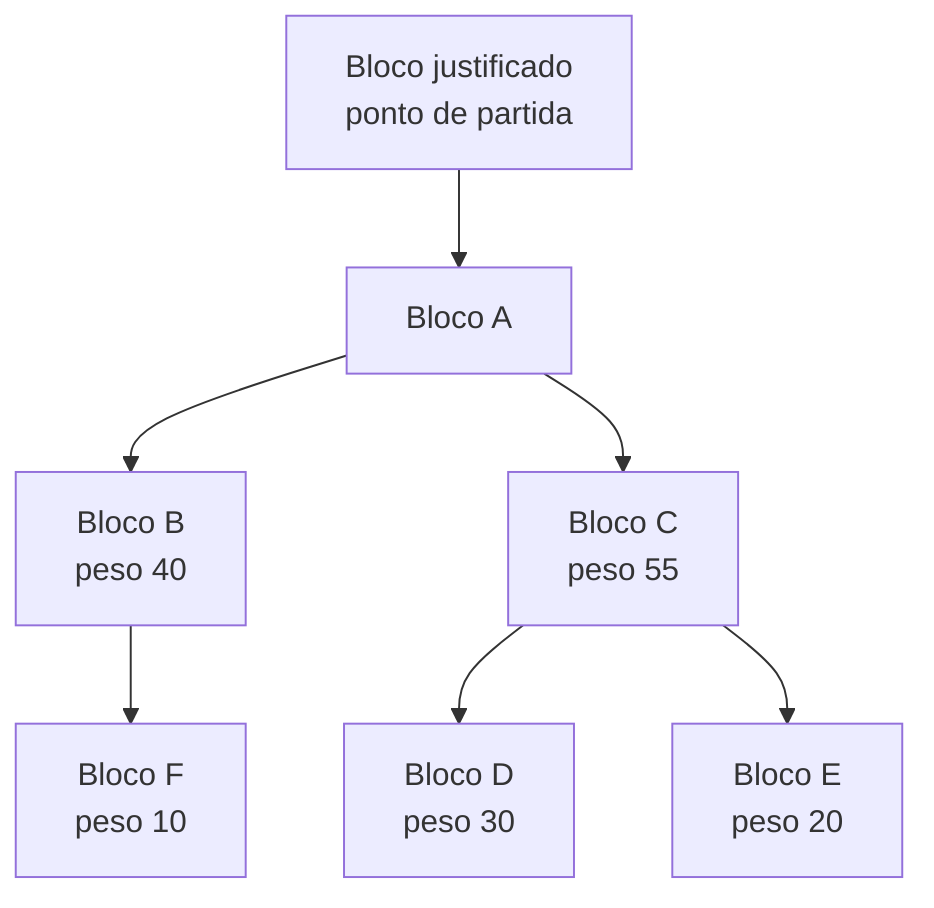

# Capítulo 62: A Escolha da Cadeia, LMD-GHOST, Proposer Boost e as Reorganizações

O Capítulo 2 explicou que o Ethereum combina duas peças: o Casper FFG, que justifica e finaliza checkpoints, e uma regra de escolha de cadeia, que diz qual é a ponta da cadeia a cada instante. O Capítulo 61 mostrou o que acontece quando a primeira peça trava. Este capítulo olha para a segunda, que quase nunca aparece nas manchetes e, mesmo assim, decide todos os dias qual bloco é "o último" para carteiras, exchanges e contratos. Aqui entram a regra LMD-GHOST, o reforço chamado proposer boost, as reorganizações de cadeia (reorgs) e o que a pesquisa discute como substituto. Nada aqui é recomendação de compra, venda ou uso de qualquer produto.

**Por que uma regra de escolha de cadeia é necessária.** Em uma rede distribuída, dois validadores podem propor blocos diferentes para o mesmo momento, ou um bloco pode chegar atrasado e deixar parte da rede sem vê-lo. Surgem então ramificações. Todos os nós precisam de uma regra determinística que, olhando as mesmas mensagens, aponte o mesmo vencedor. No Bitcoin essa regra é a cadeia com mais trabalho acumulado (Capítulo 36). No Ethereum com proof-of-stake, o trabalho foi trocado por votos: a regra olha para as atestações dos validadores.

**O que é uma atestação, de fato.** Segundo a especificação da camada de consenso, cada atestação carrega três votos em um só pacote: o voto de cabeça (`beacon_block_root`, o bloco que o validador considera a ponta), o voto de origem (`source`, o checkpoint justificado de onde ele parte) e o voto de alvo (`target`, o checkpoint que ele quer justificar). Os dois últimos alimentam o Casper FFG. O primeiro alimenta a escolha de cadeia. A rede tem slots de 12 segundos e 32 slots por época, e em cada slot um comitê sorteado de validadores atesta uma vez por época.

**LMD-GHOST em palavras simples.** O nome vem de "Latest Message Driven, Greedy Heaviest Observed SubTree". Traduzindo: a cada bifurcação, o nó escolhe o ramo com mais peso de votos, considerando apenas a mensagem mais recente de cada validador. Na especificação, o algoritmo `get_head` parte do bloco do checkpoint justificado mais recente e, em cada bifurcação, desce para o filho de maior peso. O peso de um ramo é a soma do saldo efetivo dos validadores cujo último voto de cabeça aponta para algum bloco daquele ramo. Em caso de empate, vence o bloco com a raiz (hash) lexicograficamente maior, só para que todos os nós desempatem do mesmo jeito.


*Os números são hipotéticos: em A, o ramo de C (soma 55 + 30 + 20, contando os descendentes) pesa mais que o de B (40 + 10), e depois, entre D e E, a ponta é D.*

**Por que só a última mensagem conta.** Se cada validador pudesse somar votos antigos, o peso de um ramo cresceria sem parar e votos de épocas passadas distorceriam o presente. A especificação guarda uma única mensagem por validador e só a substitui quando chega uma com época de alvo mais nova. Além disso, validadores flagrados votando duas vezes de forma conflitante (equivocação, tema do slashing do Capítulo 2) são descartados da contagem de peso assim que a prova chega ao nó.

**Como FFG e LMD-GHOST se encaixam.** A busca da cabeça não parte do bloco gênese: parte do checkpoint justificado. Isso significa que o FFG delimita o terreno e o LMD-GHOST escolhe o caminho dentro dele. A especificação também filtra a árvore, mantendo só ramos cujos blocos concordam com os checkpoints justificado e finalizado que o nó conhece. Sem esse filtro, um ramo poderia ganhar em peso e, ao mesmo tempo, impedir a rede de finalizar. Há ainda uma regra contra o chamado ataque de "bouncing": a literatura da especificação anotada descreve que o checkpoint justificado só muda dentro dos primeiros 8 slots de uma época, dando tempo para a rede convergir. Essa descrição vem da versão anotada da especificação; as versões mais recentes da especificação reorganizaram esses detalhes, e este capítulo não depende deles.

**Um detalhe de relógio.** Uma atestação feita em um slot só afeta a escolha de cadeia a partir do slot seguinte. A especificação diz isso com todas as letras: atestações só afetam a escolha de cadeia de slots subsequentes. Por isso o bloco recém-proposto, no próprio slot, ainda não tem votos que o sustentem. E é aí que nasce o problema que o proposer boost tenta resolver.

**O problema: ataques de balanceamento e reorgs ex-ante.** Pesquisas publicadas descrevem duas famílias de ataque contra a regra pura. No ataque de balanceamento, um adversário que observa os votos honestos libera os próprios votos de modo a manter dois ramos empatados, impedindo a rede de se decidir. Na reorg ex-ante, um adversário que será proponente prepara um bloco na manga e o divulga no momento certo para derrubar o bloco honesto anterior. Como resumo de uma das fontes consultadas pela busca, o proposer boost foi introduzido para mitigar esses ataques.

**O proposer boost.** A ideia é dar ao bloco do slot corrente um peso extra e temporário. Na especificação, o parâmetro `PROPOSER_SCORE_BOOST` vale 40, medido como percentual do peso de um único comitê. A função `compute_proposer_score` calcula a fração dividindo o saldo ativo total por `SLOTS_PER_EPOCH` e multiplicando por 40 sobre 100. O bônus só vale se o bloco chegou no próprio slot e antes do prazo de atestação, e ele é zerado no slot seguinte. O peso entra apenas para o bloco boostado e seus ancestrais.

A conta de ordem de grandeza ajuda a dar escala:

```latex
peso_do_comite = stake_ativo_total / 32            (cerca de 3,125% do total)
boost          = 0,40 * peso_do_comite              (cerca de 1,25% do total)
```

*Cálculo próprio a partir das constantes: o bônus de um bloco pontual equivale a cerca de 1,25% do stake ativo, o bastante para desempatar disputas sem ser maior que um comitê inteiro.*

**Um parâmetro que já mudou.** Segundo o resumo do EIP-7942 devolvido pela busca, o valor do boost foi reduzido de 70% para 40%. Não foi possível abrir a página do EIP diretamente, então este número fica atribuído a essa fonte secundária. O que se sabe de forma segura, pela especificação atual, é o valor 40.

**O custo do boost: o ataque sanduíche de reorg.** Todo bônus cria uma alavanca. A mesma busca aponta que o boost abriu espaço para uma classe de ataque de "sandwich reorg", em que o proponente adversário explora o peso extra para derrubar um bloco honesto. E a pesquisa em torno do Goldfish, publicada em 2022, sustenta que, com o boost, o LMD-GHOST deixa de ser resiliente a reorgs quando o adversário controla cerca de um quarto do stake ou mais. Essas são análises teóricas, não ataques observados na mainnet.

**Reorgs honestos: quando o próprio proponente derruba um bloco fraco.** Nem toda reorg é ataque. A especificação inclui, como função opcional, o `get_proposer_head`, que permite a um proponente honesto construir sobre o pai em vez de sobre um bloco que chegou tarde e quase ninguém atestou. As condições têm valores explícitos e se somam:

| Condição na especificação | Valor |
| --- | --- |
| Bloco da cabeça não foi pontual | sim |
| Slot não é início de época | sim |
| Épocas desde a finalização | no máximo 2 |
| Momento do slot em que o proponente decide | até 1667 bps (cerca de 17% do slot) |
| Peso da cabeça | abaixo de 20% do peso de um comitê |
| Peso do pai | acima de 160% do peso de um comitê |
| Alcance | apenas reorg de 1 slot |

*A tabela resume quando um proponente honesto pode ignorar um bloco atrasado e fraco; todas as condições precisam valer ao mesmo tempo.*

Convertendo para fração do stake total (cálculo próprio, com o comitê de 1/32), 20% de um comitê equivale a cerca de 0,6% do total e 160% a cerca de 5%. Ou seja, o bloco derrubado quase não recebeu votos, e o pai tem respaldo claro. Existe ainda um segundo caminho, quando há equivocação do proponente do bloco da cabeça. Como a função é opcional, clientes diferentes podem se comportar de modos diferentes, o que reforça o ponto do Capítulo 28 sobre diversidade.

**O que isso muda para quem usa a rede.** Uma reorg de 1 slot significa que um bloco visto por poucos segundos pode desaparecer e as transações dele voltarem ao mempool para entrar em outro bloco. Por isso vale distinguir camadas de segurança: um bloco recém-proposto não é final, o checkpoint justificado dá mais segurança, e a finalização (Capítulo 2) é o único ponto de não retorno forte. Quem recebe pagamentos de valor alto espera finalizar, e não só ver a transação incluída. O MEV (Capítulo 17) também aparece aqui: reorgar um bloco pode ser lucrativo quando ele contém oportunidades valiosas, e é uma das razões por que se estuda desincentivar a prática.

**Onde a pesquisa busca sair desse arranjo.** A busca devolveu um conjunto consistente de trabalhos. O Goldfish propõe trocar o LMD-GHOST por uma regra que usa fusão de visões (view-merge) e expiração de votos, com a promessa de resiliência a reorgs sem precisar de proposer boost. Uma revisão de 2025 sobre finalidade em um único slot (SSF) afirma que variantes como o RLMD-GHOST relaxam a expiração de votos para tratar uma fragilidade do Goldfish diante de assincronia de rede. Há também o EIP-7942, "Available Attestation", como proposta de solução resiliente a reorgs, que não chegou a ser aberto diretamente nesta pesquisa. Nada disso está no calendário de bifurcações do Ethereum que o Capítulo 46 detalhou, e tratar essas propostas como planos confirmados seria um erro.

**Relação com os capítulos recentes.** O ePBS (Capítulo 38) altera quem decide e quando o conteúdo do bloco aparece, mexendo na temporização do slot, e o FOCIL (Capítulo 42) adiciona um comitê que força inclusão de transações. Ambos convivem com a regra de escolha de cadeia e precisam ser analisados em conjunto com ela. E, no extremo da crise, o vazamento por inatividade do Capítulo 61 age quando a finalidade para, enquanto a escolha de cadeia continua escolhendo cabeças normalmente.

**Resumo.** A finalidade protege o passado; a escolha de cadeia decide o presente. O LMD-GHOST usa o voto mais recente de cada validador, o proposer boost dá 40% do peso de um comitê a blocos pontuais para evitar balanceamentos e reorgs ex-ante, e o preço desse reforço é uma nova superfície de ataque teórica. Reorgs de 1 slot são raras e, quando honestas, regidas por condições explícitas. A leitura prática é simples: incluído não é final.

**Glossário do capítulo.**

- **Escolha de cadeia (fork choice)**: regra que cada nó aplica para decidir qual ramo da árvore de blocos é a cabeça atual.
- **LMD-GHOST**: regra que desce a árvore de blocos escolhendo o ramo mais pesado, contando só o voto mais recente de cada validador.
- **Voto de cabeça**: campo da atestação que indica o bloco que o validador considera a ponta da cadeia.
- **Proposer boost**: peso extra e temporário, de 40% do peso de um comitê, dado a um bloco pontual do slot corrente.
- **Reorg (reorganização)**: troca da cabeça da cadeia por outro ramo, descartando blocos antes considerados canônicos.
- **Ataque de balanceamento**: estratégia em que um adversário libera votos para manter dois ramos empatados e impedir a decisão da rede.
- **Reorg ex-ante**: reorg em que o adversário prepara de antemão um bloco para derrubar o bloco honesto anterior.
- **Equivocação**: voto ou proposta conflitante do mesmo validador, que gera slashing e remove seus votos da contagem de peso.
- **Checkpoint justificado**: ponto de partida da busca da cabeça, definido pelo Casper FFG.
- **Finalidade em um único slot (SSF)**: linha de pesquisa que busca finalizar blocos em um slot, em vez de duas épocas.

**Fontes.**

Observação de transparência: neste ambiente só foi possível abrir diretamente os arquivos de especificação hospedados no GitHub; ethereum.org, ethresear.ch, notes.ethereum.org, eips.ethereum.org, arxiv.org e paradigm.xyz retornaram erro de resolução. Os pontos sobre ataques, o valor anterior de 70% do boost e as propostas de substituição vêm dos trechos devolvidos pela busca web, sem leitura integral das páginas, e estão atribuídos como tal no texto. Os cálculos de fração do stake são próprios.

- Especificação da camada de consenso, fork choice (PROPOSER_SCORE_BOOST, get_head, get_proposer_head, tratamento de equivocação): https://raw.githubusercontent.com/ethereum/consensus-specs/master/specs/phase0/fork-choice.md
- Especificação da camada de consenso, beacon chain (SLOT_DURATION_MS, SLOTS_PER_EPOCH, conteúdo da atestação): https://raw.githubusercontent.com/ethereum/consensus-specs/master/specs/phase0/beacon-chain.md
- Especificação anotada, fork choice (LMD-GHOST, FFG e escolha de cadeia): https://raw.githubusercontent.com/ethereum/annotated-spec/master/phase0/fork-choice.md
- Proposer Boost considerations, notas de Caspar Schwarz-Schilling (via busca): https://notes.ethereum.org/@casparschwa/H1T0k7b85
- Selfish mining in PoS, ethresear.ch (via busca): https://ethresear.ch/t/selfish-mining-in-pos/15551
- Goldfish, Paradigm (via busca): https://www.paradigm.xyz/writing/goldfish
- EIP-7942, Available Attestation (via busca): https://eips.ethereum.org/EIPS/eip-7942
- SoK: Speedy Secure Finality (via busca): https://arxiv.org/pdf/2512.20715
- Reorg resilience and security in post-SSF LMD-GHOST, ethresear.ch (via busca): https://ethresear.ch/t/reorg-resilience-and-security-in-post-ssf-lmd-ghost/14164
