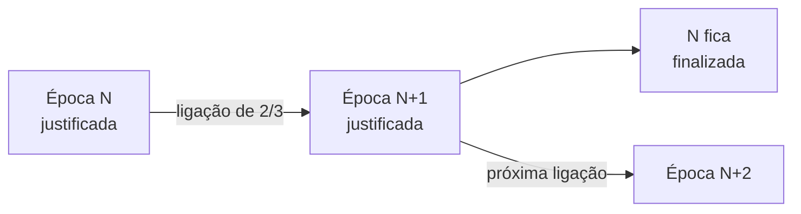
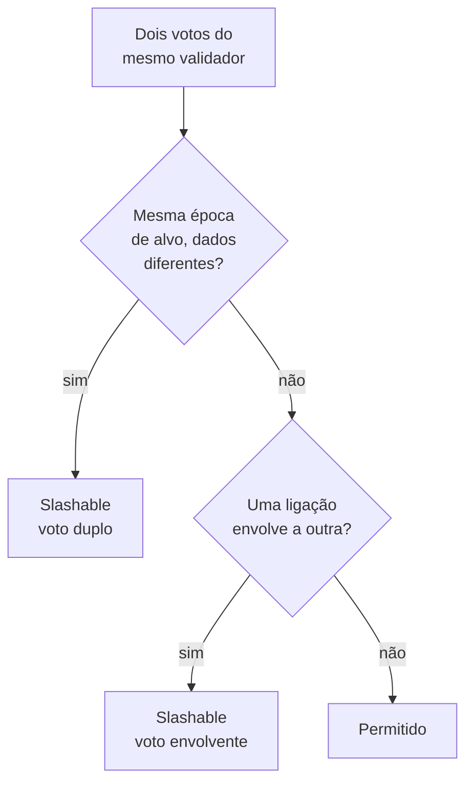

# Capítulo 63: Casper FFG por Dentro, Justificação, Finalização e as Duas Regras que Dão Dentes à Finalidade

O Capítulo 2 apresentou a finalidade em um parágrafo: dois terços de votos justificam um checkpoint, e um checkpoint justificado seguido de outro justificado vira finalizado. O Capítulo 61 mostrou o que acontece quando ela trava, e o Capítulo 62 tratou da outra peça, a escolha de cadeia. Falta abrir a caixa da finalidade em si. Este capítulo percorre o mecanismo como a especificação da camada de consenso o escreve, explica as duas regras de slashing que o protegem e mostra por que a promessa de "um terço do stake queimado" não é só slogan. Nada aqui é recomendação de compra, venda ou uso de qualquer produto.

**A ideia central: votar em ligações, não em blocos.** O Casper FFG ("Friendly Finality Gadget") não escolhe blocos um a um. Ele trabalha sobre checkpoints, o primeiro bloco de cada época. Cada atestação traz um voto de origem (`source`) e um de alvo (`target`), como visto no Capítulo 62, e juntos formam uma ligação de um checkpoint antigo já justificado para um checkpoint novo. Quando validadores que somam pelo menos dois terços do stake ativo assinam a mesma ligação, ela é uma "ligação de supermaioria", e o alvo passa a ser justificado.

**A conta de dois terços, no código.** Na função `weigh_justification_and_finalization` da especificação, a verificação é feita sem divisão, para evitar arredondamentos. Se o saldo que votou no alvo, multiplicado por 3, é maior ou igual ao saldo ativo total multiplicado por 2, o checkpoint é justificado:

```latex
saldo_do_alvo * 3  >=  saldo_ativo_total * 2
```

*Condição exata da especificação: o voto é ponderado pelo saldo efetivo, não pelo número de validadores.*

**Quatro épocas na memória.** O estado da beacon chain guarda quatro bits de justificação (`justification_bits`), um para cada uma das últimas épocas. A cada fronteira de época os bits deslizam uma posição, e o bit da época que acabou de ser justificada é ligado. O processamento olha tanto o alvo da época atual quanto o da anterior, porque votos de uma época ainda podem chegar na seguinte.

**Quando justificado vira finalizado.** A especificação lista quatro padrões de bits que finalizam um checkpoint. Todos dizem a mesma coisa em variações: se um checkpoint justificado serve de origem para uma ligação de supermaioria que justifica o checkpoint seguinte, o primeiro é finalizado. O caso mais comum, em rede saudável, é o das duas épocas consecutivas justificadas, em que a mais antiga fica final. Os outros três cobrem situações em que uma ou duas épocas ficaram sem justificar no meio do caminho, mas a ligação de supermaioria ainda existe, apontando para trás.


*Quando a época N+1 é justificada com N como origem, N é finalizada; N+1 passa a ser o novo candidato.*

**Quanto tempo leva.** Com 12 segundos por slot e 32 slots por época, uma época dura 6,4 minutos. Em condições normais, um checkpoint é justificado ao fim da época em que é alvo e finalizado ao fim da seguinte, ou seja, em torno de duas épocas, cerca de 13 minutos, como o Capítulo 2 já havia dito. Quando a finalização atrasa, o `get_finality_delay` mede a distância entre a época anterior e o último checkpoint finalizado, e é esse número que dispara o vazamento por inatividade do Capítulo 61 ao passar de quatro.

**O que "finalizado" promete.** Duas propriedades, na linguagem do artigo original do Casper FFG. A primeira é a segurança acumulável (accountable safety): dois checkpoints conflitantes jamais podem ser finalizados sem que pelo menos um terço do stake tenha violado uma regra identificável. A segunda é a vivacidade plausível (plausible liveness): sempre existe uma forma de continuar finalizando, desde que mais de dois terços dos validadores sigam as regras. A palavra "acumulável" é a chave: a violação deixa prova, e prova permite punir.

**Por que um terço.** O argumento é de interseção. Suponha que dois checkpoints conflitantes tenham sido finalizados. Cada um precisou de ligações com dois terços do stake. Dois grupos de dois terços dentro de um total de um só se sobrepõem em pelo menos um terço. Esses validadores da interseção votaram nos dois lados. Como a regra de slashing proíbe exatamente isso, eles podem ser provados culpados.

```latex
|A| >= 2/3 ,  |B| >= 2/3   =>   |A ∩ B| >= |A| + |B| - 1  >=  1/3
```

*Cálculo próprio, tomando o stake total como 1: a sobreposição mínima de dois grupos de dois terços é um terço.*

**As duas regras de slashing.** O artigo original define duas condições, e a especificação as implementa em `is_slashable_attestation_data`, que compara duas atestações do mesmo validador:

| Regra | Condição | Ideia |
| --- | --- | --- |
| Voto duplo | Duas atestações diferentes com a mesma época de alvo | Não se pode apoiar duas versões da mesma época |
| Voto envolvente (surround) | Origem da primeira menor que a da segunda, e alvo da segunda menor que o da primeira | Uma ligação não pode envolver outra por completo |

*As duas condições vêm do código da especificação; qualquer um que prove uma delas pode denunciar o validador.*

O voto envolvente é menos intuitivo. Imagine um validador que vota na ligação da época 10 para a 14 e depois na da 11 para a 12. A segunda cabe inteira dentro da primeira. Isso permitiria, em tese, reescrever a história: a ligação longa "salta" justificações que a curta registrou. Proibir o aninhamento fecha essa brecha, e é o que garante a interseção do argumento acima.


*Árvore de decisão simplificada: só duas respostas "sim" levam à punição.*

**Quem denuncia e quando.** Qualquer participante pode incluir a prova de duas atestações conflitantes em um bloco; o proponente recebe uma recompensa por isso. O validador punido é forçado a sair, e a retirada do saldo só é liberada depois de `MIN_VALIDATOR_WITHDRAWABILITY_DELAY`, que vale 256 épocas na especificação, cerca de 27 horas (cálculo próprio: 256 vezes 6,4 minutos). Esse intervalo existe para dar tempo de a prova aparecer antes de o dinheiro sair. O Capítulo 2 resumiu a punição; os valores de penalidade variam por versão da especificação e não são o foco aqui.

**O que o slashing não cobre.** Ficar offline não viola nenhuma das duas regras, então não gera slashing, apenas perda de recompensas e, em crise longa, o vazamento do Capítulo 61. E a segurança acumulável não é mágica: ela torna a fraude cara e provável de ser punida, mas se mais de um terço dos validadores resolvesse cooperar e aceitar a perda, uma reversão seria possível. O que muda é que o custo seria enorme e público. Isso também mostra por que operadores comprometidos, como no Capítulo 49, e a diversidade de clientes do Capítulo 28 importam: bugs de software podem levar um validador honesto a assinar votos conflitantes por acidente.

**Três camadas de segurança, de novo.** Juntando os Capítulos 62 e 63: um bloco recém-proposto é apenas a cabeça escolhida pelo LMD-GHOST e pode sofrer reorg; um checkpoint justificado tem a promessa de dois terços e é o ponto de partida da busca da cabeça; um checkpoint finalizado só se reverte à custa de, no mínimo, um terço do stake provadamente culpado. Quem lida com valores altos escolhe o ponto da escada em que se sente seguro.

**Limite honesto do desenho.** Duas épocas para finalizar é muito mais lento que a confirmação em segundos que usuários esperam, e existe pesquisa sobre finalidade em um único slot (SSF) mencionada no Capítulo 62. Trocar o FFG implicaria rever agregação de assinaturas, tamanho do conjunto de validadores e regras de slashing. Isso continua sendo pesquisa, e o Capítulo 46 mostra o caminho que uma mudança precisaria percorrer até a mainnet.

**Resumo.** O FFG vota em ligações entre checkpoints. Dois terços justificam, uma justificação encadeada finaliza, e duas regras simples, voto duplo e voto envolvente, garantem que qualquer reversão deixe pelo menos um terço do stake com provas contra si. A finalidade do Ethereum é, portanto, uma garantia econômica auditável, e não apenas uma convenção de espera.

**Glossário do capítulo.**

- **Checkpoint**: primeiro bloco de uma época, usado como marco pelo Casper FFG.
- **Ligação de supermaioria**: par origem-alvo assinado por validadores que somam ao menos dois terços do stake ativo.
- **Justificação**: estado de um checkpoint que recebeu uma ligação de supermaioria como alvo.
- **Finalização**: estado de um checkpoint justificado cuja sucessora imediata também foi justificada com ele como origem.
- **Segurança acumulável (accountable safety)**: propriedade segundo a qual a finalização de dois checkpoints conflitantes implica que ao menos um terço do stake violou uma regra provável.
- **Vivacidade plausível (plausible liveness)**: propriedade de que a rede sempre pode voltar a finalizar se mais de dois terços seguirem as regras.
- **Voto duplo**: duas atestações diferentes de um mesmo validador para a mesma época de alvo.
- **Voto envolvente (surround vote)**: atestação cuja ligação origem-alvo envolve por completo outra ligação assinada pelo mesmo validador.
- **Bits de justificação**: quatro bits no estado da beacon chain que registram quais das últimas épocas foram justificadas.
- **Atraso de finalidade**: número de épocas entre a época anterior e a última finalizada.

**Fontes.**

Observação de transparência: neste ambiente só foi possível abrir diretamente os arquivos de especificação hospedados no GitHub; ethereum.org e arxiv.org retornaram erro de resolução. A descrição das propriedades de segurança acumulável e vivacidade plausível segue o artigo original do Casper FFG, citado de memória e não reaberto; os cálculos de interseção e de duração são próprios.

- Especificação da camada de consenso, beacon chain (`weigh_justification_and_finalization`, `is_slashable_attestation_data`, `get_finality_delay`, `MIN_VALIDATOR_WITHDRAWABILITY_DELAY`): https://raw.githubusercontent.com/ethereum/consensus-specs/master/specs/phase0/beacon-chain.md
