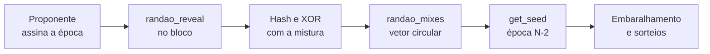
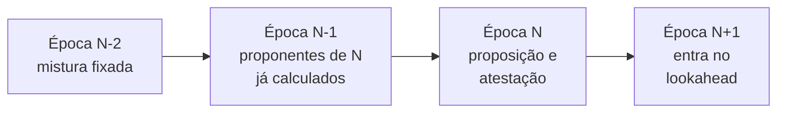

# Capítulo 64: RANDAO, a Aleatoriedade do Consenso e os Cuidados com o PREVRANDAO

O Capítulo 2 disse, em uma frase, que o RANDAO sorteia proponentes e comitês. O Capítulo 62 usou esses sorteios sem abri-los, e o Capítulo 63 mostrou o que ocorre com os votos depois que os comitês existem. Este capítulo volta ao começo da cadeia causal: de onde vem o número aleatório que decide quem propõe o bloco, como ele é fabricado sem um sorteador central, qual é o pequeno viés que sobra e por que contratos inteligentes que o consomem precisam de cuidado. Nada aqui é recomendação de compra, venda ou uso de qualquer produto.

**O problema: aleatoriedade sem árbitro.** Sortear o próximo proponente parece trivial, mas numa rede aberta não há quem lance o dado. Se um participante escolhesse o número, escolheria a si mesmo. Se o número fosse previsível demais, atacantes saberiam quem derrubar com antecedência. O desenho precisa de uma fonte que ninguém controle sozinho e que todos possam verificar depois.

**A ideia: cada proponente assina a época.** Ao propor um bloco, o validador inclui um campo chamado `randao_reveal`. Segundo a especificação do validador, trata-se de uma assinatura BLS, feita com a chave do próprio validador, sobre o número da época do bloco, sob um domínio próprio (`DOMAIN_RANDAO`). Como uma assinatura BLS para uma chave e uma mensagem é determinística, o proponente não pode "rolar de novo" para obter outro valor: dada a época, só existe uma assinatura possível. Qualquer nó verifica essa assinatura contra a chave pública do proponente.

**Misturando com XOR.** A função `process_randao` não guarda a assinatura crua. Ela calcula o hash SHA-256 do `randao_reveal` e faz um XOR desse hash com a mistura atual da época, guardada no estado em `randao_mixes`. O XOR tem uma propriedade útil: o resultado depende de todas as contribuições acumuladas, e basta uma delas ser imprevisível para o conjunto ser imprevisível.

```latex
mix_nova  =  mix_anterior  XOR  SHA-256( assinatura_do_proponente(época) )
```

*Relação descrita na especificação: cada bloco da época acrescenta uma contribuição à mistura corrente.*

**Do bloco ao sorteio.** A mistura não é usada de imediato. A função `get_seed` lê o valor guardado numa época anterior: a especificação usa a posição `época + EPOCHS_PER_HISTORICAL_VECTOR - MIN_SEED_LOOKAHEAD - 1`, o que, com `MIN_SEED_LOOKAHEAD` igual a 1, equivale à mistura do fim da época N-2 para sortear a época N (leitura própria da fórmula). Essa defasagem dá tempo para que os comitês sejam conhecidos com folga. A mistura é guardada num vetor circular de 65.536 épocas (`EPOCHS_PER_HISTORICAL_VECTOR`), e a cada virada de época o valor corrente é copiado para a posição da época seguinte por `process_randao_mixes_reset`.


*Da assinatura de cada bloco até o sorteio de comitês e proponentes duas épocas depois.*

**Como o sorteio usa a semente.** Com a semente na mão, os comitês de atestação nascem de um embaralhamento determinístico dos índices de validadores ativos (`compute_shuffled_index`, com `SHUFFLE_ROUND_COUNT` igual a 90 rodadas). O proponente de cada slot é escolhido de forma ponderada pelo saldo efetivo: a função `compute_proposer_index` sorteia candidatos e os aceita com probabilidade proporcional ao saldo efetivo. Quem tem mais stake efetivo propõe proporcionalmente mais vezes, o que conversa com a EIP-7251 do Capítulo 40.

**O viés de um bit.** O RANDAO não é perfeito. Um proponente conhece sua própria contribuição e, ao chegar a sua vez, tem duas opções: revelar ou deixar o slot passar vazio. Cada opção produz uma mistura diferente, então ele escolhe entre dois resultados. O texto da EIP-4399 resume isso como "1 bit of influence power per slot", um bit de poder de influência por slot. O custo de usar esse poder é perder a recompensa daquele bloco, e uma única revelação honesta posterior volta a embaralhar tudo. Para o sorteio de proponentes isso costuma ser pouco rentável. Para aplicações com muito dinheiro em jogo, deve ser tratado como risco.

**Por que o proponente não "vê" o futuro.** A defasagem de épocas protege, em parte, mas tem uma contrapartida. Os comitês de atestação são conhecidos com pelo menos uma época de antecedência, e a especificação do validador diz que esse intervalo não se aplica à proposição, que "must be checked during the epoch in question". Foi esse o ponto atacado pela EIP-7917, tratada nos Capítulos 41 e 56: o campo `proposer_lookahead` do estado guarda os proponentes da época atual e da próxima, com tamanho `(MIN_SEED_LOOKAHEAD + 1) * SLOTS_PER_EPOCH`, ou seja, 64 entradas com os parâmetros atuais (conta própria: 2 vezes 32). A cada virada de época a lista desliza e acrescenta a época seguinte. Rollups baseados e pré-confirmações, vistos no Capítulo 56, dependem dessa previsibilidade.


*Linha do tempo simplificada: a mistura de duas épocas atrás alimenta o sorteio, e o lookahead de proponentes avança uma época por vez.*

**Do consenso ao contrato: o PREVRANDAO.** Antes do The Merge (Capítulo 1), o opcode `0x44` se chamava `DIFFICULTY` e devolvia a dificuldade de mineração, que contratos às vezes usavam como "aleatoriedade". A EIP-4399, de Mikhail Kalinin e Danny Ryan, manteve o número do opcode e o custo em gás, renomeou-o para `PREVRANDAO` e passou a devolver a mistura RANDAO da pós-estado do bloco anterior, gravada no campo `prevRandao` do cabeçalho (antes chamado `mixHash`). Contratos antigos que liam `DIFFICULTY` continuaram compilando, mas passaram a receber um valor com outro significado.

**Os avisos oficiais.** A própria EIP-4399 lista cuidados: o valor histórico é público; o futuro depende de variáveis que ninguém controla por inteiro; um proponente pode reter uma transação de "rolagem de dado" até um bloco cuja mistura já conhece, a custo desprezível; e erros honestos de proposição, em torno de 1% dos slots segundo o texto, acrescentam entropia. A recomendação para desenvolvedores é usar a aleatoriedade com muita antecedência: por exemplo, encerrar as apostas ao fim de uma época e rolar o dado usando uma mistura de pelo menos quatro épocas depois, mantendo a defasagem final de poucos slots. O risco aumenta em jogos repetidos e quando um mesmo ator controla vários validadores.

| Fonte de número aleatório | Quem influencia | Ponto de atenção |
| --- | --- | --- |
| `PREVRANDAO` (RANDAO) | Proponentes, com 1 bit por slot | Barato e nativo, mas manipulável quando há muito valor em jogo |
| Hash de bloco antigo | Proponentes e, em PoW, mineradores | Prática desencorajada pela comunidade, pouca entropia |
| Oráculo de aleatoriedade (Capítulo 25) | O provedor e sua prova | Custo extra e dependência de terceiro, com prova verificável |

*Comparação conceitual; a primeira linha vem da EIP-4399, as demais seguem a lógica do Capítulo 25 sobre oráculos.*

**O que RANDAO não é.** Ele não resolve sorteios de alto risco sozinho, e não é a mesma coisa que o relógio da finalidade do Capítulo 63. Também não é secreto: depois de revelado, é público. Sua virtude é ser barato, verificável e de difícil manipulação em larga escala, e não perfeito.

**Resumo.** Cada bloco acrescenta ao estado uma assinatura determinística do proponente sobre a época, misturada por XOR. A mistura, lida com defasagem de épocas, vira semente de embaralhamentos e sorteios. Um proponente pode escolher entre revelar ou faltar, e isso é o um bit de viés. Contratos que usam o `PREVRANDAO` herdam essa propriedade, e por isso a recomendação oficial é pedir aleatoriedade com antecedência e não tratar o valor como dado seguro quando há muito em disputa.

**Glossário do capítulo.**

- **RANDAO**: mecanismo em que cada proponente contribui com uma assinatura que é misturada à aleatoriedade do protocolo.
- **randao_reveal**: assinatura BLS do proponente sobre o número da época, incluída em cada bloco.
- **Mistura RANDAO (randao mix)**: valor acumulado por XOR dos hashes dos reveals, guardado em um vetor circular no estado.
- **Semente (seed)**: valor derivado da mistura e usado nos embaralhamentos e sorteios de comitês e proponentes.
- **Embaralhamento (shuffling)**: permutação determinística dos validadores ativos que forma os comitês.
- **Viés de um bit**: capacidade do proponente de escolher entre revelar ou deixar o slot vazio, alterando o resultado do RANDAO.
- **PREVRANDAO**: opcode `0x44` que devolve a mistura RANDAO do bloco anterior, sucessor do `DIFFICULTY`.
- **proposer_lookahead**: campo do estado, da EIP-7917, que lista os proponentes da época atual e da próxima.
- **Saldo efetivo**: saldo do validador usado como peso nos sorteios e nas recompensas.
- **Assinatura determinística**: assinatura que, para a mesma chave e a mesma mensagem, só pode ter um valor.

**Fontes.**

Observação de transparência: ethereum.org e eips.ethereum.org não resolveram neste ambiente, então a EIP-4399 foi lida pelo repositório oficial de EIPs no GitHub. O texto das especificações foi lido por resumo, sem acesso integral ao código. As contas de defasagem e de tamanho do lookahead são próprias.

- Especificação da camada de consenso, beacon chain (`process_randao`, `process_randao_mixes_reset`, `get_seed`, `compute_proposer_index`, constantes): https://raw.githubusercontent.com/ethereum/consensus-specs/master/specs/phase0/beacon-chain.md
- Especificação do validador (`randao_reveal` e lookahead de atribuições): https://raw.githubusercontent.com/ethereum/consensus-specs/master/specs/phase0/validator.md
- Especificação da Fulu (`proposer_lookahead`, EIP-7917): https://raw.githubusercontent.com/ethereum/consensus-specs/master/specs/fulu/beacon-chain.md
- EIP-4399, PREVRANDAO: https://raw.githubusercontent.com/ethereum/EIPs/master/EIPS/eip-4399.md
