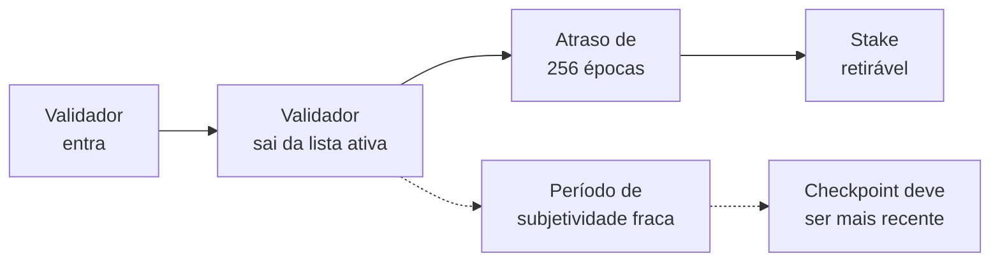
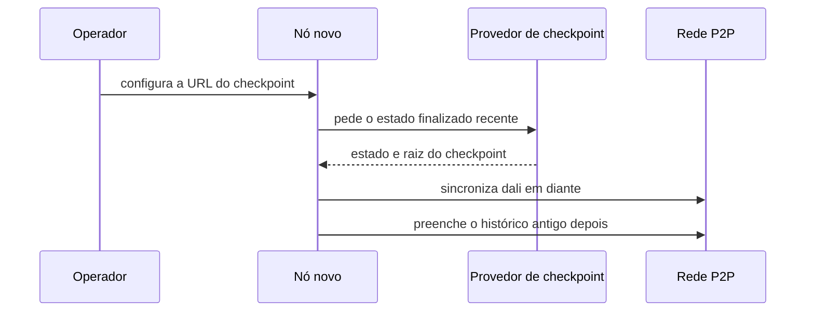

# Capítulo 65: Subjetividade Fraca e Checkpoint Sync, Por que um Nó Novo Precisa de um Ponto de Partida Confiável

O Capítulo 63 mostrou que a finalidade do Casper FFG tem dentes: quem finaliza duas versões conflitantes pode perder pelo menos um terço do stake. O Capítulo 61 mostrou o que acontece quando a finalidade para. Falta uma pergunta que fica antes de tudo isso: um nó que acabou de nascer, ou que ficou meses desligado, como sabe qual das cadeias que lhe apresentam é a verdadeira? Este capítulo trata da resposta do Ethereum, a subjetividade fraca, e de sua face prática, o checkpoint sync. Nada aqui é recomendação de compra, venda ou uso de qualquer produto.

**O problema: votos antigos custam pouco.** Numa cadeia de proof-of-work (Capítulo 36), qualquer nó novo pode ligar, baixar tudo e escolher a cadeia com mais trabalho acumulado. O trabalho é um fato físico: refazê-lo em segredo custa energia real. Na proof-of-stake, a escolha de cadeia se apoia em votos assinados. Segundo a ethereum.org, validadores antigos podem guardar uma bifurcação alternativa escondida e divulgá-la muito depois, num ataque de longo alcance. Há ainda um segundo risco: validadores que já retiraram seu stake, e portanto não têm mais nada a perder, poderiam continuar assinando e montar uma cadeia conflitante. A página cita o limiar de um terço dos validadores para esse cenário.

**A ideia: um pedacinho de confiança social.** Em vez de fingir que o problema não existe, o Ethereum o assume. A ethereum.org descreve a subjetividade fraca como um meio-termo entre cadeias subjetivas e objetivas: a cadeia progride de forma objetiva depois que uma semente inicial de informação é obtida socialmente. Essa semente é o **checkpoint de subjetividade fraca**. Pela especificação, qualquer objeto `Checkpoint` (um par raiz de bloco e época) pode servir como tal. Ele é distribuído por provedores, baixado por usuários ou embutido nos clientes. O nó que o recebe rejeita qualquer bloco que conflite com ele, tratando-o como absoluto, diferentemente de duas finalizações conflitantes, que sinalizariam uma falha de consenso.

**Por que a janela existe.** Um checkpoint só serve enquanto for recente o bastante. A especificação define o **período de subjetividade fraca** como o número de épocas recentes dentro do qual deve existir um checkpoint, de modo que um atacante que tomasse o conjunto de validadores no começo do período perderia, por slashing, pelo menos um mínimo se uma cadeia conflitante fosse finalizada. A ethereum.org resume a consequência: os checkpoints precisam estar mais próximos entre si do que o prazo de retirada dos validadores, para que quem bifurca seja punido de forma relevante antes de conseguir sacar. É a ponte com o Capítulo 49, onde o atraso de 256 épocas entre a saída e a retirada (`MIN_VALIDATOR_WITHDRAWABILITY_DELAY`) aparece do lado do validador.



*Enquanto o stake não é retirável, uma bifurcação ainda pode ser punida; o checkpoint precisa ser recente dentro dessa janela.*

**A conta do período.** A função `compute_weak_subjectivity_period` da especificação parte do atraso de retirada e soma uma folga que depende do número de validadores ativos, do saldo médio e do limite de rotatividade por época (o churn). Em linhas gerais, a fórmula tem dois ramos: um dominado pelo churn, quando o saldo médio é alto em relação ao máximo, e outro mais simples, quando é baixo. Em vez de reproduzir tudo, vale ler o efeito: quanto mais validadores, mais tempo a rede leva para trocar uma fração relevante do conjunto, e portanto mais longo pode ser o período, até um patamar.

```latex
periodo = MIN_VALIDATOR_WITHDRAWABILITY_DELAY + folga(N, t, T, churn, SAFETY_DECAY)
```

*Forma geral descrita na especificação phase0; N é o número de validadores ativos, t o saldo médio, T o saldo efetivo máximo, e SAFETY_DECAY vale 10, a perda máxima tolerada da margem de um terço, em pontos percentuais.*

A própria especificação traz uma tabela de referência, calculada com `SAFETY_DECAY` igual a 10:

| Saldo médio (ETH) | Validadores | Período (épocas) |
| --- | --- | --- |
| 28 | 32.768 | 504 |
| 28 | 131.072 | 1.248 |
| 28 | 262.144 ou mais | 2.241 |
| 32 | 32.768 | 665 |
| 32 | 131.072 | 1.894 |
| 32 | 262.144 ou mais | 3.532 |

*Valores da tabela de referência da especificação phase0, com churn e regras daquela versão. Regras posteriores, como a EIP-7251 do Capítulo 40, mudaram o cálculo de churn, então estes números são ilustrativos da lógica, não o prazo vigente da mainnet.*

Como uma época dura 6,4 minutos (32 slots de 12 segundos), 3.532 épocas equivalem a cerca de 15,7 dias (conta própria). A ordem de grandeza, portanto, é de semanas, não de meses. Fontes secundárias falam em torno de duas semanas na mainnet, o que combina com a conta, mas não é número oficial.

**Checkpoint sync na prática.** Os clientes de consenso (Capítulo 28) transformaram isso em recurso de uso comum. A especificação diz que clientes devem permitir que o usuário informe um checkpoint na inicialização, no formato `raiz_do_bloco:número_da_época`, e que, se a sincronização até ele não for possível, o cliente deve tratar isso como falha crítica e irrecuperável. Uma checagem de que o checkpoint não está obsoleto é opcional e usa a função `is_within_weak_subjectivity_period`. Na prática, o usuário aponta o cliente para um endpoint de um provedor, que entrega o estado finalizado recente, e o nó começa dali, em vez de reprocessar anos de história desde o gênesis. O Teku, por exemplo, oferece a opção `--checkpoint-sync-url` para isso.



*O nó confia em um provedor só para o ponto de partida; o restante vem da rede e é verificado pelas regras do protocolo.*

**Onde está a confiança, e onde não está.** O provedor não pode forjar uma cadeia inteira sem que isso seja descoberto, porque o checkpoint pode ser comparado com várias fontes independentes (exploradores de blocos, outros nós, outros provedores). A ethereum.org enfatiza isso: um checkpoint ruim dificilmente passaria despercebido. Ainda assim, o modelo muda o que significa "sem confiança" para quem sincroniza do zero: ele exige uma verificação social, uma vez, no início. É diferente dos clientes leves do Capítulo 60, que renovam a confiança continuamente por meio dos comitês de sincronização, e diferente de rodar um nó que nunca desliga, em que o próprio nó acompanha a cadeia sem precisar de ponto de partida novo.

| Situação do nó | Precisa de checkpoint novo? | Observação |
| --- | --- | --- |
| Ligado continuamente | Não | Acompanha as finalizações em tempo real |
| Desligado por pouco tempo | Normalmente não | Retoma do último estado salvo |
| Desligado além do período | Sim | O último estado local saiu da janela de segurança |
| Nó novo | Sim | Ponto de partida social, verificado em várias fontes |

*Resumo conceitual da lógica descrita na especificação e na ethereum.org.*

**Boas práticas, sem receita.** Quem opera nós costuma conferir a raiz do checkpoint em mais de uma fonte antes de aceitá-la, e manter o nó atualizado dentro da janela. Esses são cuidados de higiene, não instruções específicas de nenhum produto.

**O que isso não é.** Não é um ponto central de controle: o provedor não decide a cadeia, apenas indica um ponto de partida que a rede e outras fontes podem confirmar. Também não é um defeito escondido: é uma troca declarada de propriedades, aceita para que a finalidade punível do Capítulo 63 possa existir sem a energia da proof-of-work.

**Resumo.** Como votos antigos podem ser reutilizados por validadores que já saíram, a proof-of-stake do Ethereum exige que um nó novo comece de um checkpoint recente obtido socialmente e verificado em várias fontes. O período de subjetividade fraca, calculado a partir do atraso de retirada, do número de validadores e do churn, dá a medida de quanto esse checkpoint pode envelhecer. O checkpoint sync é a implementação cotidiana dessa ideia.

**Glossário do capítulo.**

- **Subjetividade fraca**: propriedade de uma cadeia que precisa de uma informação inicial obtida socialmente, mas depois progride de forma objetiva.
- **Checkpoint de subjetividade fraca**: par de raiz de bloco e época usado como ponto de partida confiável por um nó novo.
- **Período de subjetividade fraca**: número de épocas recentes dentro do qual deve existir um checkpoint para que uma bifurcação ainda possa ser punida.
- **Ataque de longo alcance**: bifurcação alternativa antiga, mantida em segredo e divulgada muito depois, possível quando votos antigos custam pouco.
- **Checkpoint sync**: sincronização em que o cliente parte de um estado finalizado recente fornecido por um endpoint, em vez do gênesis.
- **MIN_VALIDATOR_WITHDRAWABILITY_DELAY**: atraso de 256 épocas entre a saída de um validador e a liberação de seu stake.
- **SAFETY_DECAY**: parâmetro (10) que limita, em pontos percentuais, a perda tolerada da margem de um terço da finalidade.
- **Churn**: limite de validadores que entram ou saem por época.
- **Slashing**: penalidade aplicada a validadores que assinam votos conflitantes, vista no Capítulo 63.
- **Época**: intervalo de 32 slots de 12 segundos, ou seja, 6,4 minutos.

**Fontes.**

Observação de transparência: ethereum.org e a documentação do Teku não resolveram neste ambiente. O texto da ethereum.org foi lido pelo espelho do repositório oficial no GitHub, e a menção à opção `--checkpoint-sync-url` do Teku vem de resultado de busca, sem abertura direta da página. A especificação lida é a phase0; regras posteriores de churn podem alterar os números. A conta de 15,7 dias é própria.

- Especificação da camada de consenso, subjetividade fraca (phase0): https://raw.githubusercontent.com/ethereum/consensus-specs/master/specs/phase0/weak-subjectivity.md
- Especificação da beacon chain (constantes de atraso e churn): https://raw.githubusercontent.com/ethereum/consensus-specs/master/specs/phase0/beacon-chain.md
- ethereum.org, Weak subjectivity (espelho no repositório oficial): https://raw.githubusercontent.com/ethereum/ethereum-org-website/dev/public/content/developers/docs/consensus-mechanisms/pos/weak-subjectivity/index.md
