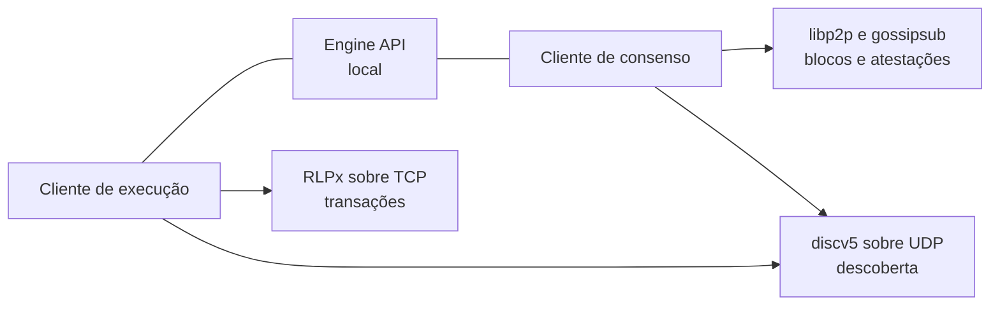
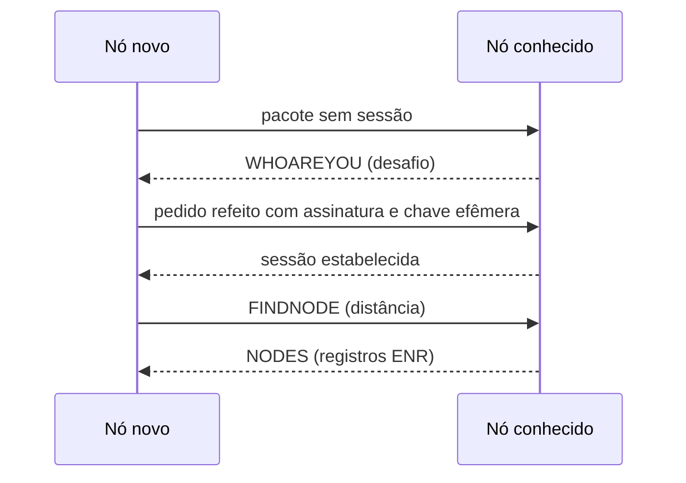
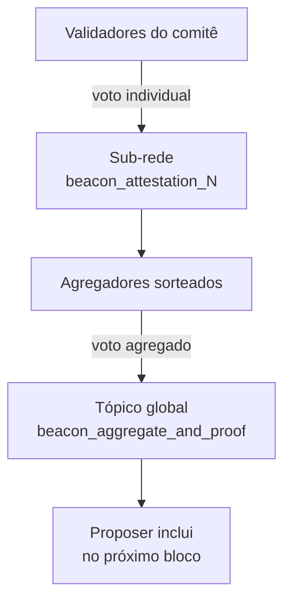

# Capítulo 66: A Camada de Rede, Como os Nós se Encontram e Como Blocos e Atestações Viajam

Os capítulos anteriores trataram de regras: quem propõe, quem atesta, quando um bloco é finalizado. Todas elas pressupõem algo que raramente aparece nos diagramas: as mensagens precisam chegar. O Capítulo 62 mostrou que o proposer boost depende de um bloco chegar cedo, e o Capítulo 28 mostrou que cada nó roda dois clientes conversando entre si. Este capítulo desce um nível e olha para a rede por baixo: como um nó recém-ligado encontra outros, como se identifica, e como blocos e votos se espalham por milhares de máquinas sem um servidor central. Nada aqui é recomendação de compra, venda ou uso de qualquer produto.

**Duas pilhas de rede, uma por camada.** Desde The Merge, um nó Ethereum é a soma de um cliente de execução e um cliente de consenso (Capítulo 28), e cada um tem a sua própria conversa com o mundo. O lado da execução usa a pilha chamada DevP2P, cujo transporte é o RLPx, sobre TCP. O lado do consenso usa libp2p, uma biblioteca de rede modular, com gossipsub para espalhar mensagens. A descoberta de pares, nos dois lados, usa o mesmo protocolo, o discv5, sobre UDP. Entre os dois clientes do mesmo nó não há rede aberta: a conversa local passa pela Engine API, do Capítulo 28.

*Cada cliente fala com a rede por um canal próprio, mas ambos usam o mesmo mecanismo de descoberta.*

**Achar pares: a ficha de contato.** Antes de falar com alguém, é preciso saber quem existe. A unidade de informação é o **Ethereum Node Record (ENR)**, definido na especificação do DevP2P como um formato aberto para dados de conectividade: tipicamente os endereços IP e as portas do nó, mais detalhes sobre o papel dele na rede, para que outros decidam se vale a pena conectar. O registro é assinado. Só o campo `id`, o nome do esquema de identidade (hoje o `v4`), é obrigatório. Os demais são opcionais: `secp256k1` (chave pública comprimida de 33 bytes), `ip`, `tcp` e `udp`, além de versões para IPv6. Um número de sequência `seq` sobe a cada alteração, para que registros mais novos substituam os antigos. O tamanho máximo é de 300 bytes codificados, e a forma textual é a codificação base64 do registro com o prefixo `enr:`. No esquema `v4`, o endereço do nó é o hash keccak256 da chave pública, um parentesco direto com os endereços de conta do Capítulo 26.

No consenso, o ENR carrega campos extras. Segundo a especificação de rede da camada de consenso, o campo `eth2` informa a versão do fork em que o nó está, e o campo `attnets` indica em quais sub-redes de atestação o nó está presente. Assim, quem procura pares para uma sub-rede específica já filtra pelo registro, sem precisar perguntar a cada candidato.

**O discv5: uma lista telefônica sem dono.** O protocolo de descoberta é descrito, pelos próprios autores, como inspirado no Kademlia, uma tabela hash distribuída. Diferente da maioria delas, ele não guarda valores arbitrários: guarda e repassa registros de nó assinados. A organização funciona assim, conforme a documentação de teoria do protocolo:

- cada nó tem um identificador de 32 bytes, e a **distância** entre dois nós é o resultado do XOR dos identificadores, lido como número; distância aqui não tem relação com geografia, é só uma métrica sobre os identificadores;
- cada nó mantém 256 baldes, um para cada distância logarítmica, e cada balde guarda até 16 entradas (k = 16), ordenadas pelo último contato;
- para encontrar nós perto de um alvo, o nó pergunta aos que já conhece (tipicamente 3 de cada vez) por vizinhos dele, e repete a pergunta com os nós mais próximos que surgirem, até que os mais próximos conhecidos tenham todos respondido.

A mensagem central é o `FINDNODE`, que pede nós a uma dada distância. A conversa é cifrada: um nó que recebe um pacote de origem desconhecida responde com um desafio (`WHOAREYOU`), e o remetente refaz o pedido com uma assinatura e uma chave efêmera, e as chaves de sessão saem de uma troca ECDH. Isso protege consultas de observadores passivos e dificulta falsificação de endereço.

*O nó novo prova quem é e só então recebe registros de outros nós, que ele passa a testar e a guardar nos baldes.*

Um nó novo ainda precisa de um primeiro contato. Os clientes trazem uma lista embutida de nós de bootstrap, ponto de partida confiável de que o Capítulo 65 já falava em outro contexto: a rede se organiza sozinha, mas alguém precisa entregar o primeiro endereço. Por isso a diversidade de endereços iniciais importa tanto quanto a diversidade de clientes.

**Execução: RLPx e o gossip de transações.** Depois de achar um par, o nó da camada de execução abre uma conexão TCP. A especificação do RLPx descreve uma troca de mensagens `auth` e `ack`, cifradas com ECIES sobre secp256k1, da qual saem os segredos de sessão. A primeira mensagem de cada lado é um `Hello`, onde os dois declaram suas **capacidades**, cada uma com nome e versão. É assim que clientes diferentes descobrem que falam o mesmo protocolo de aplicação, o `eth`. As mensagens são comprimidas com Snappy, e as maiores que 16 MiB são rejeitadas.

Sobre esse canal, o protocolo `eth` espalha transações com um padrão econômico, anunciar e depois buscar: o nó avisa os pares sobre novas transações com `NewPooledTransactionHashes`, que carrega só os hashes; quem ainda não tem alguma delas pede o conteúdo com `GetPooledTransactions`. Uma fração pequena e aleatória dos pares recebe a transação inteira diretamente. Isso poupa banda, porque cada nó receberia a mesma transação de dezenas de vizinhos se todos mandassem tudo. Já a propagação de blocos saiu dessa pilha: as mensagens `NewBlock` e `NewBlockHashes` foram deprecadas com a EIP-3675 e devem ser descartadas em redes proof-of-stake. Blocos e atestações agora circulam pelo lado do consenso.

**Consenso: gossipsub, tópicos e sub-redes.** O gossipsub organiza a rede em **tópicos**, e cada nó assina os tópicos que lhe interessam. Dentro de um tópico, o nó mantém uma malha de pares: segundo a especificação, o grau-alvo é D = 8, com limites de 6 a 12, e o ritmo de manutenção é de 0,7 segundo. Mensagens novas são encaminhadas pela malha, e há ainda uma fofoca em segundo plano, que avisa pares fora da malha sobre o que existe, para cobrir buracos. Cada mensagem tem um identificador de 20 bytes, derivado do hash do conteúdo, que permite descartar duplicatas. As cargas são serializadas em SSZ e comprimidas com Snappy; a carga máxima sem compressão é de 10 MiB.

Os nomes dos tópicos seguem o formato `/eth2/<fork_digest>/<nome>/<codificação>`. O resumo do fork no nome impede que nós de versões incompatíveis misturem mensagens. Os tópicos globais incluem `beacon_block`, `beacon_aggregate_and_proof`, `voluntary_exit`, `proposer_slashing` e `attester_slashing`. Para as atestações, há um desenho diferente, e a razão é de escala: se cada validador publicasse seu voto num tópico único, todos os nós receberiam centenas de milhares de mensagens por época. A solução é dividir em 64 sub-redes (`ATTESTATION_SUBNET_COUNT`), com tópicos `beacon_attestation_{subnet_id}`. Cada comitê, em cada slot, é mapeado a uma sub-rede por uma conta simples de módulo, e os votos individuais só circulam ali.

Falta juntar os votos de cada sub-rede. É a tarefa dos **agregadores**. A especificação define como alvo 16 agregadores por comitê, e a escolha é feita por sorteio privado: o validador assina o slot e verifica se o hash da assinatura cai num múltiplo adequado ao tamanho do comitê. Quem é sorteado reúne as atestações da sub-rede numa só, assinada em conjunto (a agregação BLS que o Capítulo 2 apresentou), e publica o resultado no tópico global `beacon_aggregate_and_proof`. Como o sorteio depende de uma assinatura, só o próprio validador sabe se foi escolhido, o que dificulta ataques dirigidos aos agregadores.

*Votos individuais ficam restritos a 64 sub-redes; só o resultado agregado chega a toda a rede.*

**O relógio do slot, de novo.** A rede precisa respeitar o tempo, e a especificação do validador marca os momentos: a atestação é publicada quando o bloco esperado do slot chega ou, no máximo, em um terço do slot; o agregado é publicado em dois terços. Com slots de 12 segundos, são cerca de 4 e 8 segundos (conta própria). Mensagens de gossip também carregam uma tolerância: a especificação permite uma disparidade de relógio de 500 milissegundos entre nós. É o motivo pelo qual a latência de propagação aparece como risco em propostas como o ePBS e o FOCIL, nos Capítulos 38 e 42: cada uma redistribui o que cabe dentro dessa janela apertada.

**Pedir, em vez de ouvir: o Req/Resp.** O gossip serve para o que acontece agora. Para o que ficou para trás, o consenso usa um segundo modo, de pedido e resposta direto entre dois pares, com protocolos como `status` (trocado ao conectar, para checar se os dois estão no mesmo fork e em cadeias compatíveis), `ping`, `metadata` e pedidos de blocos por raiz ou por faixa de slots, com limite de 1.024 blocos por pedido. Parte desses pedidos está marcada na especificação como deprecada, em transição para outros formatos, então detalhes mudam entre versões. É por esse canal que um nó que acabou de sincronizar a partir de um checkpoint (Capítulo 65) preenche o histórico que ficou para trás.

**Resumo comparativo.**

| Aspecto | Execução (DevP2P) | Consenso (libp2p) |
| --- | --- | --- |
| Transporte | RLPx sobre TCP | QUIC preferencial, TCP como alternativa |
| Descoberta | discv5 (UDP) | discv5 (UDP) |
| Padrão de difusão | Anunciar hashes e buscar | Malha gossipsub por tópico |
| O que circula | Transações | Blocos, atestações, agregados, saídas e provas de slashing |
| Codificação | RLP com Snappy | SSZ com Snappy |
| Falha típica | Transação não chega aos produtores | Bloco ou voto chega tarde demais |

*Sínteses a partir das especificações citadas nas fontes; implementações podem oferecer opções adicionais.*

**O que a rede não garante.** A camada de rede é um mercado de boa vontade. Nós podem mentir, atrasar ou ficar em silêncio, e o gossipsub se defende com pontuação de pares, que penaliza quem manda mensagens inválidas, mas nenhum desenho elimina por completo ataques de eclipse, em que um nó é cercado só por pares adversários, nem a concentração de pares em poucos provedores de nuvem. Daí a dependência dos clientes de uma boa dose de diversidade de endereços, de implementações e de infraestrutura, tema que conecta este capítulo ao 28. Também por isso a latência e a largura de banda são limites silenciosos para propostas que aumentam o tamanho de blocos ou de blobs, como o PeerDAS do Capítulo 34: o consenso pode permitir, mas a rede precisa dar conta.

**Glossário do capítulo.**

- **ENR (Ethereum Node Record)**: registro assinado e de até 300 bytes com os dados de conectividade de um nó, como IP, portas e chave pública.
- **discv5**: protocolo de descoberta de pares sobre UDP, inspirado no Kademlia, que troca registros ENR assinados.
- **Distância XOR**: métrica sobre identificadores de nós, obtida pelo XOR dos dois valores, usada para organizar os baldes da tabela de pares.
- **RLPx**: protocolo de transporte cifrado sobre TCP da camada de execução, que negocia capacidades como o `eth`.
- **libp2p**: biblioteca modular de rede usada pela camada de consenso.
- **Gossipsub**: protocolo de publicação e assinatura que espalha mensagens por uma malha de pares dentro de cada tópico.
- **Tópico**: canal nomeado do gossipsub; cada nó assina apenas os que lhe interessam.
- **Sub-rede de atestação**: um dos 64 tópicos onde circulam os votos individuais de um comitê, antes da agregação.
- **Agregador**: validador sorteado para reunir os votos de uma sub-rede num único voto agregado.
- **Req/Resp**: modo de comunicação direto entre dois pares, usado para consultas pontuais como a sincronização de blocos.

**Fontes.**

- Especificação do ENR (DevP2P): https://raw.githubusercontent.com/ethereum/devp2p/master/enr.md
- Descoberta de nós v5, visão geral: https://raw.githubusercontent.com/ethereum/devp2p/master/discv5/discv5.md
- Descoberta de nós v5, teoria: https://raw.githubusercontent.com/ethereum/devp2p/master/discv5/discv5-theory.md
- Transporte RLPx: https://raw.githubusercontent.com/ethereum/devp2p/master/rlpx.md
- Protocolo de aplicação eth: https://raw.githubusercontent.com/ethereum/devp2p/master/caps/eth.md
- Interface P2P da camada de consenso (phase0): https://raw.githubusercontent.com/ethereum/consensus-specs/master/specs/phase0/p2p-interface.md
- Especificação do validador honesto (phase0): https://raw.githubusercontent.com/ethereum/consensus-specs/master/specs/phase0/validator.md
