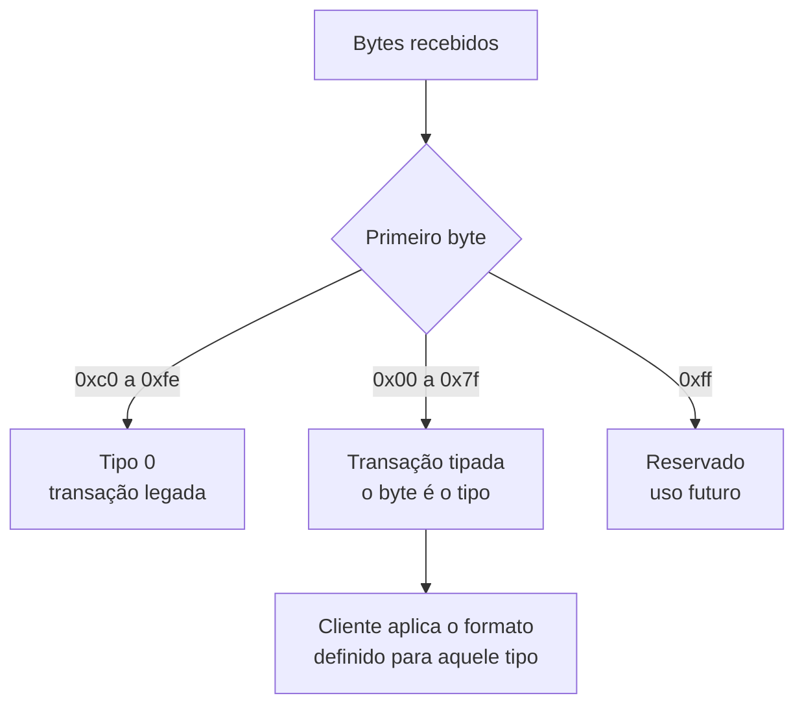
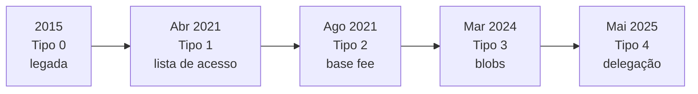

# Capítulo 67: Tipos de Transação, o Envelope Tipado da EIP-2718 e Seus Cinco Formatos

Quase todo capítulo deste caderno falou de "uma transação" como se fosse um objeto único. Não é. Desde 2021 o Ethereum convive com vários formatos de transação, identificados por um número de tipo, e cada atualização importante tende a acrescentar um. A taxa com base fee do Capítulo 16, os blobs do Capítulo 34 e a delegação de código do Capítulo 24 são, no nível do protocolo, formatos diferentes de transação. Este capítulo mostra o mecanismo que torna isso possível, percorre os formatos um a um e explica como ler o campo "tipo" que aparece em exploradores e carteiras. Nada aqui é recomendação de compra, venda ou uso de qualquer produto.

**O problema: como acrescentar um formato sem quebrar os outros.** A motivação da EIP-2718 está escrita no próprio texto. Antes dela, cada novo tipo de transação precisava ser compatível com todos os anteriores, de modo que o cliente conseguisse distinguir um do outro olhando apenas o conteúdo codificado, sem que uma mesma sequência de bytes pudesse ser lida como dois tipos. O exemplo citado é a EIP-155, que escondeu um valor novo dentro de um dos campos já existentes. Com várias propostas em discussão, esse malabarismo viraria um fardo para autores e para quem escreve clientes. A saída foi criar um "envelope": basta garantir compatibilidade com o formato antigo uma vez, e depois só resta evitar conflito de numeração entre os tipos.

**O envelope.** A regra é simples. Uma transação válida é a concatenação de um byte de tipo com uma carga útil cujo significado depende desse tipo; o recibo segue o mesmo padrão, e o tipo do recibo precisa coincidir com o da transação de mesmo índice no bloco.

```latex
transacao = TipoDaTransacao || CargaDaTransacao
recibo    = TipoDaTransacao || CargaDoRecibo
```

O tipo é um número de 0 a 0x7f. A faixa foi escolhida para não colidir com as transações antigas (as chamadas *legacy*), cuja codificação RLP sempre começa com um byte igual ou maior que 0xc0. Assim, o cliente lê o primeiro byte: entre 0 e 0x7f, é uma transação tipada; entre 0xc0 e 0xfe, é uma transação legada. O byte 0xff ficou reservado como sentinela para extensões futuras. A carga útil é tratada como uma sequência opaca de bytes, o que deixa aberta a possibilidade de, no futuro, usar outra codificação que não o RLP.

Há ainda uma recomendação de segurança: o byte de tipo deve ser o primeiro byte dos dados assinados. Dessa forma, uma assinatura feita para um tipo não pode ser reaproveitada como assinatura de outro, o que fecharia uma porta para ataques de repetição entre formatos.



*A primeira leitura do cliente é só um byte: ele decide qual formato usar para interpretar o restante.*

**Tipo 0, a transação legada.** É o formato original, `rlp([nonce, gasPrice, gasLimit, to, value, data, v, r, s])`. O remetente oferece um único preço por unidade de gás, o `gasPrice`, e paga exatamente isso. Era o leilão de primeiro preço descrito no Capítulo 16. Continua válido hoje; o protocolo apenas o trata, internamente, como um caso particular dos formatos mais novos.

**Tipo 1, a lista de acesso (EIP-2930).** Ativada em abril de 2021 (a especificação indica o bloco 12.244.000 como bloco de ativação), a transação do tipo 1 acrescenta ao formato legado o campo `chainId` e uma **lista de acesso**: endereços e chaves de armazenamento que a transação promete tocar. Há dois motivos, segundo o texto. O primeiro é atenuar o risco de quebrar contratos depois da EIP-2929 (Capítulo 21), que encareceu o primeiro acesso a um endereço ou posição de armazenamento; ao declarar de antemão, o remetente paga com desconto. O segundo é introduzir um formato de lista que poderia ser reaproveitado para outros fins. Os custos definidos são 2.400 de gás por endereço e 1.900 por chave de armazenamento, cobrados no início da execução, junto com o gás intrínseco. Como o próprio nome sugere, só vale a pena incluir um item se o desconto no acesso compensar o custo de declará-lo, e a lista continua existindo nos tipos seguintes.

**Tipo 2, o formato da base fee (EIP-1559).** É o formato que a maioria das carteiras usa hoje. Seus campos são `chain_id`, `nonce`, `max_priority_fee_per_gas`, `max_fee_per_gas`, `gas_limit`, destino, valor, dados e lista de acesso, mais a assinatura. Em vez de um preço único, o remetente declara dois limites: quanto está disposto a pagar de gorjeta por gás e quanto aceita pagar no total por gás. O protocolo calcula o preço efetivo com a regra da especificação:

```latex
gorjeta_por_gas = min(max_priority_fee_per_gas, max_fee_per_gas - base_fee)
preco_efetivo   = base_fee + gorjeta_por_gas
```

Dois exemplos numéricos (valores ilustrativos, escolhidos para o cálculo). Com base fee de 30 gwei, gorjeta máxima de 2 e teto de 50, a gorjeta é min(2, 20) = 2 e o preço efetivo é 32 gwei. Se o teto fosse 31, a gorjeta cairia para min(2, 1) = 1 e o preço seria 31 gwei, de modo que o teto sempre protege o remetente. A transação só é incluída se o teto for pelo menos igual à base fee do bloco, e o saldo exigido na verificação é `gas_limit × max_fee_per_gas`; o que sobra do teto não é cobrado. A base fee é queimada e a gorjeta vai ao produtor do bloco, como no Capítulo 16. Uma transação legada, nesse cálculo, equivale a um tipo 2 em que os dois limites são iguais ao `gasPrice`: com base fee de 30 e `gasPrice` de 40, a gorjeta resultante é de 10.

**Tipo 3, a transação com blobs (EIP-4844).** Usada por rollups para publicar dados (Capítulos 5 e 34), carrega os campos do tipo 2 e mais dois: `max_fee_per_blob_gas` e `blob_versioned_hashes`. Os blobs em si não ficam no corpo da transação que entra no bloco. O que a cadeia guarda são os **hashes versionados**, cada um formado por um byte de versão (0x01 para compromissos KZG) seguido de parte do hash SHA-256 do compromisso. Na rede de propagação, a transação viaja embrulhada junto com os blobs, os compromissos e as provas, e o nó confere se cada compromisso gera o hash declarado; o que entra no bloco é a forma sem os blobs. Cada blob consome 2^17 unidades de "gás de blob" (131.072), e o preço desse gás tem mercado próprio, independente do gás comum, com base fee que sobe ou desce conforme o uso fique acima ou abaixo da meta. Os valores iniciais da EIP eram meta de 3 e máximo de 6 blobs por bloco; esses números foram elevados depois, como o Capítulo 34 mostrou ao tratar dos forks BPO. Para o EVM, o contrato só enxerga os hashes, por meio do opcode `BLOBHASH` (0x49), nunca o conteúdo dos blobs. Uma transação desse tipo precisa ter pelo menos um hash.

**Tipo 4, a transação de código definido (EIP-7702).** Introduzida com a Pectra, em 7 de maio de 2025, é a que faz uma conta comum (EOA) delegar seu código. Além dos campos do tipo 2, traz uma `authorization_list`, uma lista de tuplas `[chain_id, address, nonce, y_parity, r, s]`. Cada tupla é uma autorização assinada pela conta que deseja delegar, e quem envia a transação pode ser outra pessoa (por exemplo, um patrocinador do gás). O processamento ocorre antes da execução: o cliente recupera o endereço do autor da assinatura (a mensagem assinada inclui o byte mágico 0x05 e a tripla `chain_id`, `address`, `nonce`), confere que o `chain_id` é zero ou o da cadeia atual, que o nonce da conta bate e que ela não tem código ou já está delegada, e então grava como código da conta o indicador de delegação `0xef0100 || address`, incrementando o nonce. Se o endereço for o endereço zero, o código é apagado, desfazendo a delegação. O custo base de cada autorização é de 12.500 de gás, com 25.000 para conta que ainda não existia, e há reembolso parcial quando a conta já existia. Duas restrições do formato valem a menção: a lista de autorizações não pode ser vazia e o destino não pode ser nulo, ou seja, esse tipo não cria contratos. Os cuidados de segurança, como assinar delegação a contrato desconhecido, estão no Capítulo 24.

Um detalhe que costuma confundir: o `chain_id` zero numa autorização significa "vale em qualquer cadeia", o que amplia o alcance de uma assinatura e exige atenção redobrada de quem a assina.



*Cada tipo novo chegou com uma atualização da rede; os formatos antigos seguem válidos.*

**Resumo comparativo.**

| Tipo | Origem | Campos novos em relação ao anterior | Para que serve |
| --- | --- | --- | --- |
| 0 | Formato original | `gasPrice` | Preço único por gás, leilão de primeiro preço |
| 1 | EIP-2930 | `chainId`, lista de acesso | Declarar acessos com desconto, base para tipos seguintes |
| 2 | EIP-1559 | `max_priority_fee_per_gas`, `max_fee_per_gas` | Base fee queimada, gorjeta e teto de preço |
| 3 | EIP-4844 | `max_fee_per_blob_gas`, hashes versionados | Dados de rollups em blobs, mercado de preço separado |
| 4 | EIP-7702 | Lista de autorizações | Conta comum delegar o código a um contrato |

**Por que isso importa na prática.** Ler o tipo em um explorador de blocos conta muita coisa sobre a operação sem abrir os dados. Uma transação do tipo 2 exibirá base fee, gorjeta máxima e teto; uma do tipo 3 mostrará também o gás de blob e a taxa associada; uma do tipo 4 indicará que houve autorizações de delegação, algo que merece atenção de quem acompanha as próprias contas. Para desenvolvedores, o envelope reduz o custo de evoluir o protocolo: um novo tipo ocupa seu número, define a carga e as regras, e os demais seguem intactos. O caminho que um formato novo percorre até a mainnet é o do Capítulo 46. Também ajuda a entender por que carteiras e bibliotecas precisam ser atualizadas a cada fork: assinar e serializar um tipo novo exige código novo.

**Limites do desenho.** O envelope resolve a convivência de formatos, mas não elimina custos. Cada tipo acrescenta casos para ferramentas, indexadores, cadeias compatíveis e implementações de cliente, e uma divergência de interpretação entre clientes é exatamente o tipo de risco que o Capítulo 28 discutiu. A faixa de 0 a 0x7f é ampla, mas finita, e a própria EIP deixa sem definição um algoritmo de atribuição de números, o que significa que a coordenação entre propostas continua sendo uma conversa social entre autores e desenvolvedores de clientes.

**Glossário do capítulo.**

- **Transação tipada**: transação cujo primeiro byte indica o formato, seguido de uma carga que o cliente interpreta conforme esse tipo.
- **Envelope (EIP-2718)**: regra que define transação e recibo como o byte de tipo concatenado com uma carga opaca.
- **Transação legada**: formato original em RLP, com `gasPrice` único, distinguido pelo primeiro byte maior ou igual a 0xc0.
- **Lista de acesso**: relação de endereços e chaves de armazenamento declarada na transação, cobrada com desconto no acesso.
- **Preço efetivo de gás**: base fee do bloco somada à gorjeta, esta limitada pelo teto declarado na transação.
- **Hash versionado**: identificador de um blob formado por um byte de versão e parte do hash do compromisso KZG.
- **Gás de blob**: unidade de custo dos blobs, com mercado de preço separado do gás comum.
- **Indicador de delegação**: código `0xef0100` seguido de um endereço, gravado numa EOA para que ela execute o código daquele contrato.
- **Lista de autorizações**: conjunto de tuplas assinadas, na EIP-7702, que permitem a uma conta delegar seu código.

**Fontes.**

- https://raw.githubusercontent.com/ethereum/EIPs/master/EIPS/eip-2718.md
- https://raw.githubusercontent.com/ethereum/EIPs/master/EIPS/eip-2930.md
- https://raw.githubusercontent.com/ethereum/EIPs/master/EIPS/eip-1559.md
- https://raw.githubusercontent.com/ethereum/EIPs/master/EIPS/eip-4844.md
- https://raw.githubusercontent.com/ethereum/EIPs/master/EIPS/eip-7702.md
