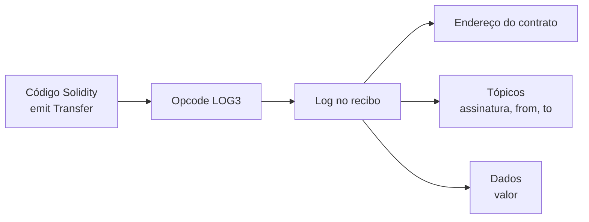
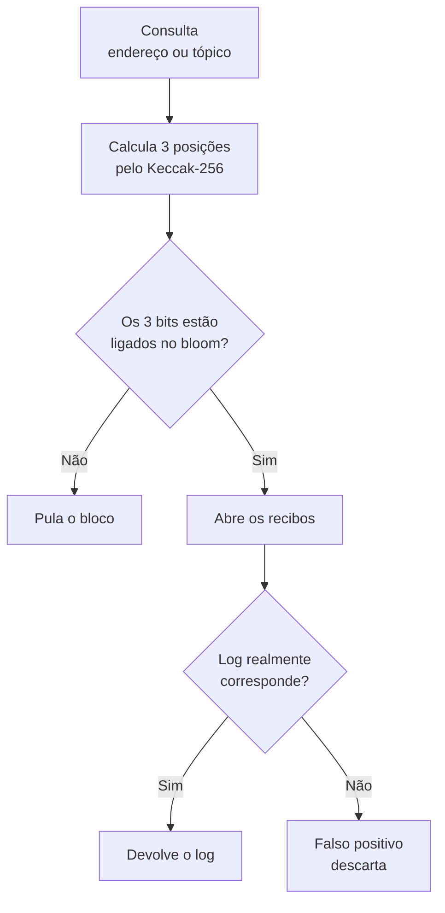

# Capítulo 68: Eventos, Logs e Filtros de Bloom, Como um Contrato Deixa Rastro

Quando uma carteira mostra "você recebeu 50 USDC" ou um painel de DeFi lista todas as trocas de um pool, a informação raramente vem do saldo guardado no armazenamento dos contratos. Ela vem dos **logs**, um registro paralelo que cada transação grava em seu recibo. Este capítulo explica o que é um evento no Solidity, como ele vira um log no nível da EVM (Capítulo 21), por que existem "tópicos", como o bloco resume seus logs num filtro de Bloom e como aplicativos fazem buscas sobre esse material. Nada aqui é recomendação de compra, venda ou uso de qualquer produto.

**Duas memórias diferentes.** O armazenamento de um contrato (*storage*) guarda o estado atual e é caro de escrever. O log é outra coisa: um registro de "aconteceu isto" anexado ao recibo da transação. A documentação do Solidity descreve os eventos como uma abstração sobre a funcionalidade de log da EVM, associada ao endereço do contrato que os emitiu. O ponto mais importante para quem projeta contratos vem na mesma documentação: o log e seus dados **não são acessíveis de dentro de contratos**, nem mesmo do contrato que os criou. Ou seja, o log serve a quem está fora da EVM, como interfaces, indexadores e sistemas de monitoramento. Um contrato que precise lembrar de algo para decidir depois deve guardar em storage, não em evento. A mesma fonte observa que o log permanece enquanto o bloco estiver acessível ("para sempre, por ora", com a ressalva de que isso pode mudar), o que dialoga com a expiração de histórico do Capítulo 37.

**Do evento ao opcode.** Em Solidity, o desenvolvedor declara `event` e dispara com `emit`. O compilador traduz isso para um dos cinco opcodes `LOG0` a `LOG4`, cujo número indica quantos **tópicos** a entrada carrega. Na implementação de referência da especificação de execução, o opcode retira da pilha a posição e o tamanho de um trecho da memória (que será o campo de dados) e depois os tópicos, cada um com 32 bytes. O custo em gás tem três parcelas: uma base de 375, mais 375 por tópico, mais 8 por byte de dados, além da expansão de memória se houver. Um `LOG3` com 64 bytes de dados custa, portanto, 375 + 3 × 375 + 8 × 64 = 2.012 de gás, fora a memória. É barato perto de gravar o mesmo dado em storage, e é por isso que contratos usam eventos para tudo o que só precisa ser lido por fora (Capítulo 35 sobre custos). Dentro de uma chamada estática (`STATICCALL`), emitir log é proibido, como qualquer escrita.

**Tópicos e dados.** Um log tem três partes: o endereço do contrato emissor, uma lista de até quatro tópicos e um campo de dados livre. A regra do Solidity é: parâmetros marcados `indexed` (no máximo três) vão para os tópicos; os demais são codificados em ABI e vão para o campo de dados. Como um tópico cabe em uma palavra de 32 bytes, parâmetros de tipos de referência (texto, vetores) marcados como `indexed` não são gravados por inteiro: o que vai para o tópico é o hash Keccak-256 do valor. Isso permite buscar por igualdade, mas impede recuperar o conteúdo original a partir do tópico. O primeiro tópico, em eventos comuns, é o hash da assinatura do evento (nome e tipos, como `Transfer(address,address,uint256)`). Eventos declarados `anonymous` não gravam esse hash; em compensação são mais baratos e permitem quatro parâmetros indexados, mas só podem ser filtrados pelo endereço do contrato. A documentação alerta para um detalhe de segurança: o log não guarda o tipo, apenas os bytes, então quem lê precisa conhecer a definição do evento, e um evento anônimo pode até "imitar" a assinatura de outro.



*Um `emit` com dois parâmetros indexados vira um `LOG3`: o hash da assinatura e os dois indexados viram tópicos, e o valor vai nos dados.*

**O caso mais famoso, o ERC-20.** O padrão do Capítulo 22 define dois eventos: `Transfer(address indexed _from, address indexed _to, uint256 _value)` e `Approval(address indexed _owner, address indexed _spender, uint256 _value)`. A EIP-20 exige que `Transfer` seja disparado em toda transferência, inclusive de valor zero, e recomenda que um contrato que cria tokens dispare `Transfer` com origem no endereço zero. Esse detalhe é o que permite a um indexador reconstruir o saldo de qualquer endereço sem consultar o contrato: basta somar entradas e subtrair saídas ao longo dos logs. Já o `Approval` é a trilha das permissões que o Capítulo 27 recomendou revisar.

| Característica | Tópico indexado | Campo de dados |
| --- | --- | --- |
| Quantidade | Até 3 (4 em evento anônimo) | Ilimitada, paga por byte |
| Tipos de referência | Guarda só o hash Keccak-256 | Guarda o valor codificado em ABI |
| Filtragem na busca | Sim, por igualdade | Não, só depois de baixar o log |
| Custo | 375 de gás por tópico | 8 de gás por byte |
| Uso típico | Quem enviou, quem recebeu, identificador | Valores, textos, listas |

**O filtro de Bloom do bloco.** Procurar um evento varrendo todos os recibos de milhões de blocos seria lento. Por isso cada bloco carrega, no cabeçalho, um **logs bloom**: um filtro de Bloom de 256 bytes (2.048 bits) que resume os logs do bloco. O código da especificação mostra como ele é montado: para cada log, entram no filtro o endereço do emissor e cada tópico; cada entrada é passada pelo Keccak-256 e, dos 16 bits de cada um dos três primeiros pares de bytes do hash, os 11 bits menos significativos indicam três posições a serem ligadas. O próprio texto da especificação resume o propósito: eliminar rapidamente blocos e recibos numa busca por endereço ou tópico.

```latex
posicao_i = (16 bits do hash na posição 2i) AND 0x07FF,   i = 0, 1, 2
```

A leitura é assimétrica, como em todo filtro de Bloom. Se algum dos três bits de uma consulta estiver desligado, o item certamente não está no bloco e o cliente pula o bloco inteiro. Se os três estiverem ligados, o item *pode* estar: pode ser coincidência de outros itens, o chamado falso positivo, e só abrindo os recibos se confirma. Nunca há falso negativo. Como o filtro é pequeno e fixo (2.048 bits) e um bloco cheio pode ter muitos logs, a taxa de falsos positivos sobe com a quantidade de entradas, e o filtro serve mais para descartar a maioria dos blocos do que para localizar com precisão.



*O bloom do cabeçalho funciona como porteiro: só quem passa pelos três bits chega à etapa cara de abrir recibos.*

**Como um aplicativo consulta.** A interface JSON-RPC expõe o método `eth_getLogs`, que recebe um filtro com `fromBlock` e `toBlock` (intervalo inclusivo), `address` (um endereço, vários ou nenhum) e `topics`. Segundo o esquema oficial, cada posição da lista de tópicos pode ser vazia (aceita qualquer valor), um valor único ou uma lista de alternativas, e a posição importa: a primeira casa com o primeiro tópico (a assinatura do evento), a segunda com o segundo, e assim por diante. Há também a forma alternativa por `blockHash`, que consulta um bloco específico por seu hash, útil para não confundir blocos de ramos diferentes numa reorganização (Capítulo 62). Cada log devolvido traz campos como `logIndex`, `blockNumber`, `blockHash`, `transactionHash`, `transactionIndex`, `address`, `data`, `topics` e o booleano `removed`. A especificação atual do método também prevê um erro dedicado, de código 4444, para o caso em que o histórico pedido foi podado pelo nó, ecoando a EIP-4444 do Capítulo 37.

Um exemplo de leitura: para ver todas as transferências de um token para um endereço, o filtro pede o contrato do token em `address`, o hash de `Transfer(address,address,uint256)` na primeira posição de tópicos, qualquer valor na segunda (origem) e o endereço de destino, preenchido até 32 bytes, na terceira. Foi exatamente por o destino ser um parâmetro `indexed` que essa busca é possível sem baixar o valor de cada transferência.

**Limites e cuidados.** Primeiro, os provedores de nó costumam limitar o tamanho do intervalo ou a quantidade de resultados de uma consulta, então grandes varreduras são feitas por etapas ou por indexadores especializados; a especificação, por sua vez, proíbe os clientes de "recortar" silenciosamente o intervalo ou devolver resultado parcial, exigindo erro. Segundo, o log é informação **declarada pelo contrato**: um contrato mal escrito ou malicioso pode emitir um evento `Transfer` sem ter movido nada, de modo que um evento prova apenas que aquele endereço o emitiu, nunca que o efeito aconteceu. Por isso interfaces sérias confrontam eventos com o estado real e desconfiam de tokens desconhecidos, o que se relaciona com os golpes do Capítulo 27. Terceiro, a mesma documentação do Solidity registra que um contrato pode, em tese, verificar a existência de um log recebendo uma prova de Merkle, mas precisa dos cabeçalhos de bloco porque só enxerga os últimos 256 hashes de bloco, o que explica por que esse tipo de verificação aparece mais em pontes (Capítulo 23) e clientes leves (Capítulo 60) do que em contratos do dia a dia.

**Por que isso importa.** Eventos são a ponte entre a execução em cadeia e o mundo de aplicações. Entendê-los ajuda a ler um recibo em um explorador, a perceber por que um painel pode divergir do saldo real e a avaliar o desenho de um contrato: bons contratos emitem eventos para toda mudança relevante, com os campos de busca como `indexed`, e não dependem deles para a própria lógica.

**Glossário do capítulo.**

- **Evento**: declaração no Solidity que, ao ser emitida com `emit`, grava um log na transação.
- **Log**: entrada de recibo com endereço emissor, até quatro tópicos e um campo de dados, não legível por contratos.
- **Tópico**: palavra de 32 bytes do log usada para busca; em eventos comuns, o primeiro é o hash da assinatura.
- **Parâmetro `indexed`**: parâmetro de evento enviado aos tópicos (até três), em vez do campo de dados.
- **Evento anônimo**: evento sem o tópico da assinatura, mais barato e com até quatro indexados, filtrável só pelo endereço.
- **LOG0 a LOG4**: opcodes da EVM que gravam um log com 0 a 4 tópicos; custam 375 de base, 375 por tópico e 8 por byte de dados.
- **Filtro de Bloom (logs bloom)**: resumo de 2.048 bits no cabeçalho do bloco que permite descartar rapidamente blocos sem o endereço ou tópico procurado.
- **Falso positivo**: resposta "talvez esteja aqui" do filtro de Bloom que a abertura dos recibos desmente.
- **eth_getLogs**: método JSON-RPC que devolve os logs que casam com um filtro de intervalo, endereço e tópicos.

**Fontes.**

- https://raw.githubusercontent.com/ethereum/solidity/develop/docs/contracts/events.rst
- https://raw.githubusercontent.com/ethereum/EIPs/master/EIPS/eip-20.md
- https://raw.githubusercontent.com/ethereum/ERCs/master/ERCS/erc-20.md
- https://raw.githubusercontent.com/ethereum/execution-specs/master/src/ethereum/forks/cancun/vm/instructions/log.py
- https://raw.githubusercontent.com/ethereum/execution-specs/master/src/ethereum/forks/cancun/vm/gas.py
- https://raw.githubusercontent.com/ethereum/execution-specs/master/src/ethereum/forks/cancun/bloom.py
- https://raw.githubusercontent.com/ethereum/execution-apis/main/src/schemas/filter.yaml
- https://raw.githubusercontent.com/ethereum/execution-apis/main/src/eth/filter.yaml
