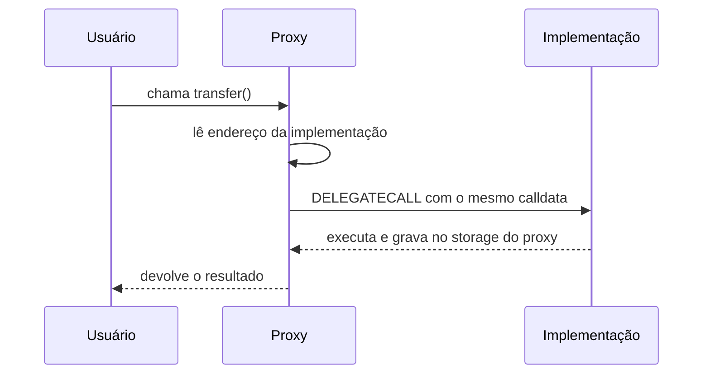
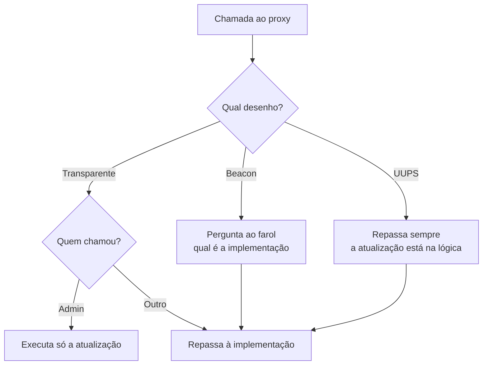

# Capítulo 69: Contratos Atualizáveis, Proxies, DELEGATECALL e o Padrão UUPS

Um contrato inteligente, uma vez publicado, tem código imutável (Capítulo 21). Isso é uma virtude para quem confia nas regras, mas um problema para quem descobre um erro depois do lançamento ou quer acrescentar uma função. A solução mais usada no ecossistema é separar o contrato em duas peças: um **proxy**, que guarda o endereço e os dados, e uma **implementação**, que guarda a lógica. Trocar a implementação "atualiza" o contrato sem mudar o endereço que os usuários conhecem. Este capítulo explica o mecanismo, os principais desenhos (transparente, UUPS, beacon e clone mínimo), os erros clássicos e o que isso significa para quem avalia um protocolo. Nada aqui é recomendação de compra, venda ou uso de qualquer produto.

**A peça-chave, o DELEGATECALL.** O opcode `DELEGATECALL` foi introduzido pela EIP-7 e entrou na rede no hard fork Homestead, a partir do bloco 1.150.000. A EIP o descreve como parecido com o `CALLCODE`, mas com uma diferença: a chamada criada propaga o remetente e o valor do contexto original. Na prática, o código do contrato B roda como se estivesse dentro do contrato A: lê e escreve no **storage de A**, enxerga o saldo de A e vê como `msg.sender` quem chamou A. É isso que permite a um proxy "emprestar" a lógica de outro contrato e, ainda assim, manter os dados consigo. O mesmo recurso explica falhas como a da biblioteca compartilhada da Parity (Capítulo 33), em que código chamado por delegação mexeu em estado que não deveria.



*O usuário só conversa com o proxy; a implementação fornece o código, mas todos os dados ficam no proxy.*

**Onde guardar o endereço da implementação.** Se o proxy guardasse o endereço na posição 0 do storage, a implementação, que também usa a posição 0 para suas próprias variáveis, poderia sobrescrevê-lo sem querer. A ERC-1967 resolve isso fixando posições "impossíveis de o compilador alocar". A fórmula, tirada da especificação, é:

```latex
slot_implementacao = keccak256("eip1967.proxy.implementation") - 1
                   = 0x360894a1...2e2076cc3735a920a3ca505d382bbc
```

A posição é o hash de um texto que não começa por um índice de storage, menos 1, para que a pré-imagem do hash não seja conhecida. O padrão define também a posição do **admin** (`eip1967.proxy.admin`) e a do **beacon** (`eip1967.proxy.beacon`), além dos eventos `Upgraded(address indexed implementation)`, `AdminChanged` e `BeaconUpgraded`. O texto recomenda que toda função que altere essas posições emita o evento correspondente, inclusive na inicialização. Por isso exploradores de blocos conseguem detectar que um endereço é proxy e mostrar o ABI da implementação, e por isso o monitoramento de eventos `Upgraded` (Capítulo 68) é a forma de ser avisado de uma troca de código.

**Por que não uma função pública no proxy.** A especificação explica que o padrão usa uma posição de storage, e não um método, porque o proxy não deveria expor funções que possam colidir com as da implementação. O seletor de função tem só 4 bytes, então duas funções de nomes diferentes podem ter o mesmo seletor. Uma colisão assim, citada no texto a partir de um estudo da Nomic Labs, pode ser usada para esconder um backdoor num contrato aparentemente inofensivo.

**Três desenhos de proxy.** A diferença entre eles está em onde vive a regra de "quem pode atualizar".

| Desenho | Onde fica a lógica de atualização | Como evita conflito de seletores | Ponto de atenção |
| --- | --- | --- | --- |
| Transparente | No próprio proxy, usada só pelo admin | O admin nunca é repassado à implementação; os demais usuários sempre são | Cada chamada confere se o remetente é o admin |
| UUPS | Na implementação (`upgradeToAndCall`) | A função de atualização faz parte do ABI da implementação | Uma versão sem a função de atualização pode travar o contrato para sempre |
| Beacon | Num contrato "farol" que diz qual é a implementação | Muitos proxies consultam o mesmo farol | Quem controla o farol atualiza todos os proxies de uma vez |

No **proxy transparente** da biblioteca OpenZeppelin, a documentação descreve duas regras que andam juntas: se qualquer conta diferente do admin chama o proxy, a chamada é repassada à implementação, mesmo que combine com `upgradeToAndCall`; se o admin chama, ele só consegue atualizar, e qualquer outra chamada falha. Por isso o admin deve ser uma conta dedicada. Na versão 5, o proxy cria sua própria instância de `ProxyAdmin` e só aceita atualizações vindas dela, e o dono do `ProxyAdmin` pode ser trocado.

No **UUPS** (ERC-1822, que o próprio texto marca como estagnado, embora o padrão seja amplamente usado pela implementação do OpenZeppelin), o proxy é mínimo e quem carrega a função de atualização é a implementação. A versão 5 do `UUPSUpgradeable` exige que a chamada de atualização venha por um proxy ativo (`onlyProxy`), chama uma função `_authorizeUpgrade` que o desenvolvedor precisa implementar com sua regra de permissão, e confere que a nova implementação responde com o identificador esperado (`proxiableUUID`, que deve ser a posição da ERC-1967). Essa checagem existe porque, se a nova versão não tiver a função de atualização, o contrato perde a capacidade de ser atualizado outra vez.

No **beacon**, o proxy guarda o endereço de um contrato de farol e, a cada chamada, pergunta a ele qual é a implementação. Segundo a ERC-1967, o resultado do farol não deve depender de `msg.sender`. A documentação do `BeaconProxy` avisa que o endereço do farol não muda depois da construção, então é preciso controlar o farol ou confiar em quem o controla.



*Os três desenhos terminam repassando a chamada à implementação; o que muda é quem decide a rota e onde mora o poder de atualizar.*

**Clones mínimos, o proxy que não atualiza.** A ERC-1167 usa a mesma ideia com outro objetivo: economizar gás ao implantar muitas cópias do mesmo contrato. O bytecode padrão tem 45 bytes, com 20 deles reservados ao endereço do contrato "mestre", e delega toda chamada a ele. O próprio texto deixa claro que o desenho "não é feito para atualização", e que essa rigidez é justamente a garantia: quem inspeciona o bytecode sabe qual código vai rodar para sempre. É um bom exemplo de que proxy nem sempre significa "atualizável".

**Construtor não existe, inicializador sim.** O código do construtor só roda na implantação da implementação, e não afeta o storage do proxy. Por isso contratos por trás de proxy movem a lógica de partida para uma função `initialize`, protegida para rodar uma única vez. A documentação do `Initializable` descreve o modificador `initializer`, a numeração de versões com `reinitializer` e um alerta importante: um contrato não inicializado pode ser tomado por um atacante, tanto o proxy quanto a implementação. A recomendação é inicializar logo na criação do proxy, passando a chamada codificada no construtor, e chamar `_disableInitializers()` no construtor da implementação para travá-la.

**O mapa do storage e as armadilhas.** Como o proxy mantém os dados e a nova implementação os lê, a ordem das variáveis precisa permanecer compatível entre versões. Inserir uma variável no meio, trocar o tipo de uma existente ou mudar a ordem de heranças faz a nova versão ler a posição errada: um saldo vira um endereço, por exemplo. Uma defesa moderna é o **storage namespaced**, da ERC-7201, que organiza as variáveis em structs enraizadas em posições calculadas por hash, com a fórmula abaixo, anotadas por `@custom:storage-location` para que ferramentas as encontrem:

```latex
erc7201(id) = keccak256( keccak256(id) - 1 ) AND NOT 0xff
```

Assim, módulos diferentes não disputam as mesmas posições e adicionar campos a uma struct não desloca as demais. Outra armadilha vem dos próprios avisos da OpenZeppelin: uma implementação maliciosa ou descuidada pode sobrescrever as posições da ERC-1967, deixando o proxy num estado inconsistente.

**O ponto de confiança.** Um contrato atualizável é, na prática, um contrato cujo código pode mudar por decisão de quem detém a chave de atualização. Se essa chave é uma conta única, o usuário confia na pessoa; se é um multisig (Capítulo 26) ou um sistema de governança com timelock (Capítulo 19), a confiança passa a ser em um grupo e em um atraso que permite sair antes da mudança. Não existe resposta universal: atualização permite corrigir falhas, como as dos incidentes do Capítulo 33, mas também permite introduzir uma. Há ainda quem renuncie à capacidade de atualizar depois de amadurecer o código, o que devolve a imutabilidade.

**Perguntas úteis para avaliar um contrato.** Um resumo prático para ler um protocolo:

- O endereço é um proxy? Um explorador costuma indicar e mostrar a implementação atual.
- Quem pode chamar a atualização: uma conta, um multisig ou a governança?
- Existe atraso (timelock) entre o anúncio e a execução de uma troca?
- A implementação está verificada e auditada, e as atualizações passadas aparecem nos eventos `Upgraded`?
- O contrato de implementação e o proxy foram inicializados?

**Por que isso importa.** Proxies explicam por que "o contrato" que se usa hoje pode ter lógica diferente da de ontem e por que o endereço, sozinho, não diz tudo. Conhecer o mecanismo ajuda a ler um explorador, a entender relatos de incidentes e a perceber que a imutabilidade, nesse ecossistema, é uma escolha de projeto e não uma garantia automática.

**Glossário do capítulo.**

- **Proxy**: contrato que guarda os dados e o endereço e repassa as chamadas a outro contrato por `DELEGATECALL`.
- **Implementação**: contrato que contém a lógica executada em nome do proxy; também chamado de contrato lógico.
- **DELEGATECALL**: opcode que executa o código de outro contrato no contexto do chamador, preservando storage, saldo, remetente e valor.
- **ERC-1967**: padrão que fixa as posições de storage do proxy para implementação, admin e beacon, e os eventos associados.
- **Proxy transparente**: desenho em que o admin só atualiza e os demais usuários são sempre repassados à implementação, evitando colisão de seletores.
- **UUPS**: desenho em que a função de atualização fica na implementação e o proxy é mínimo.
- **Beacon**: contrato que informa a implementação para muitos proxies, permitindo atualizar todos de uma vez.
- **Clone mínimo (ERC-1167)**: proxy fixo de 45 bytes que delega tudo a um endereço, usado para baratear implantações.
- **Inicializador**: função que substitui o construtor em contratos por trás de proxy e deve rodar uma única vez.
- **Storage namespaced (ERC-7201)**: organização do estado em structs enraizadas em posições calculadas por hash, para evitar colisões entre versões e módulos.

**Fontes.**

- [EIP-7: DELEGATECALL](https://github.com/ethereum/EIPs/blob/master/EIPS/eip-7.md)
- [ERC-1967: Proxy Storage Slots](https://github.com/ethereum/ERCs/blob/master/ERCS/erc-1967.md)
- [ERC-1822: Universal Upgradeable Proxy Standard (UUPS)](https://github.com/ethereum/ERCs/blob/master/ERCS/erc-1822.md)
- [ERC-1167: Minimal Proxy Contract](https://github.com/ethereum/ERCs/blob/master/ERCS/erc-1167.md)
- [ERC-7201: Namespaced Storage Layout](https://github.com/ethereum/ERCs/blob/master/ERCS/erc-7201.md)
- [OpenZeppelin Contracts, UUPSUpgradeable.sol](https://github.com/OpenZeppelin/openzeppelin-contracts/blob/master/contracts/proxy/utils/UUPSUpgradeable.sol)
- [OpenZeppelin Contracts, TransparentUpgradeableProxy.sol](https://github.com/OpenZeppelin/openzeppelin-contracts/blob/master/contracts/proxy/transparent/TransparentUpgradeableProxy.sol)
- [OpenZeppelin Contracts, Initializable.sol](https://github.com/OpenZeppelin/openzeppelin-contracts/blob/master/contracts/proxy/utils/Initializable.sol)
- [OpenZeppelin Contracts, BeaconProxy.sol](https://github.com/OpenZeppelin/openzeppelin-contracts/blob/master/contracts/proxy/beacon/BeaconProxy.sol)
