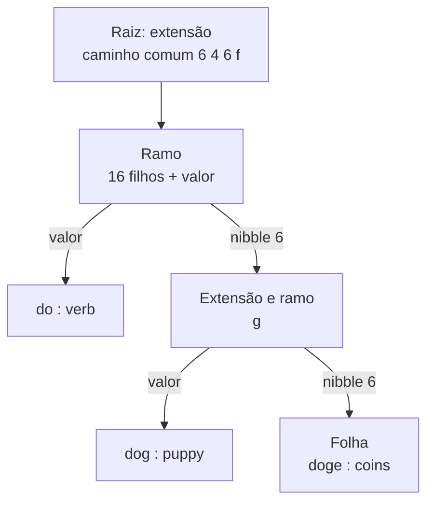
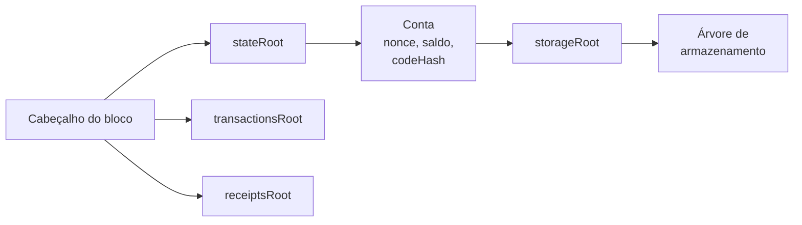

# Capítulo 70: A Árvore Merkle Patricia por Dentro, Nós, Caminhos e Provas

O Capítulo 37 mostrou que o estado do Ethereum vive numa árvore de Merkle Patricia e que o tamanho das provas dessa árvore é um dos motivos pelos quais se discutem alternativas como Verkle e a árvore binária. Faltava abrir a estrutura e ver como ela é montada. Este capítulo faz isso: quais são os tipos de nó, como um caminho é codificado, quando um nó vira hash, quais são as quatro árvores do protocolo e por que uma prova de Merkle convence quem só conhece a raiz.

**A ideia de fundo.** Uma árvore de Merkle resume muitos dados em um único hash, a raiz. Se qualquer dado mudar, a raiz muda. A variante Patricia acrescenta algo útil para um banco de dados chave-valor: as chaves são lidas como sequências de **nibbles** (meio byte, um dígito hexadecimal, de 0 a f), e cada passo na descida da árvore consome um nibble. Como cada nibble tem 16 valores possíveis, a árvore é **hexária**. O resultado é uma estrutura que se comporta como um dicionário, mas cujo conteúdo inteiro cabe em 32 bytes.

**Os quatro tipos de nó.** Segundo a documentação do ethereum.org, todo nó é de um destes tipos:

| Tipo | Forma | Papel |
| --- | --- | --- |
| Nulo | string vazia | Ausência de nó |
| Ramo (branch) | 17 itens: 16 filhos e um valor | Bifurcação, um filho para cada nibble possível |
| Folha (leaf) | 2 itens: caminho codificado e valor | Fim de um caminho, guarda o dado |
| Extensão (extension) | 2 itens: caminho codificado e chave do próximo nó | Atalho que pula um trecho de caminho compartilhado |

O ramo tem 17 posições porque as 16 primeiras apontam para os filhos e a última guarda um valor, para o caso de uma chave terminar exatamente naquele ponto. A extensão existe para não desperdiçar ramos: se muitas chaves compartilham os mesmos oito nibbles iniciais, em vez de oito ramos com um único filho cada, uma extensão carrega o trecho comum de uma vez.



*Desenho simplificado inspirado no exemplo de ethereum.org, em que as chaves "do", "dog" e "doge" compartilham o início do caminho; "horse" ficaria em outro filho da raiz.*

**Como o caminho é codificado.** Caminhos de extensão e de folha têm um problema prático: o número de nibbles pode ser par ou ímpar, e é preciso distinguir folha de extensão. A solução é a codificação **hex-prefix**, que usa o primeiro nibble como bandeira:

| Primeiro nibble | Tipo de nó | Tamanho do caminho |
| --- | --- | --- |
| 0 | extensão | par |
| 1 | extensão | ímpar |
| 2 | folha | par |
| 3 | folha | ímpar |

Quando o caminho tem tamanho par, entra um nibble 0 de preenchimento logo depois da bandeira, para o resultado fechar em bytes inteiros. Os exemplos da documentação ajudam: os nibbles `[1, 2, 3, 4, 5]` de uma extensão ímpar viram `11 23 45`; `[0, 1, 2, 3, 4, 5]` de uma extensão par viram `00 01 23 45`; e os nibbles `[f, 1, c, b, 8, 10]` de uma folha ímpar viram `3f 1c b8`. Quem lê o primeiro nibble sabe imediatamente que tipo de nó tem diante de si.

**Quando um nó vira hash.** Os nós são serializados com o RLP, o formato de codificação do Ethereum. Pelas regras resumidas no ethereum.org, um byte único de 0x00 a 0x7f codifica a si mesmo; uma string de até 55 bytes recebe o prefixo 0x80 mais o tamanho (a palavra "dog" vira `0x83` seguido de `d`, `o`, `g`); uma lista cujo conteúdo codificado tem até 55 bytes recebe o prefixo 0xc0 mais o tamanho; e há prefixos próprios para os casos maiores. Depois disso vem a regra que dá nome à árvore de hashes:

```latex
referencia(no) = keccak256(rlp(no))   se len(rlp(no)) >= 32
referencia(no) = rlp(no)              se len(rlp(no)) < 32   (embutido no pai)
```

Em outras palavras, um nó cuja codificação tem 32 bytes ou mais é guardado no banco de dados com o hash como chave, e o pai guarda apenas esse hash. Um nó pequeno, de menos de 32 bytes, é embutido diretamente no pai, porque guardar o hash custaria tanto quanto guardar o próprio nó. No exemplo da documentação, a folha `[<20 6f 72 73 65>, 'stallion']` aparece embutida, enquanto nós maiores aparecem como hashes armazenados à parte. A raiz da árvore, por sua vez, é sempre o hash do nó de topo. Uma árvore vazia tem uma raiz fixa, bem conhecida e codificada como constante nos clientes: `0x56e81f17...63b421`, o hash do RLP de uma string vazia (`0x80`).

**As quatro árvores do protocolo.** O Ethereum usa a mesma estrutura em quatro lugares, e as raízes de três delas aparecem no cabeçalho do bloco.

| Árvore | Quantas existem | Caminho (chave) | Valor |
| --- | --- | --- | --- |
| Estado | uma, global, atualizada a cada bloco | `keccak256(endereço)` | `rlp([nonce, saldo, storageRoot, codeHash])` |
| Armazenamento (storage) | uma por conta de contrato | `keccak256(endereço ++ posição)`, ambos preenchidos até 32 bytes | valor da posição |
| Transações | uma por bloco | `rlp(índice da transação)` | a transação (com o tipo, pela EIP-2718, Capítulo 67) |
| Recibos | uma por bloco, nunca atualizada | `rlp(índice da transação)` | o recibo, com status, gás acumulado, bloom e logs |

Duas observações. Primeiro, as chaves do estado e do armazenamento passam por `keccak256` antes de entrar na árvore, o que espalha os caminhos de forma uniforme e impede que alguém fabrique endereços para criar árvores desbalanceadas. Segundo, cada conta carrega dentro de si a raiz da própria árvore de armazenamento (`storageRoot`), de modo que a raiz do estado resume, de forma encadeada, todas as contas e todos os dados de todos os contratos (Capítulo 21). A coluna de recibos conversa com o Capítulo 68: o `logsBloom` e os logs de cada transação ficam nessa árvore.



*O cabeçalho guarda três raízes; a do estado leva às contas, e cada conta de contrato leva à sua própria árvore de armazenamento.*

**Como uma prova de Merkle funciona.** Suponha que um cliente leve (Capítulo 60) queira saber o saldo de um endereço e confie apenas na raiz do estado. Um nó completo devolve o saldo e a lista dos nós que ligam a raiz à folha da conta, desde o topo. O verificador faz o caminho contrário: calcula o hash de cada nó, confere se ele é a referência guardada no nó de cima, e segue até chegar à raiz que já conhecia. Pela documentação, como a raiz depende de todos os hashes abaixo dela, não é possível provar um par `(caminho, valor)` falso contra uma raiz conhecida. É esse mecanismo que a chamada `eth_getProof` expõe a quem não quer confiar cegamente em um provedor de RPC.

**O custo da escolha.** A mesma estrutura tem o seu preço, que é o ponto de partida do Capítulo 37. Cada nível da descida pode exigir uma leitura de disco, e cada ramo carrega até 16 hashes de 32 bytes, o que infla as provas. Por isso a árvore hexária com hashes é considerada pesada para a ideia de clientes sem estado, e por isso circulam propostas de trocá-la. Entender como ela funciona, nó a nó, ajuda a ver o que essas propostas querem melhorar: menos bytes por prova e menos leituras por acesso, sem perder a propriedade central de que 32 bytes bastam para resumir o estado inteiro.

**Glossário do capítulo.**

- **Nibble**: meio byte, um dígito hexadecimal de 0 a f; cada passo da descida na árvore consome um nibble da chave.
- **Árvore de Merkle Patricia**: árvore hexária de hashes, usada como dicionário chave-valor, cuja raiz resume todo o conteúdo.
- **Nó de ramo**: nó de 17 itens, com um filho para cada nibble possível e uma posição para um valor.
- **Nó de folha**: nó de 2 itens com o resto do caminho codificado e o valor armazenado.
- **Nó de extensão**: nó de 2 itens que pula um trecho de caminho comum e aponta para o próximo nó.
- **Hex-prefix**: codificação de caminhos cujo primeiro nibble indica se o nó é extensão ou folha e se o número de nibbles é par ou ímpar.
- **RLP**: formato de serialização do Ethereum, em que strings e listas recebem um prefixo com o tamanho.
- **Raiz do estado (stateRoot)**: hash do nó de topo da árvore de estado, guardado no cabeçalho do bloco.
- **storageRoot**: raiz da árvore de armazenamento de uma conta de contrato, guardada dentro da própria conta.
- **Prova de Merkle**: lista de nós que liga um valor à raiz, permitindo verificá-lo conhecendo só a raiz.

**Fontes.**

- [ethereum.org, Merkle Patricia Trie (conteúdo do repositório ethereum-org-website)](https://raw.githubusercontent.com/ethereum/ethereum-org-website/dev/public/content/developers/docs/data-structures-and-encoding/patricia-merkle-trie/index.md)
- [ethereum.org, RLP (conteúdo do repositório ethereum-org-website)](https://raw.githubusercontent.com/ethereum/ethereum-org-website/dev/public/content/developers/docs/data-structures-and-encoding/rlp/index.md)
