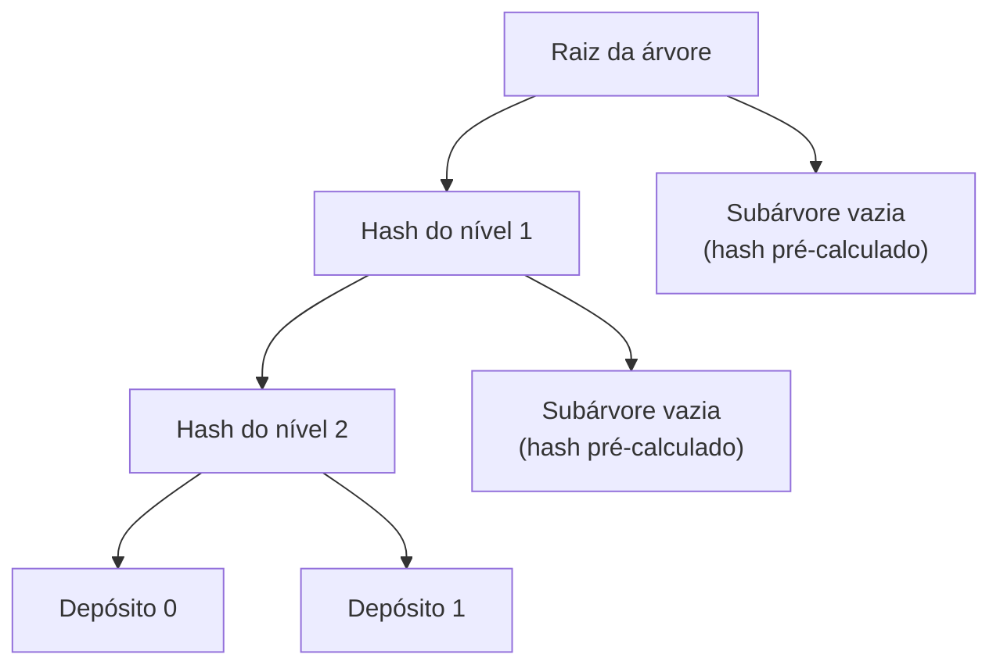
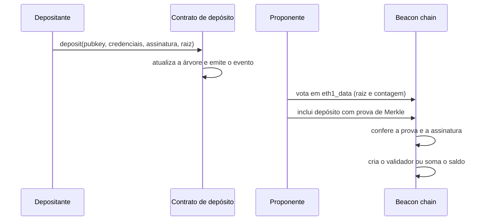

# Capítulo 71: O Contrato de Depósito do Staking e a Árvore de Merkle Incremental

Todo validador do Ethereum nasce de uma transação comum: alguém envia ETH para um contrato em um endereço fixo e a camada de consenso, que é outra máquina de estados, precisa ficar sabendo disso. O Capítulo 2 mostrou o que um validador faz depois de ativo e o Capítulo 40 tratou da mudança da EIP-6110, que trouxe os depósitos para dentro do bloco. Este capítulo olha para o começo da história: o que o contrato de depósito guarda, por que ele usa uma árvore de Merkle incremental (parente próxima da árvore do Capítulo 70) e como a beacon chain confere, depósito por depósito, se o que chegou é legítimo.

**O problema que o contrato resolve.** A camada de execução e a camada de consenso são duas cadeias com estados separados. O ETH que entra no staking vive na primeira, mas os validadores são registrados na segunda. Era preciso uma ponte que fosse barata para quem deposita, simples de auditar e capaz de ser verificada pelo consenso sem confiar em ninguém. A solução da especificação da fase 0 foi um contrato que quase não valida nada e que, em troca, mantém um resumo criptográfico de todos os depósitos já feitos. O endereço na mainnet é `0x00000000219ab540356cBB839Cbe05303d7705Fa`.

**O que a chamada de depósito recebe.** A função `deposit` aceita quatro argumentos: a chave pública do validador (`pubkey`), as credenciais de saque (`withdrawal_credentials`), uma assinatura e a raiz esperada dos dados do depósito (`deposit_data_root`). Os três primeiros preenchem uma estrutura chamada `DepositData`; o quarto serve de proteção contra dados malformados, porque o contrato recalcula a raiz e compara. Segundo a especificação, o contrato faz pouca validação: ele não confere a assinatura BLS12-381 e não valida o conteúdo das credenciais de saque, cujo primeiro byte é um prefixo que define o significado dos outros 31 (assunto dos Capítulos 40 e 49). O valor enviado, arredondado para baixo em Gwei, precisa ser de pelo menos `MIN_DEPOSIT_AMOUNT`, que nos presets vale 1 bilhão de Gwei, ou seja, 1 ETH.

**Prova de posse da chave, feita do outro lado.** Se o contrato não verifica a assinatura, quem verifica? A beacon chain. Pela especificação, a assinatura cobre uma `DepositMessage` (chave pública, credenciais e quantia) e funciona como prova de posse: mostra que quem depositou controla a chave privada daquela chave pública. Há dois detalhes de desenho.

| Situação | O que a beacon chain faz |
| --- | --- |
| Chave pública nova, assinatura válida | Cria o validador, com saldo efetivo arredondado e limitado pelo teto da época |
| Chave pública nova, assinatura inválida | Não cria validador e não credita nada; o depósito conta como processado |
| Chave pública já registrada (aporte adicional) | Soma a quantia ao saldo; a assinatura não é checada e as credenciais do novo depósito são ignoradas |

O segundo caso explica um alerta frequente: enviar um depósito com assinatura inválida não devolve o dinheiro, ele simplesmente não gera validador. O terceiro caso mostra que um aporte extra não consegue trocar as credenciais de saque de um validador existente. Além disso, o domínio da assinatura (`DOMAIN_DEPOSIT`) é calculado sem versão de fork nem raiz de genesis, com o comentário de que o domínio é "fork-agnostic" porque os depósitos valem entre forks: um depósito assinado antes de uma atualização continua verificável depois dela.

**A árvore de Merkle incremental.** O contrato precisa que a beacon chain possa provar, com poucos bytes, que um depósito específico foi feito. Para isso, cada depósito vira uma folha de uma árvore de Merkle de profundidade 32 (`DEPOSIT_CONTRACT_TREE_DEPTH` igual a 2^5), e o contrato mantém a raiz atualizada. A dificuldade é o custo: guardar a árvore inteira em armazenamento seria caro. A especificação descreve a saída como um algoritmo progressivo de cálculo da raiz que exige apenas armazenamento da ordem de log(n). A ideia, em termos conceituais, é que as folhas entram sempre à direita, em ordem. Para atualizar a raiz basta lembrar, em cada nível, o nó da esquerda que ainda espera um irmão; os trechos ainda vazios da árvore são representados por hashes pré-calculados de subárvores vazias. Assim, inserir a n-ésima folha mexe em no máximo 32 posições, não importa quantos depósitos já existam.



*Visão reduzida de uma árvore com poucos depósitos: o que ainda não foi preenchido é substituído por hashes de subárvores vazias, e só os nós da borda esquerda precisam ficar guardados.*

**O acréscimo do tamanho na raiz.** Existe uma sutileza na raiz que o contrato entrega. A especificação da beacon chain verifica cada prova com profundidade `DEPOSIT_CONTRACT_TREE_DEPTH + 1`, com o comentário "Add 1 for the List length mix-in". Isso quer dizer que a raiz final mistura o número de depósitos ao hash da árvore, como numa lista SSZ. Em termos de fórmula:

```latex
raiz_do_deposito = hash( raiz_da_arvore(profundidade 32) , numero_de_depositos )
```

Misturar o tamanho impede que duas listas diferentes, uma com mais folhas vazias que a outra, produzam a mesma raiz, e permite que a beacon chain saiba, junto com a raiz, quantos depósitos esperar.

**Como o consenso confere cada depósito.** Na fase 0, o caminho era assim. Os proponentes votavam em um `eth1_data` (que carrega a raiz de depósitos e a contagem), e o valor que obtivesse mais da metade dos votos do período passava a ser o oficial. Os blocos da beacon chain então traziam depósitos acompanhados de provas de Merkle, e a função `process_deposit` conferia cada prova contra a raiz, incrementava o índice e passava os dados adiante. O índice é consumido em ordem estrita: "Deposits must be processed in order", diz a especificação. Um bloco precisa incluir exatamente tantos depósitos pendentes quantos houver, até o máximo de 16 por bloco.



*O depósito percorre as duas camadas: o contrato registra, o voto torna a raiz oficial e a beacon chain verifica a prova antes de criar o validador.*

**O custo do voto: a espera de cerca de 12 horas.** A votação em `eth1_data` tinha um preço. Segundo a EIP-6110, o mecanismo antigo levava cerca de 12 horas para processar um depósito, contra cerca de 13 minutos no desenho proposto, além de depender de consultas JSON-RPC e de manter snapshots do contrato (EIP-4881). O período de votação da especificação usa `EPOCHS_PER_ETH1_VOTING_PERIOD` de 64 épocas, e a exigência de maioria (`count * 2 > EPOCHS_PER_ETH1_VOTING_PERIOD * SLOTS_PER_EPOCH`) soma-se a uma distância de seguimento grande para evitar que uma reorganização da camada de execução desfaça um depósito já aceito.

**A virada da EIP-6110.** A solução trazida pela EIP-6110, ativada na Pectra (Capítulo 40), foi tirar a votação do caminho. O cliente de execução lê os recibos do bloco, filtra os logs cujo endereço é o do contrato e cujo primeiro tópico é o hash da assinatura do evento (`0x649bbc62...38c5`), valida o layout de 576 bytes do evento (o capítulo 68 explica como logs funcionam) e transforma cada um em uma requisição de depósito de 192 bytes, com chave pública, credenciais, quantia, assinatura e índice. Essas requisições são entregues à camada de consenso dentro do próprio bloco, via EIP-7685. A transição se completa quando o índice de depósitos da votação antiga alcança o `deposit_requests_start_index` guardado no estado, momento em que os clientes podem aposentar a votação. A EIP também faz contas de segurança: o histórico tinha 1.899.120 depósitos, cerca de 348 MB, e a EIP estima que um bloco de 30 milhões de gás comportaria no mínimo 1.916 depósitos em seu cenário de pior caso.

| Aspecto | Antes (votação em eth1_data) | Depois (EIP-6110) |
| --- | --- | --- |
| Quem informa o depósito à beacon chain | Votos de proponentes, mais prova de Merkle | O próprio bloco de execução |
| Demora aproximada | cerca de 12 horas | cerca de 13 minutos |
| Dependência de JSON-RPC e snapshots | sim | não |
| Onde está a confiança | na maioria dos votos | na validação do bloco |

**Limites e cuidados.** O contrato não tem função de saque: o ETH depositado só volta pela camada de consenso, por meio dos mecanismos de saída e saque vistos nos Capítulos 2 e 40. Enviar ETH por transferência comum ao endereço, fora da função `deposit`, não é um caminho válido de staking. Também vale lembrar que a árvore guarda apenas depósitos, não o estado dos validadores; o quadro completo de quem está ativo vive no estado da beacon chain, não no contrato. Por fim, toda essa engenharia mostra um padrão recorrente do Ethereum: o contrato fica propositalmente bobo, e a inteligência (assinatura, regras de saldo, ordem) fica na camada de consenso, onde é mais fácil de evoluir por hard fork.

**Glossário do capítulo.**

- **Contrato de depósito**: contrato no endereço `0x00000000219ab540...05Fa` que recebe o ETH do staking e registra cada depósito em uma árvore de Merkle.
- **DepositData**: estrutura com chave pública, credenciais de saque, quantia e assinatura de um depósito.
- **Prova de posse (proof of possession)**: assinatura que demonstra que o depositante controla a chave privada da chave pública informada; verificada pela beacon chain, não pelo contrato.
- **Árvore de Merkle incremental**: árvore de profundidade 32 em que as folhas entram em ordem e a raiz é atualizada guardando apenas um nó por nível.
- **Mix-in de tamanho**: acréscimo do número de depósitos ao hash da raiz, razão da profundidade de verificação 33 na especificação.
- **eth1_data**: dado votado pelos proponentes que carrega a raiz de depósitos e a contagem no mecanismo antigo.
- **Credenciais de saque**: campo de 32 bytes cujo primeiro byte define como o saldo poderá ser sacado.
- **EIP-6110**: mudança que passou a entregar os depósitos à camada de consenso dentro do bloco de execução.
- **Requisição de depósito**: registro de 192 bytes extraído do log do contrato e enviado ao consenso via EIP-7685.

**Fontes.**

- [Especificação do contrato de depósito (consensus-specs, fase 0)](https://raw.githubusercontent.com/ethereum/consensus-specs/master/specs/phase0/deposit-contract.md)
- [Especificação da beacon chain (consensus-specs, fase 0): process_deposit, DOMAIN_DEPOSIT, presets](https://raw.githubusercontent.com/ethereum/consensus-specs/master/specs/phase0/beacon-chain.md)
- [EIP-6110: Supply Validator Deposits On Chain](https://raw.githubusercontent.com/ethereum/EIPs/master/EIPS/eip-6110.md)
