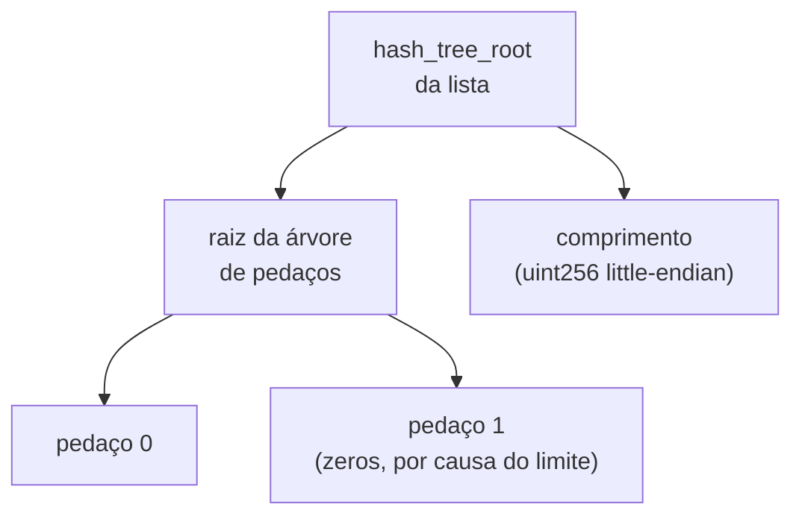
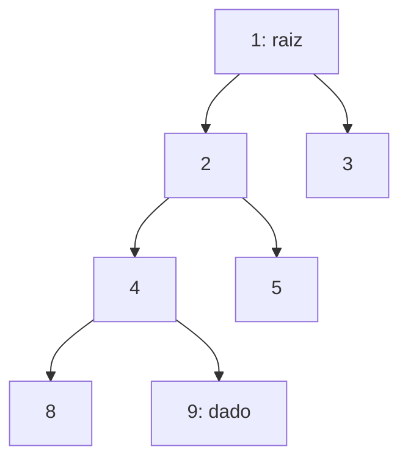

# Capítulo 72: SSZ, a Serialização e a Merkleização da Camada de Consenso

Quem lê sobre o Ethereum encontra, com frequência, a sigla RLP na camada de execução e a sigla SSZ na camada de consenso. O Capítulo 70 mostrou como o RLP codifica os nós da árvore Merkle Patricia, e o Capítulo 71 deixou uma pista: a raiz do contrato de depósito mistura o tamanho da lista "como numa lista SSZ". Este capítulo abre essa caixa. O SSZ (Simple Serialize) é o formato que a beacon chain usa para transformar objetos em bytes e, ao mesmo tempo, para calcular a raiz de hash desses objetos. Entender o SSZ explica por que blocos, atestações e o estado inteiro dos validadores podem ser resumidos em 32 bytes e provados em pedaços, base técnica dos clientes leves do Capítulo 60 e da camada de rede do Capítulo 66.

**Duas ferramentas num pacote só.** Segundo a documentação do ethereum.org, o SSZ substitui o RLP em toda a camada de consenso, com exceção do protocolo de descoberta de pares, e foi projetado para ser determinístico e para ser eficiente de merkleizar. Na prática ele tem dois componentes: um esquema de serialização, que gera bytes para armazenar e enviar pela rede, e um esquema de merkleização, que calcula a `hash_tree_root`, uma raiz de árvore de Merkle do objeto. A vantagem de pensar juntos os dois é que a forma como os bytes são organizados já antecipa como a árvore será montada. No RLP, a identidade de um objeto costuma ser o hash de seus bytes inteiros; no SSZ, o objeto é uma árvore, e cada campo ocupa uma posição previsível nela.

| Aspecto | RLP (camada de execução) | SSZ (camada de consenso) |
| --- | --- | --- |
| Tipagem | Só listas e sequências de bytes; o significado vem de fora | Tipos explícitos: inteiros de tamanho fixo, vetores, listas, contêineres |
| Auto-descritivo | Não | Não; exige o esquema conhecido de antemão |
| Raiz do objeto | Hash dos bytes serializados | `hash_tree_root`, calculada sobre uma árvore de Merkle |
| Prova de um campo isolado | Pouco natural | Natural, com índices generalizados |

**Os tipos.** A especificação define como tipos básicos os inteiros sem sinal de 8, 16, 32, 64, 128 e 256 bits, o `byte` e o `boolean`. Os tipos compostos são o contêiner (coleção ordenada de campos de tipos diferentes), o vetor (comprimento fixo, elementos do mesmo tipo), a lista (comprimento variável, mas limitado a um máximo N), o `Bitvector[N]`, o `Bitlist[N]` e a união. Um detalhe que costuma passar despercebido é que toda lista tem um limite no próprio tipo, escrito `List[tipo, N]`. Esse limite não custa nada na serialização, mas, como se verá, define a forma da árvore.

Também vale a distinção entre tipos de tamanho fixo e de tamanho variável. Pela especificação, são variáveis as listas, as uniões, o `Bitlist` e qualquer tipo que contenha um tipo variável; todos os outros são fixos.

**Serialização: little-endian e a regra dos deslocamentos.** Um inteiro de N bits vira N/8 bytes em ordem little-endian, e um booleano vira um único byte, `0x01` ou `0x00`. Para contêineres, vetores e listas, a regra tem duas partes. Primeiro vêm as partes fixas, na ordem dos campos: os campos de tamanho fixo aparecem por inteiro, e cada campo de tamanho variável é substituído por um deslocamento (offset) de 4 bytes (`BYTES_PER_LENGTH_OFFSET`). Depois vêm, no fim, os dados dos campos variáveis, um após o outro. O deslocamento diz em que posição, contada a partir do início do objeto serializado, os dados do campo começam.

Um exemplo calculado à mão deixa isso concreto. Seja um contêiner com três campos: `a` (um `uint64`) igual a 37, `b` (uma lista de `uint8`) igual a [1, 2, 3, 4] e `c` (outro `uint64`) igual a 22. A parte fixa ocupa 8 + 4 + 8 = 20 bytes, então o deslocamento de `b` vale 20, ou `0x14` em hexadecimal.

```text
25 00 00 00 00 00 00 00   a = 37 (8 bytes)
14 00 00 00               deslocamento de b = 20 (4 bytes)
16 00 00 00 00 00 00 00   c = 22 (8 bytes)
01 02 03 04               dados de b (4 bytes)
```

O resultado tem 24 bytes. Quem lê esse blob só consegue interpretá-lo com o esquema na mão, porque nomes de campos e tipos não viajam junto. É o que a documentação quer dizer ao chamar o SSZ de não auto-descritivo.

**Bitlists e o bit delimitador.** Uma lista de bits precisa carregar seu tamanho exato, mas os bits são empacotados em bytes, e o número de bytes não revela quantos bits eram válidos. A especificação resolve isso acrescentando um bit `1` logo depois do último bit da lista. Para a lista de bits [1, 0, 1], os bits nas posições 0 e 2 ficam ligados e o delimitador ocupa a posição 3, o que dá o binário `1101`, ou seja, o byte `0x0d`. Ao ler, o último bit ligado indica onde a lista termina. É assim que campos como os bits de participação de uma atestação agregada conseguem ter tamanho variável sem gastar um campo extra de comprimento.

**Desserialização: injetiva e desconfiada.** Como a serialização é injetiva, dois objetos distintos do mesmo tipo nunca geram os mesmos bytes, e um conjunto de bytes só pode ser lido de uma forma. Para listas de elementos variáveis, o primeiro deslocamento revela o número de elementos (dividindo-o por 4), e o tamanho de cada item sai da diferença entre deslocamentos vizinhos. A própria especificação lembra que a leitura precisa ser endurecida contra entradas inválidas: deslocamentos fora de ordem ou fora do intervalo, bytes sobrando e listas com mais elementos do que o limite permite. Em um sistema de consenso, aceitar uma codificação "quase válida" poderia fazer dois clientes discordarem sobre o mesmo bloco.

**Merkleização: da serialização à raiz.** O cálculo da `hash_tree_root` segue passos que a especificação nomeia. O `pack` serializa valores básicos, completa com zeros à direita até um múltiplo de 32 bytes e os divide em pedaços ("chunks") de 32 bytes (`BYTES_PER_CHUNK`). O `merkleize` junta esses pedaços como folhas de uma árvore binária, preenchendo com pedaços de zeros até a próxima potência de dois; se há um limite, o preenchimento vai até a próxima potência de dois do limite. O `mix_in_length` aplica ao final, nas listas, um hash da raiz concatenada com o comprimento real da lista. As regras por tipo ficam assim: básicos e vetores de básicos viram `merkleize(pack(...))`; contêineres e vetores de tipos compostos merkleizam a lista das `hash_tree_root` de cada campo ou elemento; listas fazem a mesma coisa com o limite e acrescentam o comprimento.

```latex
hash\_tree\_root(lista) = hash( merkleize(chunks, limite) \,\|\, comprimento )
```

O ponto sutil é a palavra "limite". Uma `List[uint64, 8]` com três elementos ocupa 24 bytes, que cabem em 1 pedaço. Mas o número de pedaços do tipo é `(8 × 8 + 31) // 32 = 2`, então a árvore tem profundidade 1, com o segundo pedaço de zeros, e só depois entra o comprimento (3). Se alguém acrescentar elementos à lista, a forma da árvore não muda, apenas o conteúdo das folhas. Isso é o que permite a uma lista com limite enorme, como a de validadores da beacon chain, ter uma raiz estável e provas com formato previsível, e é o mesmo mecanismo de "mix-in" que o Capítulo 71 encontrou na raiz do contrato de depósito.



*O desenho mostra uma lista com limite: a árvore é montada com a profundidade que o limite exige, e o comprimento real é misturado por último, de modo que listas de tamanhos diferentes nunca produzam a mesma raiz.*

**Índices generalizados e provas.** A segunda grande vantagem do SSZ é poder provar um único campo sem revelar o objeto inteiro. A especificação numera os nós da árvore com um índice generalizado: a raiz é 1, e os filhos do nó k são 2k e 2k+1. Equivalentemente, o índice de um nó é `2^profundidade + posição na linha`. Essa numeração torna simples descrever "o caminho" de um campo aninhado, como `estado.validadores[5].saldo`, como um único número. Para provar um nó, basta fornecer os irmãos ao longo do caminho até a raiz. O exemplo do ethereum.org é uma árvore de 8 folhas: para provar o dado do índice 9, são necessários os hashes dos índices 8, 5 e 3, além da raiz 1. O hash de (8, 9) deve igualar o nó 4, que com o 5 gera o 2, que com o 3 gera a raiz. Se o dado do índice 9 estiver errado, a raiz calculada muda e a prova falha. A especificação também descreve multiprovas, que verificam vários campos de uma vez compartilhando os nós em comum.



*Para provar o nó 9 contra a raiz 1, o verificador usa o irmão 8, o irmão 5 e o irmão 3; cada hash sobe um nível, e a raiz final precisa coincidir com a que a rede já aceita.*

**Resumos e expansões.** A especificação define ainda que, se se substitui parte dos campos de um objeto pelas suas raízes de hash, obtém-se um "resumo" cuja `hash_tree_root` é idêntica à do objeto original. O exemplo dado é o cabeçalho do bloco da beacon chain, que é um resumo do bloco completo. É essa propriedade que permite assinar e referenciar o cabeçalho, leve, com a garantia de estar comprometido com o bloco inteiro. É também o princípio por trás dos clientes leves do Capítulo 60: um cabeçalho de 32 bytes de raiz de estado mais uma prova curta basta para verificar um dado específico.

**Cuidados.** Primeiro, o SSZ não é auto-descritivo, então uma mudança de esquema (como novos campos num fork) exige que todos os clientes concordem na versão do tipo; por isso há tipos diferentes para cada fork na especificação. Segundo, o repositório oficial da especificação do SSZ evoluiu: a documentação mais recente descreve também tipos "progressivos" (listas e contêineres cujo formato da árvore não depende de um limite fixo), mas, como a especificação em uso na camada de consenso é a descrita acima, este capítulo se limita a ela. Terceiro, a relação entre o SSZ e a camada de execução é parcial: transações e blocos de execução continuam usando RLP, e é o cliente de consenso que embrulha o payload de execução em contêineres SSZ.

**Glossário do capítulo.**

- **SSZ (Simple Serialize)**: formato de serialização e de merkleização usado na camada de consenso do Ethereum.
- **Esquema (schema)**: descrição dos tipos e da ordem dos campos, necessária para ler bytes SSZ, já que o formato não é auto-descritivo.
- **Deslocamento (offset)**: número de 4 bytes que aponta, dentro dos bytes serializados, para onde começam os dados de um campo de tamanho variável.
- **Little-endian**: ordem de bytes em que o byte menos significativo vem primeiro.
- **Bitlist**: lista de bits de tamanho variável, serializada com um bit delimitador `1` logo após o último bit.
- **Pedaço (chunk)**: bloco de 32 bytes que serve de folha da árvore de Merkle.
- **hash_tree_root**: raiz de hash que resume um objeto SSZ, calculada por merkleização recursiva.
- **Mix-in de comprimento**: hash final da raiz com o comprimento real da lista, que distingue listas de tamanhos diferentes.
- **Índice generalizado**: número que identifica um nó da árvore (raiz igual a 1, filhos 2k e 2k+1).
- **Multiprova**: prova que verifica vários nós de uma só vez, compartilhando os hashes comuns.

**Fontes.**

- [ethereum.org: Simple serialize (SSZ)](https://github.com/ethereum/ethereum-org-website/blob/dev/public/content/developers/docs/data-structures-and-encoding/ssz/index.md)
- [Especificação SimpleSerialize (consensus-specs, v1.5.0)](https://raw.githubusercontent.com/ethereum/consensus-specs/v1.5.0/ssz/simple-serialize.md)
- [Provas de Merkle e índices generalizados (consensus-specs, v1.5.0)](https://raw.githubusercontent.com/ethereum/consensus-specs/v1.5.0/ssz/merkle-proofs.md)
- [ethereum/ssz-specs (README)](https://raw.githubusercontent.com/ethereum/ssz-specs/main/README.md)
- [Especificação da beacon chain (fase 0), com a referência ao SSZ](https://raw.githubusercontent.com/ethereum/consensus-specs/master/specs/phase0/beacon-chain.md)
