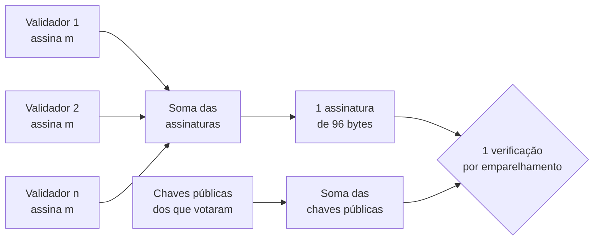
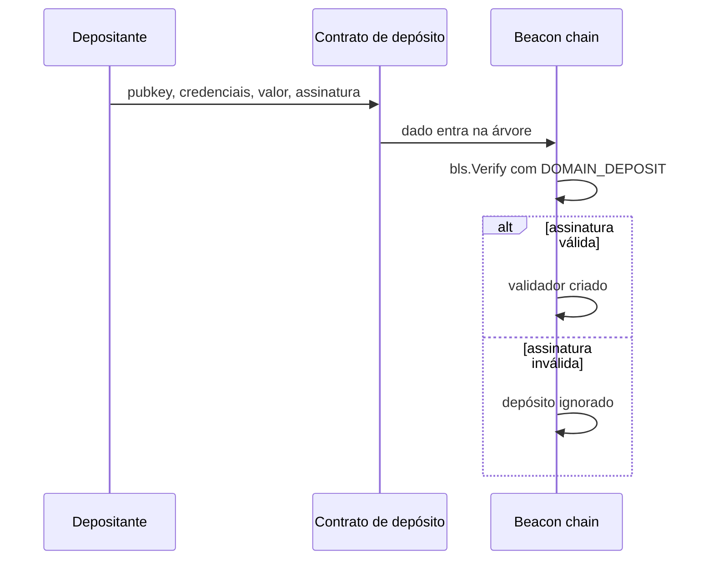

# Capítulo 73: Assinaturas BLS, a Matemática que Permite Somar Votos de Validadores

Nos capítulos sobre consenso, uma frase aparece várias vezes sem ser aberta: "as atestações são agregadas com assinaturas BLS". O Capítulo 2 apresentou a ideia, o Capítulo 66 mostrou os agregadores trabalhando nas sub-redes, o Capítulo 71 mencionou a prova de posse que a beacon chain confere em cada depósito e o Capítulo 44 lembrou que essa família de curvas elípticas é vulnerável a um computador quântico. Este capítulo fecha a lacuna e explica o que é uma assinatura BLS, por que somar assinaturas funciona, qual ataque ronda essa soma e como a especificação do consenso se defende dele.

**O problema que a agregação resolve.** Uma assinatura serve para provar que o dono de uma chave aprovou uma mensagem. Na camada de execução, o Ethereum usa ECDSA para as transações das contas comuns (Capítulo 26): cada assinatura é verificada sozinha, e não há como juntar duas em uma menor. Na camada de consenso a situação é outra. Cada validador precisa assinar uma atestação a cada época, e todos os votos de um comitê são sobre o mesmo dado. Se cada voto viajasse e fosse armazenado com a sua assinatura própria, a rede carregaria um volume enorme de bytes redundantes. O que se quer é uma assinatura única que valha pelo grupo todo. É exatamente isso que o BLS oferece.

**A curva e os tamanhos.** O Ethereum usa a curva BLS12-381. Segundo a EIP-2537, ela é uma curva de forma de Weierstrass com `y² = x³ + 4` no grupo G1, definida sobre um corpo de módulo primo de 381 bits, e oferece cerca de 120 bits de segurança ou mais, contra cerca de 80 bits da curva BN254 que já tinha precompile na EVM. A especificação de consenso adota a variante do rascunho do IETF em que as chaves públicas ficam em G1 e as assinaturas em G2, o que dá chaves públicas de 48 bytes (`BLSPubkey`, `Bytes48`) e assinaturas de 96 bytes (`BLSSignature`, `Bytes96`). O rascunho recomenda justamente essa variante, de chave pública pequena, para quem usa agregação, porque as chaves públicas dominam o volume de dados que se manipula. A suíte usada pela especificação é `BLS_SIG_BLS12381G2_XMD:SHA-256_SSWU_RO_POP_`, e o sufixo `POP` já entrega o assunto de uma seção adiante: a prova de posse.

| Aspecto | ECDSA nas transações | BLS na camada de consenso |
| --- | --- | --- |
| Quem assina | Contas comuns (EOAs) | Validadores |
| Pode juntar várias assinaturas em uma | Não | Sim, somando pontos da curva |
| Tamanho da chave pública | Aparece como endereço de 20 bytes derivado dela | 48 bytes |
| Tamanho da assinatura | 65 bytes no formato usado nas transações | 96 bytes, mesmo agregada |
| Uso típico | Autorizar transações | Atestações, blocos, RANDAO, saída voluntária |

*A tabela contrasta o que cada esquema faz bem: o ECDSA é compacto para uma assinatura isolada, e o BLS compensa o tamanho maior com a capacidade de juntar milhares de assinaturas em uma só.*

**Como a soma funciona, sem entrar na álgebra pesada.** A ideia cabe em três passos. A chave privada é um número `sk`, e a chave pública é esse número aplicado a um ponto fixo da curva, `pk = sk · G`. Para assinar uma mensagem `m`, o signatário leva a mensagem a um ponto da curva por uma função de hash (`H(m)`) e multiplica esse ponto pela chave privada, obtendo `σ = sk · H(m)`. Para verificar, usa-se o emparelhamento (pairing), uma operação especial de curvas como a BLS12-381 que transforma dois pontos em um valor que se pode comparar. A conferência é uma igualdade entre dois emparelhamentos.

```latex
e(pk, H(m)) = e(G, \sigma)

\sigma_{agregada} = \sigma_1 + \sigma_2 + \dots + \sigma_n
\qquad
pk_{agregada} = pk_1 + pk_2 + \dots + pk_n
```

Como o emparelhamento é linear em cada argumento, se todas as assinaturas forem sobre a mesma mensagem, a soma das assinaturas se verifica contra a soma das chaves públicas pela mesma igualdade. O rascunho do IETF descreve essa otimização: quando todos os signatários assinam a mesma mensagem, basta somar as chaves públicas e fazer uma única verificação. É a função `FastAggregateVerify`, que a especificação usa para as atestações. O tamanho da assinatura agregada continua sendo de 96 bytes, não importa quantos votos entraram na soma.



*O desenho mostra que muitos votos sobre a mesma mensagem viram uma assinatura só e uma chave pública somada, e que a verificação final é uma conferência única.*

**Como isso aparece na atestação.** Na especificação da beacon chain, uma `Attestation` traz três coisas: `aggregation_bits`, `data` e `signature`. O campo `aggregation_bits` é uma lista de bits (o bitlist do Capítulo 72) em que cada posição corresponde a um membro do comitê, e o bit ligado indica que aquele validador assinou. Quem verifica reconstrói a lista dos validadores presentes a partir desses bits, exige que os índices sejam ordenados e sem repetição, junta as chaves públicas e chama `FastAggregateVerify` sobre a raiz de assinatura do dado de atestação. Os bits dizem quem participou, e a assinatura única prova que todos eles realmente assinaram. A soma acontece em dois momentos: os agregadores das sub-redes (Capítulo 66) juntam os votos do comitê, e o proponente do bloco inclui no bloco as atestações já agregadas.

**Domínios, ou por que uma assinatura não serve para tudo.** Um validador assina coisas muito diferentes com a mesma chave: propostas de bloco, atestações, o `randao_reveal` (Capítulo 64), depósitos e saídas voluntárias. Se a mesma sequência de bytes pudesse ser lida em dois contextos, uma assinatura feita para um fim poderia ser reaproveitada em outro. Para impedir isso, a especificação nunca assina o objeto direto. A função `compute_signing_root` calcula a `hash_tree_root` de uma estrutura `SigningData` que junta a raiz do objeto com um domínio. O domínio, por sua vez, é formado por um tipo de 4 bytes e por parte de um resumo da versão do fork e da raiz dos validadores do gênesis. As constantes de tipo são:

| Tipo de domínio | Valor | Onde é usado |
| --- | --- | --- |
| `DOMAIN_BEACON_PROPOSER` | `0x00000000` | Assinatura de blocos |
| `DOMAIN_BEACON_ATTESTER` | `0x01000000` | Atestações |
| `DOMAIN_RANDAO` | `0x02000000` | Revelação do RANDAO |
| `DOMAIN_DEPOSIT` | `0x03000000` | Prova de posse no depósito |
| `DOMAIN_VOLUNTARY_EXIT` | `0x04000000` | Saída voluntária |
| `DOMAIN_SELECTION_PROOF` | `0x05000000` | Sorteio de agregadores |
| `DOMAIN_AGGREGATE_AND_PROOF` | `0x06000000` | Publicação do agregado |

*Cada tipo de mensagem tem seu próprio domínio, de modo que uma assinatura de atestação nunca é válida como assinatura de bloco, e vice-versa.*

Incluir a versão do fork e a raiz dos validadores do gênesis no domínio cumpre outro papel: uma assinatura feita numa rede (a mainnet, uma testnet) ou numa versão de protocolo não vale em outra. A exceção intencional é o depósito, que usa um domínio agnóstico ao fork, calculado só com o tipo, porque um depósito precisa continuar válido através de hard forks, já que é feito antes de o validador existir na beacon chain.

**O ataque da chave desonesta e a prova de posse.** A soma de chaves públicas tem uma armadilha. Se um atacante puder escolher a própria chave pública depois de ver as chaves dos outros, ele consegue fabricar uma chave "desonesta" (rogue key) construída de forma a cancelar as chaves honestas na soma. O resultado é que a chave agregada passa a ser, na prática, uma chave que ele controla sozinho, e ele consegue produzir uma assinatura agregada que parece vir de todos os signatários, sem que eles tenham assinado nada. O rascunho do IETF descreve três maneiras de evitar isso: exigir que as mensagens de um agregado sejam todas distintas (esquema básico), fazer cada signatário assinar a mensagem junto com a própria chave pública (aumento de mensagem), ou exigir uma prova de posse para cada chave pública. Só a terceira permite o atalho de somar chaves para a mesma mensagem, e o rascunho é taxativo: toda chave pública passada ao `FastAggregateVerify` deve ter uma prova de posse correspondente.

É por isso que o Ethereum usa a suíte com sufixo `POP`. A prova de posse da beacon chain é o próprio ato de assinar no depósito: na função `apply_deposit`, a especificação confere, para um validador novo, a assinatura do depósito com `bls.Verify`, e o comentário diz que essa assinatura (a prova de posse) não é verificada pelo contrato de depósito. Foi o que o Capítulo 71 deixou indicado. O contrato só acumula os depósitos na árvore, e a verificação acontece do lado do consenso. Se a assinatura for inválida, o depósito não cria validador, e a especificação não trata isso como erro: simplesmente ignora. Se a chave pública já existe, o saldo cresce sem nova verificação. Assim, nenhuma chave entra no conjunto de validadores sem que seu dono tenha provado conhecer a chave privada, e o ataque da chave desonesta fica sem porta de entrada.



*A prova de posse é conferida pela beacon chain, e não pelo contrato, e o resultado de uma conferência falha é ignorar o depósito.*

**Detalhes de implementação que a especificação carrega.** A fase Altair acrescentou duas funções auxiliares para as sync committees (Capítulo 60). A primeira, `eth_aggregate_pubkeys`, soma chaves públicas depois de checar cada uma com `KeyValidate`, que rejeita chaves inválidas. A segunda, `eth_fast_aggregate_verify`, é um envoltório do `FastAggregateVerify` que aceita um caso especial: uma lista vazia de chaves com a assinatura do ponto no infinito de G2, representada por `0xc0` seguido de zeros. Fora esse caso, repassa tudo à função padrão. A especificação consultada não explica a razão da exceção, apenas descreve o comportamento, então este capítulo também se limita a registrar que ela existe.

**Das assinaturas à EVM.** A mesma curva está disponível para contratos. A EIP-2537, com status Final, adiciona sete precompiles nos endereços de `0x0b` a `0x11`: soma em G1 e em G2, multiplicação multiescalar (MSM) em G1 e em G2, verificação de emparelhamento, e mapeamentos de elementos do corpo para G1 e G2. O custo de gás da verificação de emparelhamento é de `32600·k + 37700`, em que `k` é o número de pares. A EIP define também que um elemento do corpo ocupa 64 bytes (com os 16 primeiros zerados), que um ponto de G1 ocupa 128 bytes e um de G2, 256. Na prática, isso permite que contratos verifiquem provas e assinaturas dessa curva, e é uma peça de que sistemas como verificadores de clientes leves (Capítulo 60) e provas de conhecimento zero (Capítulo 55) se beneficiam. Os compromissos KZG dos blobs (Capítulo 34) usam a mesma família de curvas.

**Limites e cuidados.** Primeiro, a agregação só vale para o esquema de prova de posse: copiar o `FastAggregateVerify` para outro contexto sem exigir provas de posse reabre a porta do ataque da chave desonesta. Segundo, a segurança do BLS repousa em problemas de logaritmo discreto em curvas elípticas, o que o coloca entre as peças afetadas pelo algoritmo de Shor, tema do Capítulo 44, e por isso as propostas pós-quânticas discutidas ali procuram assinaturas alternativas para os validadores. Terceiro, a assinatura em si não impede o mau comportamento: o que pune um validador que assina duas coisas conflitantes são as regras de slashing (Capítulo 63), e é a assinatura BLS que torna a prova do delito publicamente verificável. Quarto, as versões do rascunho do IETF continuam evoluindo, e a especificação de consenso consultada cita a versão 4 do rascunho, então detalhes de formato devem ser conferidos na versão vigente antes de implementar.

**Glossário do capítulo.**

- **BLS12-381**: curva elíptica com emparelhamento usada pelas assinaturas dos validadores, com corpo primo de 381 bits.
- **Emparelhamento (pairing)**: operação que leva dois pontos de curvas a um valor comparável e permite verificar uma assinatura BLS por uma igualdade.
- **Agregação**: soma de várias assinaturas (ou chaves públicas) em um único ponto da curva, de tamanho constante.
- **FastAggregateVerify**: verificação de uma assinatura agregada sobre a mesma mensagem, contra a soma das chaves públicas.
- **Chave desonesta (rogue key)**: chave pública fabricada pelo atacante para cancelar as chaves honestas na soma e forjar um agregado.
- **Prova de posse (proof of possession)**: demonstração de que o dono de uma chave pública conhece a chave privada correspondente, exigida pela beacon chain no depósito.
- **aggregation_bits**: bitlist da atestação que marca quais membros do comitê assinaram.
- **Domínio de assinatura**: tipo de 4 bytes mais resumo de fork e gênesis, misturado à raiz assinada para separar contextos.
- **Raiz de assinatura (signing root)**: `hash_tree_root` do objeto combinado com o domínio, que é de fato o que o validador assina.
- **MSM (multiplicação multiescalar)**: operação de somar vários pontos multiplicados por escalares, oferecida como precompile pela EIP-2537.

**Fontes.**

- [EIP-2537: Precompile for BLS12-381 curve operations](https://raw.githubusercontent.com/ethereum/EIPs/master/EIPS/eip-2537.md)
- [Especificação da beacon chain, fase 0 (consensus-specs, v1.5.0)](https://raw.githubusercontent.com/ethereum/consensus-specs/v1.5.0/specs/phase0/beacon-chain.md)
- [Extensões de BLS da Altair (consensus-specs, v1.5.0)](https://raw.githubusercontent.com/ethereum/consensus-specs/v1.5.0/specs/altair/bls.md)
- [ethereum.org: Atestações](https://raw.githubusercontent.com/ethereum/ethereum-org-website/dev/public/content/developers/docs/consensus-mechanisms/pos/attestations/index.md)
- [IETF CFRG: rascunho de assinaturas BLS, versão 07](https://raw.githubusercontent.com/cfrg/draft-irtf-cfrg-bls-signature/master/draft-irtf-cfrg-bls-signature-07.txt)
- [Repositório do rascunho de BLS do CFRG](https://github.com/cfrg/draft-irtf-cfrg-bls-signature)
