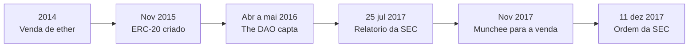

# Capítulo 74: O Boom das ICOs de 2017, Quando Qualquer Contrato Virou Captação e a Regulação Respondeu

Quando se olha o Ethereum de hoje, com rollups, staking e provas de conhecimento zero, é fácil esquecer que parte da popularidade inicial da rede veio de algo bem mais simples: a facilidade de criar um token e vendê-lo ao público. Este capítulo conta essa história. Ele liga o padrão ERC-20 (Capítulo 22), a experiência da The DAO (Capítulo 20), as regras de emissão e vesting (Capítulo 18) e os golpes (Capítulo 27) em um único episódio, o das ofertas iniciais de moedas, as ICOs, e da resposta dos reguladores americanos.

**O precedente: a venda de ether de 2014.** A primeira grande venda pública de um ativo do ecossistema foi a do próprio ether, descrita no Capítulo 1. Segundo o blog oficial do Ethereum, a venda durou 42 dias, com preço de 2.000 ETH por bitcoin nos primeiros 14 dias e queda linear depois, até 1.337 ETH por bitcoin, e se encerrou em 2 de setembro de 2014. O total arrecadado em bitcoin aparece com valores diferentes conforme a fonte, então este capítulo não fixa um número. O que importa aqui é o modelo: um projeto sem produto pronto vende antecipadamente os direitos sobre uma unidade que só terá utilidade depois que a rede existir.

**O que tornou o Ethereum o palco das ICOs.** Uma ICO é, em essência, um contrato inteligente que recebe ether (ou bitcoin) e, em troca, registra saldos de um token novo. Antes de 2015, cada token tinha uma interface própria e cada carteira ou corretora precisava de código sob medida. O padrão ERC-20, criado em novembro de 2015 por Fabian Vogelsteller e Vitalik Buterin, definiu funções comuns como `balanceOf`, `transfer`, `approve` e `transferFrom`, além dos eventos `Transfer` e `Approval`. Com isso, qualquer equipe podia publicar um contrato quase idêntico ao de outras e ter o token aceito por carteiras e exchanges sem trabalho adicional. O custo de lançar um token caiu a ponto de caber em um fim de semana de programação, e esse foi o combustível técnico do boom.

**A escala do fenômeno.** Estimativas do total captado em 2017 variam conforme a metodologia. Um estudo acadêmico de Fenu e coautores, publicado pelo IEEE, fala em mais de 4 bilhões de dólares nos últimos oito meses de 2017 e examina 1.387 ICOs. A Ernst & Young, com uma amostra de 372 ICOs, falou em algo próximo de 4 bilhões, e a imprensa especializada chegou a cifras de cerca de 3,5 bilhões. A ordem de grandeza segura, portanto, é "alguns bilhões de dólares em um único ano". A participação do Ethereum também depende da base: a E&Y apontou cerca de 70% dos tokens em sua amostra, enquanto outras contagens chegam a mais de 80%. Em qualquer delas, a maioria das ICOs rodava sobre contratos ERC-20.



*A linha do tempo mostra como o padrão técnico, o primeiro grande experimento de captação on-chain e as duas manifestações centrais da SEC se encadeiam em pouco mais de três anos.*

**A anatomia de uma ICO.** A mecânica típica tinha poucas peças. O contrato de venda recebia ETH e distribuía tokens a uma taxa fixa ou por faixas de preço. Havia um teto de arrecadação (hard cap), às vezes um piso (soft cap) abaixo do qual o dinheiro era devolvido, e uma parcela de tokens reservada à equipe e a consultores, com ou sem vesting (Capítulo 18). O preço implícito de cada token era simplesmente a razão entre o que foi aportado e o que foi vendido, e o valor "de mercado" anunciado costumava ser esse preço multiplicado pela oferta total, inclusive a parte que ainda não circulava.

```latex
P_{\text{implícito}} = \frac{E_{\text{arrecadado}}}{N_{\text{vendidos}}}
\qquad
\text{FDV} = P \times N_{\text{total}}
```

*A primeira expressão dá o preço médio pago pelos compradores; a segunda mostra o valor totalmente diluído, que pode ser muito maior que o arrecadado quando a maior parte da oferta ficou com a equipe ou em reserva.*

**Os problemas que o modelo trouxe.** Vender uma promessa por um contrato aberto, sem prospecto, sem auditoria obrigatória e sem verificação de quem compra, abriu espaço para vários problemas. Havia projetos sem produto, páginas falsas de ICOs, contratos com bugs que travavam ou desviavam fundos e comunicação de marketing que prometia retorno. Os mecanismos de golpe descritos no Capítulo 27, como personificação e páginas clonadas, encontraram terreno fértil, e os incidentes de contrato do Capítulo 33 mostram o outro lado, o de erros honestos de código que custaram dinheiro de verdade.

**A resposta regulatória: o Relatório da DAO.** Em 25 de julho de 2017, a SEC, a autoridade de valores mobiliários dos Estados Unidos, publicou um relatório de investigação sobre a The DAO (Capítulo 20). O documento registra que, entre 30 de abril e 28 de maio de 2016, a The DAO ofereceu e vendeu cerca de 1,15 bilhão de tokens DAO em troca de aproximadamente 12 milhões de ether. A conclusão foi que esses tokens eram valores mobiliários, com base no teste de Howey, que pergunta se há investimento de dinheiro, em empreendimento comum, com expectativa de lucro derivado dos esforços de terceiros. O relatório também deixou um recado geral: quem usasse uma DAO ou outro meio baseado em blockchain para captar dinheiro precisava observar a lei de valores mobiliários. A forma tecnológica não mudava a substância econômica.

**O caso Munchee e o fim do rótulo "utility".** Depois do relatório, muitas equipes passaram a chamar seus tokens de "utility tokens", apostando que um token com função no produto ficaria fora da lei de valores mobiliários. O caso Munchee testou essa ideia. A empresa, que criou um aplicativo de avaliação de refeições, buscava captar cerca de 15 milhões de dólares com o token MUN e parou a venda em 1º de novembro de 2017, depois de contato do corpo técnico da SEC. Em 11 de dezembro de 2017, a SEC emitiu uma ordem de cessar e desistir. O raciocínio central foi que a classificação não depende do rótulo, e sim da realidade econômica da operação. Mesmo que o token tivesse alguma utilidade prática no momento da oferta, isso não impedia que fosse um valor mobiliário, e o marketing da empresa, que sugeria valorização, pesou na análise. Os tokens não chegaram a ser entregues e os valores recebidos foram devolvidos. Chama atenção que a ordem não alegava fraude: o problema era a oferta sem registro ou isenção.

| Marco | Data | O que estabeleceu |
| --- | --- | --- |
| Venda de ether | 2014 | Modelo de vender uma unidade antes de a rede existir |
| ERC-20 | Nov 2015 | Interface comum que barateou a criação de tokens |
| The DAO | Abr a mai 2016 | Captação de cerca de 12 milhões de ETH por contrato |
| Relatório da DAO (SEC) | 25 jul 2017 | Tokens da DAO tratados como valores mobiliários pelo teste de Howey |
| Munchee (SEC) | 11 dez 2017 | O rótulo "utility" não afasta a análise de substância |

*A tabela resume os cinco pontos de referência do capítulo; os dois últimos são manifestações da autoridade americana, e os três primeiros são fatos técnicos e de mercado.*

**O que ficou para o desenho de tokens.** A lição mais duradoura não é jurídica no detalhe, mas conceitual. Primeiro, um token não é bom ou ruim por ser ERC-20: o padrão só garante a interface, não a qualidade do projeto nem a honestidade de quem o emite. Segundo, a forma de distribuição importa: tokens ganhos por uso, distribuídos por airdrop ou criados em redes com governança descentralizada têm perfil diferente do de tokens vendidos por uma empresa que promete construir algo. Terceiro, o debate regulatório não terminou: o enquadramento de cada cripto ativo continua sendo discutido, e documentos recentes da própria SEC reconhecem que aplicar o teste de Howey a ativos digitais é difícil. O leitor deve, por isso, tratar este capítulo como história e conceito, não como orientação jurídica, nem como recomendação sobre qualquer ativo.

**Perguntas úteis diante de qualquer captação por token.** (1) Existe produto em funcionamento ou só promessa? (2) Quanto da oferta ficou com a equipe, e há vesting? (3) O contrato foi auditado e o código é verificável? (4) O marketing fala de uso ou de valorização? (5) Quem controla chaves administrativas do contrato? Essas perguntas não substituem aconselhamento profissional, mas organizam a análise que as ICOs de 2017 deixaram como herança.

**Glossário do capítulo.**

- **ICO (oferta inicial de moedas)**: captação em que um projeto vende tokens novos ao público, geralmente por um contrato inteligente, em troca de ETH, BTC ou outro ativo.
- **ERC-20**: padrão de interface para tokens fungíveis no Ethereum, com funções como `transfer`, `approve` e `transferFrom`.
- **Teste de Howey**: critério da jurisprudência americana que define contrato de investimento: investimento de dinheiro em empreendimento comum com expectativa de lucro pelos esforços de terceiros.
- **Valor mobiliário (security)**: instrumento sujeito às leis de mercado de capitais, que exigem registro da oferta ou uma isenção.
- **SEC**: Securities and Exchange Commission, a autoridade de valores mobiliários dos Estados Unidos.
- **Utility token**: rótulo para token com função em um produto ou serviço, que por si só não afasta a análise de valor mobiliário.
- **Hard cap e soft cap**: teto de arrecadação de uma ICO e piso mínimo abaixo do qual o dinheiro costuma ser devolvido.
- **FDV (valor totalmente diluído)**: preço do token multiplicado pela oferta total, incluindo a parte ainda não circulante.
- **Ordem de cessar e desistir**: determinação administrativa que manda interromper uma prática, como uma oferta sem registro.

**Fontes.**

- [ethereum.org: ERC-20 (documentação de padrões de token)](https://raw.githubusercontent.com/ethereum/ethereum-org-website/dev/public/content/developers/docs/standards/tokens/erc-20/index.md)
- [ERC-20: Token Standard (repositório de ERCs)](https://raw.githubusercontent.com/ethereum/ERCs/master/ERCS/erc-20.md)
- [Blog da Ethereum Foundation: Launching the Ether Sale (22 jul 2014), conferido por resultado de busca](https://blog.ethereum.org/2014/07/22/launching-the-ether-sale)
- [SEC: Report of Investigation sobre The DAO (Release 34-81207), conferido por resultado de busca](https://www.sec.gov/files/litigation/investreport/34-81207.pdf)
- [SEC: ordem administrativa do caso Munchee (33-10445), conferida por resultado de busca](https://www.sec.gov/files/litigation/admin/2017/33-10445.pdf)
- [Goodwin: SEC Issues Cease and Desist Order and Further Guidance on ICOs](https://www.goodwinlaw.com/en/insights/publications/2017/12/12_13_17-sec-issues-cease-and-desist-order)
- [TechCrunch: SEC shuts down Munchee ICO](https://techcrunch.com/2017/12/12/sec-shuts-down-munchee-ico/)
- [Fenu et al.: The ICO Phenomenon and Its Relationships with Ethereum Smart Contract Environment](https://deepai.org/publication/the-ico-phenomenon-and-its-relationships-with-ethereum-smart-contract-environment)
- [IEEE Xplore: resumo do estudo de Fenu et al.](https://ieeexplore.ieee.org/abstract/document/8327568)
