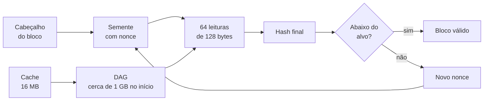
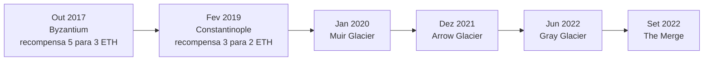

# Capítulo 75: Mineração no Ethereum, o Ethash e a Bomba de Dificuldade

Boa parte do vocabulário do Ethereum de hoje, como slots, validadores e atestações, só faz sentido para quem sabe o que existia antes. Até setembro de 2022 os blocos eram produzidos por mineradores, por meio de proof-of-work. O Capítulo 1 contou a troca para proof-of-stake e o Capítulo 36 comparou os dois modelos em linhas gerais. Este capítulo olha o motor antigo por dentro: como o Ethash funcionava, por que ele exigia tanta memória, como o protocolo ajustava a dificuldade e, sobretudo, a história curiosa da "bomba de dificuldade", um mecanismo escrito no protocolo para tornar a mineração cada vez mais difícil de propósito.

**O que um minerador fazia.** Segundo a documentação do ethereum.org, o minerador juntava transações pendentes do seu mempool, priorizando as que pagavam mais taxa, dentro do limite de gás do bloco. Executava cada uma na sua cópia local da EVM (Capítulo 21), montava o bloco candidato e então procurava uma "prova de trabalho": um valor que, combinado ao cabeçalho, produzisse um resultado abaixo de um alvo. Achando o valor, transmitia o bloco, e os demais nós conferiam tudo antes de aceitá-lo. Como o achado era probabilístico, às vezes dois blocos válidos apareciam quase juntos. A rede ficava com a cadeia mais longa e o bloco válido deixado de fora podia virar um "tio" (ommer, ou uncle), que recebia uma recompensa parcial. Isso permitia que mineradores menores, com mais latência de rede, ainda tivessem retorno.

**O Ethash e a ideia de memória difícil.** O algoritmo usado era o Ethash, descrito pelo ethereum.org como uma versão modificada do Dagger-Hashimoto. A ideia central era que o gargalo da mineração fosse a memória, e não só o poder de cálculo. Para isso havia duas estruturas. A primeira era um cache pseudoaleatório de cerca de 16 MB, gerado a partir de uma semente derivada dos cabeçalhos, que os clientes leves guardavam. A segunda era o conjunto de dados completo, o DAG, de cerca de 1 GB no início, gerado a partir do cache, em que cada item combinava 256 nós do cache. O DAG era refeito a cada época de 30.000 blocos, o que dá cerca de 5,2 dias. Pelas constantes do algoritmo, o tamanho inicial era de 2^30 bytes e crescia 2^23 bytes (8 MiB) por época, de modo que com o tempo o DAG passou de vários gigabytes e as placas de vídeo mais antigas deixaram de dar conta.

No laço de mineração (chamado hashimoto), o minerador combinava cabeçalho e nonce numa semente e lia 64 vezes fatias de 128 bytes do DAG, misturando-as, e ao final comparava um hash SHA3-256 com o alvo de dificuldade. Quem mineria precisava do DAG inteiro na memória e de leituras rápidas. Quem verificava precisava só do cache pequeno, porque os itens exigidos do DAG podiam ser recalculados na hora. A assimetria é o coração do desenho: minerar é caro, conferir é barato.



*O desenho mostra o laço do minerador: cada nonce gera uma semente, que dispara leituras no DAG; só um hash final abaixo do alvo produz um bloco, e verificar usa apenas o cache.*

**A promessa e o limite da resistência a ASICs.** A memória difícil foi pensada para frear circuitos dedicados (ASICs), que levariam a mineração para poucas fábricas e poucos grandes operadores. A própria documentação admite o que aconteceu na prática: ASICs de Ethash chegaram a ser construídos, mas a mineração com placas de vídeo continuou lucrativa até o fim do proof-of-work. Fica a lição de que "resistente a ASIC" descreve uma intenção de desenho, não uma garantia.

**O ajuste automático de dificuldade.** O alvo não era fixo. A EIP-100, parte da Byzantium, fixou que a dificuldade de cada bloco seria calculada a partir da do bloco pai e do intervalo de tempo entre os dois, com um termo que considerava se o pai tinha tios. O fator de ajuste, pelo código de referência, tinha a forma `max((2 se há tios, senão 1) - (intervalo // 9), -99)`. Blocos rápidos demais empurravam a dificuldade para cima e blocos lentos a empurravam para baixo, mantendo o ritmo médio estável. A EIP-100 também mudou o divisor de 10 para 9 para preservar os tempos de bloco, e o motivo de contar tios era impedir que a taxa de tios inflasse a emissão.

**A bomba de dificuldade.** Além do ajuste automático, o protocolo trazia um termo exponencial separado, apelidado de bomba (ou "era do gelo"). No código do Geth, o número do bloco é dividido por 100.000, e quando esse quociente passa de 1 soma-se à dificuldade uma parcela de 2 elevado a (quociente menos 2). Em notação matemática:

```latex
D_{\text{filho}} = D_{\text{ajustada}} + 2^{\,\lfloor n_{\text{falso}} / 100000 \rfloor - 2}
\qquad
n_{\text{falso}} = \max(0,\; n - \text{atraso})
```

*A primeira parcela é a dificuldade já ajustada pelo tempo de bloco; a segunda é a bomba, que dobra a cada 100.000 blocos, e o "atraso" é o deslocamento aplicado a cada adiamento.*

No início, esse termo era desprezível diante do resto. Mas, por crescer exponencialmente, chegaria a um ponto em que os blocos demorariam cada vez mais, até que a cadeia praticamente congelasse. A intenção declarada era incentivar a migração para proof-of-stake e desencorajar quem quisesse manter uma versão antiga da cadeia: sem remover a bomba do código, o ramo de proof-of-work ficaria inviável. Como a transição para proof-of-stake demorou muito mais do que o previsto, a bomba precisou ser adiada várias vezes. Em vez de editar a fórmula, os desenvolvedores usavam um "número de bloco falso": a partir de um bloco de ativação, o cálculo passa a usar o número real menos um deslocamento, como se a cadeia estivesse mais atrás no tempo.



*A linha do tempo mostra os forks que adiaram a bomba ou mexeram na recompensa, até a troca para proof-of-stake, que tornou a bomba irrelevante.*

**Os adiamentos, um a um.** A tabela reúne o que as próprias propostas de melhoria (EIPs) dizem, com os blocos de ativação e as datas aproximadas de fontes técnicas, que podem variar em um dia conforme o fuso e o tempo de bloco.

| Fork | Proposta | Deslocamento da bomba | Observação |
| --- | --- | --- | --- |
| Byzantium (bloco 4.370.000, out. 2017) | EIP-649 | 3.000.000 de blocos, cerca de 1,4 ano | Recompensa base de 5 para 3 ETH |
| Constantinople (bloco 7.280.000, fev. 2019) | EIP-1234 | 5.000.000 de blocos, cerca de 12 meses | Recompensa base de 3 para 2 ETH |
| Muir Glacier (bloco 9.200.000, jan. 2020) | EIP-2384 | 9.000.000 de blocos | Bomba voltara a ser sentida em out. 2019 |
| Arrow Glacier (bloco 13.773.000, dez. 2021) | EIP-4345 | 10.700.000 de blocos | Meta: Merge antes de junho de 2022 |
| Gray Glacier (bloco 15.050.000, jun. 2022) | EIP-5133 | 11.400.000 de blocos | Adiou cerca de 100 dias, para meados de setembro de 2022 |

*A tabela mostra que cada adiamento foi justificado pelo atraso na migração para proof-of-stake, e que o deslocamento é sempre contado em relação ao número real do bloco, não em relação ao adiamento anterior.*

O caso da recompensa merece atenção. A EIP-649 reduziu a recompensa base de 5 para 3 ETH e a EIP-1234, de 3 para 2 ETH, com o argumento de manter a emissão mais ou menos constante: se a bomba era adiada, os blocos continuavam rápidos, e sem o corte os mineradores teriam ganho mais ETH por dia. A EIP-649 também apontou outra razão, a de que recompensas menores diminuem o incentivo de uma divisão da cadeia puxada por mineradores perto da transição. Em ambas, o tio recebia a fração `(8 - k) × recompensa / 8`, onde k é a distância do bloco, e o bloco que o citava recebia 1/32 da recompensa.

**O que se vê quando a bomba "pega".** A EIP-2384 descreve o sintoma: a bomba voltou a ser perceptível em 5 de outubro de 2019, por volta do bloco 8.600.000, com tempo médio de bloco de 13,1 segundos, subindo para 14,3 segundos perto do bloco 8.900.000. O autor projetava blocos de 20 segundos no fim de dezembro e mais de 30 segundos a partir de fevereiro de 2020. Blocos mais lentos significam menos transações por unidade de tempo e uma rede mais cara de usar, o que explica a pressa dos adiamentos nesses episódios. Já a EIP-4345 projetava, para junho de 2022, um aumento de apenas cerca de 0,1 segundo no tempo de bloco, e a EIP-5133 mirava meados de setembro de 2022.

**Por que isso importa hoje.** Primeiro, é um exemplo concreto de governança off-chain (Capítulo 19) agindo sobre um cronograma técnico: a bomba só podia ser adiada por hard fork, e todo adiamento exigia coordenação entre desenvolvedores e clientes (Capítulo 46 mostra como esse processo funciona). Segundo, a bomba é uma lembrança de que o Ethereum foi desenhado, desde o começo, para trocar de mecanismo de consenso. Terceiro, a mineração deixou marcas no desenho atual: a EIP-1559 (Capítulo 16) nasceu num mundo de leilão de taxas entre mineradores, e o MEV (Capítulo 17) herdou da época em que quem ordenava transações era quem minerava. Por fim, a comparação com o Bitcoin (Capítulo 36) fica mais clara: ambos nasceram com proof-of-work, mas o Ethereum escolheu sair dele, e a bomba foi uma das ferramentas que tornou a saída pouco negociável.

**Uma ressalva de leitura.** Os números de bloco e as datas deste capítulo vêm das especificações e de fontes técnicas, e mudam em um dia dependendo da fonte e do fuso. Já os deslocamentos da bomba e os valores de recompensa são os que as próprias EIPs trazem. Este capítulo é histórico e conceitual, e não orienta nenhuma decisão de investimento.

**Glossário do capítulo.**

- **Proof-of-work (prova de trabalho)**: mecanismo de consenso em que produzir um bloco exige resolver um problema computacional caro de resolver e barato de conferir.
- **Ethash**: algoritmo de proof-of-work do Ethereum, derivado do Dagger-Hashimoto, projetado para depender de memória.
- **DAG**: conjunto de dados de cerca de 1 GB no início, que crescia 8 MiB por época de 30.000 blocos e era lido pelos mineradores.
- **Época**: intervalo de 30.000 blocos, cerca de 5,2 dias, ao fim do qual o DAG e o cache eram refeitos.
- **Nonce**: valor que o minerador variava a cada tentativa para obter um novo hash.
- **Tio (uncle ou ommer)**: bloco válido que ficou fora da cadeia principal, mas era citado por um bloco posterior e recebia recompensa parcial.
- **Bomba de dificuldade (ice age)**: termo exponencial na fórmula de dificuldade que torna a mineração cada vez mais lenta, para forçar a migração de consenso.
- **Número de bloco falso**: artifício usado nos adiamentos, em que a fórmula usa o número real menos um deslocamento.
- **ASIC**: circuito integrado projetado para uma única tarefa, como minerar um algoritmo específico.
- **Hard fork**: mudança de regras incompatível com as versões anteriores, que exige que todos atualizem o software.

**Fontes.**

- [ethereum.org: Mineração (documentação histórica de proof-of-work)](https://raw.githubusercontent.com/ethereum/ethereum-org-website/dev/public/content/developers/docs/consensus-mechanisms/pow/mining/index.md)
- [ethereum.org: Ethash (documentação histórica)](https://raw.githubusercontent.com/ethereum/ethereum-org-website/dev/public/content/developers/docs/consensus-mechanisms/pow/mining/mining-algorithms/ethash/index.md)
- [EIP-100: Change difficulty adjustment to target mean block time including uncles](https://raw.githubusercontent.com/ethereum/EIPs/master/EIPS/eip-100.md)
- [EIP-649: Metropolis Difficulty Bomb Delay and Block Reward Reduction](https://raw.githubusercontent.com/ethereum/EIPs/master/EIPS/eip-649.md)
- [EIP-1234: Constantinople Difficulty Bomb Delay and Block Reward Adjustment](https://raw.githubusercontent.com/ethereum/EIPs/master/EIPS/eip-1234.md)
- [EIP-2384: Muir Glacier Difficulty Bomb Delay](https://raw.githubusercontent.com/ethereum/EIPs/master/EIPS/eip-2384.md)
- [EIP-4345: Difficulty Bomb Delay to June 2022](https://raw.githubusercontent.com/ethereum/EIPs/master/EIPS/eip-4345.md)
- [EIP-5133: Delaying Difficulty Bomb to mid-September 2022](https://raw.githubusercontent.com/ethereum/EIPs/master/EIPS/eip-5133.md)
- [go-ethereum v1.10.26: consensus/ethash/consensus.go (cálculo de dificuldade e da bomba)](https://raw.githubusercontent.com/ethereum/go-ethereum/v1.10.26/consensus/ethash/consensus.go)
- [Blocos e datas dos forks, conferidos por resultado de busca: Ethereum Execution Specs (Byzantium e Constantinople)](https://steel.ethereum.foundation/docs/execution-specs/specs/reference/diffs/byzantium/constantinople/index.html)
- [Blocos de Arrow Glacier e Muir Glacier, conferidos por resultado de busca: documentação do Reth](https://reth.rs/docs/reth_op/node/core/primitives/ethereum/constant.MAINNET_ARROW_GLACIER_BLOCK.html)
- [Gray Glacier, conferido por resultado de busca: The Block](https://www.theblock.co/post/155081/ethereum-finishes-gray-glacier-hard-fork-difficulty-bomb)
