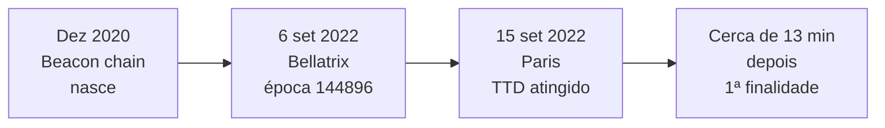
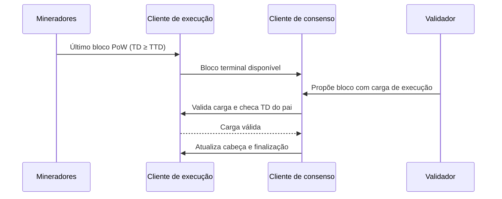

# Capítulo 76: The Merge por Dentro, TTD, Bellatrix e Paris

O Capítulo 1 contou The Merge em linhas gerais e o Capítulo 75 mostrou o motor antigo, a mineração com Ethash. Falta o meio do caminho: como, tecnicamente, uma rede com bilhões de dólares em jogo trocou o mecanismo de consenso sem parar, sem reiniciar e sem que os saldos de ninguém mudassem. A resposta é um desenho em duas etapas, com um gatilho escolhido de propósito para não depender de um número de bloco. Este capítulo percorre esse desenho: o que foi a beacon chain esperando a vez, o que é a dificuldade total terminal, como o primeiro bloco de proof-of-stake foi validado e o que mudou (e o que não mudou) no cabeçalho dos blocos.

**Duas camadas que já existiam separadas.** Até setembro de 2022 conviviam duas cadeias. A cadeia de execução era a antiga mainnet, com contas, contratos e transações, produzida por mineradores. A beacon chain, a camada de consenso do Capítulo 2, já rodava desde dezembro de 2020 com validadores, mas não carregava transação alguma. The Merge foi o momento em que a cadeia de execução passou a aceitar a beacon chain como a única fonte de blocos. Por isso o nome: a cadeia de execução não foi substituída, ela foi "fundida" ao consenso novo e seguiu com o mesmo histórico e o mesmo estado.

**Duas etapas, dois nomes.** O anúncio da Fundação Ethereum para a mainnet dividiu a atualização em duas fases. A primeira, chamada Bellatrix, ocorreu na camada de consenso e foi marcada por altura de época: a época 144896 da beacon chain, em 6 de setembro de 2022, às 11h34min47s UTC, segundo o anúncio. Bellatrix deixou a beacon chain pronta para receber cargas de execução, mas nada mudou ainda para os mineradores. A segunda, chamada Paris, ocorreu na camada de execução e foi acionada por um valor de dificuldade total, não por uma data nem por um número de bloco. Foi o que fez a troca de fato, e aconteceu em 15 de setembro de 2022, conforme a documentação do ethereum.org.



*A linha do tempo mostra as duas etapas: Bellatrix prepara o consenso e Paris, disparada pelo TTD, entrega a produção de blocos aos validadores; o anúncio estimava a primeira finalidade cerca de duas épocas (uns 13 minutos) depois do primeiro bloco pós-TTD.*

**A dificuldade total e o TTD.** Cada bloco de proof-of-work tinha uma dificuldade. A dificuldade total de um bloco é a soma das dificuldades de todos os blocos desde a gênese até ele. Como a regra da cadeia mais pesada do PoW já usava essa soma, ela era um número que todos os nós conheciam e que só crescia. A EIP-3675 aproveitou isso e definiu a constante `TERMINAL_TOTAL_DIFFICULTY` (TTD), cujo valor na mainnet foi fixado em 58750000000000000000000. Um bloco PoW é o "bloco terminal" se a sua dificuldade total alcança o TTD e a do seu pai ainda está abaixo dele.

```latex
\text{bloco terminal: } TD(b) \ge TTD \;\;\text{e}\;\; TD(\text{pai}(b)) < TTD
```

*A fórmula diz que o bloco terminal é o primeiro da cadeia a cruzar o limiar; todos os antes dele ficaram abaixo e a cadeia PoW termina nele.*

Pode haver mais de um bloco terminal, por exemplo dois filhos do mesmo pai que cruzam o limiar ao mesmo tempo. A especificação admite isso e permite trocar entre eles até que a primeira finalidade chegue.

**Por que um limiar de dificuldade, e não uma altura de bloco.** A EIP-3675 explica a escolha. Se a troca fosse marcada por um número de bloco, um atacante com uma fração pequena do poder de mineração poderia minerar uma cadeia paralela até aquela altura e propor, em cima dela, o primeiro bloco de proof-of-stake, e como a regra de escolha da cadeia do PoS passa a valer na transição, isso seria perigoso. A dificuldade total acumulada é muito mais cara de falsificar. Além disso, o desenho previa válvulas de emergência: o TTD podia ser ajustado se o poder de mineração caísse, e um mecanismo mais invasivo permitia fixar o bloco terminal pelo hash (`TERMINAL_BLOCK_HASH`) em caso de ataque. A escolha do valor, segundo reportagem da época, mirou o dia 15 de setembro sabendo que a data real poderia variar alguns dias, porque a velocidade com que o limiar seria cruzado dependia do poder de mineração naquele momento.

**O primeiro bloco de proof-of-stake.** O bloco de transição é o primeiro bloco da cadeia canônica produzido pela beacon chain, e a regra é que seja filho de um bloco terminal. Do lado do consenso, a especificação de Bellatrix cuida disso em dois predicados. O primeiro, `is_valid_terminal_pow_block`, devolve verdadeiro apenas se o bloco tem dificuldade total maior ou igual ao TTD e o pai tem menor. O segundo, `validate_merge_block`, é chamado quando um bloco da beacon chain carrega pela primeira vez uma carga de execução: ele busca o bloco PoW apontado pelo `parent_hash`, busca o pai dele e confere o primeiro predicado. Se algum bloco PoW não estiver disponível, a validação pode ser adiada e repetida, já que o bloco pode chegar depois. Há também o caminho de exceção, em que o `TERMINAL_BLOCK_HASH` configurado substitui a checagem de dificuldade por uma comparação direta de hash.



*O desenho mostra o encontro das duas camadas: o último bloco PoW é validado pelo cliente de execução, o consenso confere o limiar de dificuldade e só então a cabeça da cadeia passa a ser ditada pela beacon chain.*

**Quem manda na cabeça da cadeia.** A partir do primeiro evento de atualização de escolha de cadeia vindo do consenso (`POS_FORKCHOICE_UPDATED` na EIP-3675), a regra da cadeia PoW mais pesada deixa de valer e a cabeça passa a ser a que o consenso indica, com a regra LMD-GHOST do Capítulo 62. Os clientes de execução também param de importar blocos PoW descendentes do bloco terminal. O custo dessa parada é uma troca consciente: um nó que perdesse a conexão com a beacon chain ficaria parado em vez de seguir uma cadeia errada, preferindo segurança à continuidade. Na prática, é esse o motivo de a mainnet exigir hoje dois clientes conversando, o de execução e o de consenso, que o Capítulo 28 descreveu, ligados pela Engine API.

**O que mudou no cabeçalho do bloco.** A EIP-3675 fixou valores constantes para campos que só faziam sentido no PoW. A partir do bloco de transição, a dificuldade passa a ser zero, o `nonce` é zero, a lista de tios é vazia (com o hash correspondente a uma lista RLP vazia) e o `mixHash` era fixado em zero na EIP. Os blocos deixam de ter recompensa de bloco e de tios, e as taxas das transações continuam indo para o beneficiário como antes. Na especificação de Bellatrix, a carga de execução traz um campo `prev_randao`, que precisa ser igual à mistura de RANDAO da época atual. Esse campo ocupa o lugar do que na especificação de execução era a dificuldade e é o que depois se tornou o opcode PREVRANDAO, com os cuidados descritos no Capítulo 64. Também a hora do bloco passa a ser a do slot, calculada a partir da gênese. Os formatos de transação do Capítulo 67 e o mecanismo de taxas do Capítulo 16 não foram alterados.

| Campo ou regra | Antes (PoW) | Depois (PoS) |
| --- | --- | --- |
| Quem produz o bloco | Minerador que acha o nonce | Validador sorteado para o slot |
| Dificuldade no cabeçalho | Valor calculado a cada bloco | Zero |
| Nonce | Valor da prova de trabalho | Zero |
| Tios (ommers) | Permitidos e premiados | Lista vazia |
| Campo de aleatoriedade | Dificuldade | `prev_randao` (mistura de RANDAO) |
| Regra da cadeia | Maior dificuldade total | LMD-GHOST com finalidade |
| Recompensa de bloco | Emitida no bloco de execução | Removida; vem do consenso |
| Intervalo entre blocos | Alvo de cerca de 13,3 s | Slot de 12 s |

**O que mudou e o que não mudou para quem usa.** Segundo o ethereum.org, o consumo de energia da rede caiu em cerca de 99,95%. A emissão de ETH também mudou de natureza: antes cerca de 13.000 ETH por dia iam para os mineradores e cerca de 1.700 para os validadores; depois sobrou só a parte do consenso, o que o ethereum.org estima como uma queda de cerca de 88% na emissão total, de aproximadamente 4,61% para 0,52% ao ano. Como o Capítulo 16 mostrou, a queima do EIP-1559 pode compensar essa emissão restante quando o preço médio do gás fica alto o bastante; a mesma página cita um preço médio de pelo menos 16 gwei para zerar a inflação líquida. Já as taxas de gás não caíram, porque dependem de demanda frente à capacidade, e a capacidade não mudou. Os blocos ficaram um pouco mais frequentes, e surgiu a finalidade, o conceito do Capítulo 63. Quem tinha ETH não precisou fazer nada, e o histórico de transações foi preservado.

**Por que o desenho importa como lição.** The Merge é um estudo de caso de migração em sistema vivo. Três escolhas se destacam: separar a mudança em duas etapas, para que a parte arriscada ocorresse sobre infraestrutura já testada; usar um gatilho que o atacante não consiga fabricar a baixo custo; e deixar válvulas de emergência explícitas, em vez de depender de improviso. Nada disso elimina o risco, mas explica por que a transição ocorreu sem interrupção de serviço, e o mesmo método (devnets, testnets, gatilhos claros) reaparece no Capítulo 46, sobre como um hard fork chega à mainnet.

**Glossário do capítulo.**

- **Beacon chain**: cadeia de consenso do Ethereum, ativa desde dezembro de 2020, que coordena validadores, atestações e finalidade.
- **Bellatrix**: atualização da camada de consenso que preparou a beacon chain para receber cargas de execução, ativada na época 144896.
- **Paris**: atualização da camada de execução disparada pelo TTD, que entregou a produção de blocos ao consenso.
- **Dificuldade total (TD)**: soma das dificuldades de todos os blocos de proof-of-work desde a gênese até um dado bloco.
- **TTD (terminal total difficulty)**: limiar de dificuldade total, 58750000000000000000000 na mainnet, cujo cruzamento marca o fim do proof-of-work.
- **Bloco terminal**: primeiro bloco PoW cuja dificuldade total alcança o TTD, com pai ainda abaixo do limiar.
- **Bloco de transição**: primeiro bloco da cadeia canônica produzido pela beacon chain, filho de um bloco terminal.
- **prev_randao**: campo da carga de execução que deve igualar a mistura de RANDAO da época, ocupando o lugar da antiga dificuldade.
- **Engine API**: interface pela qual o cliente de consenso instrui o cliente de execução a validar cargas e atualizar a cabeça.
- **Finalidade**: ponto a partir do qual um bloco não pode mais ser revertido sem punição de pelo menos um terço do stake.

**Fontes.**

- [EIP-3675: Upgrade consensus to Proof-of-Stake](https://raw.githubusercontent.com/ethereum/EIPs/master/EIPS/eip-3675.md)
- [Especificação de consenso, Bellatrix: fork choice](https://raw.githubusercontent.com/ethereum/consensus-specs/master/specs/bellatrix/fork-choice.md)
- [Especificação de consenso, Bellatrix: beacon chain](https://raw.githubusercontent.com/ethereum/consensus-specs/master/specs/bellatrix/beacon-chain.md)
- [ethereum.org: The Merge](https://raw.githubusercontent.com/ethereum/ethereum-org-website/dev/public/content/roadmap/merge/index.md)
- [ethereum.org: Mudanças na emissão de ETH com a Merge](https://raw.githubusercontent.com/ethereum/ethereum-org-website/dev/public/content/roadmap/merge/issuance/index.md)
- [Fundação Ethereum: anúncio da Merge na mainnet, conferido por resultado de busca](https://blog.ethereum.org/2022/08/24/mainnet-merge-announcement)
- [The Defiant: Bellatrix em 6 de setembro, conferido por resultado de busca](https://www.thedefiant.io/ethereum-bellatrix-sep-6)
