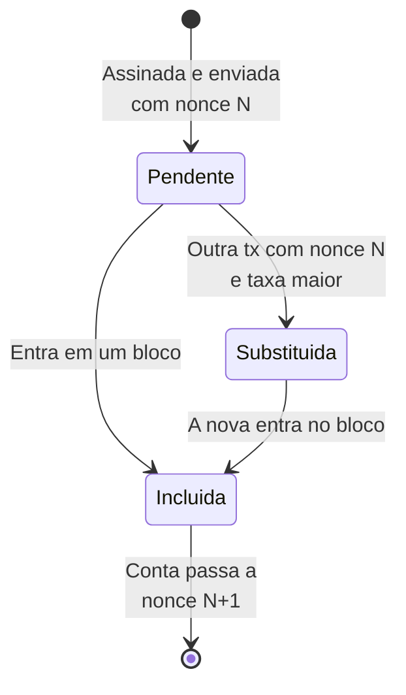
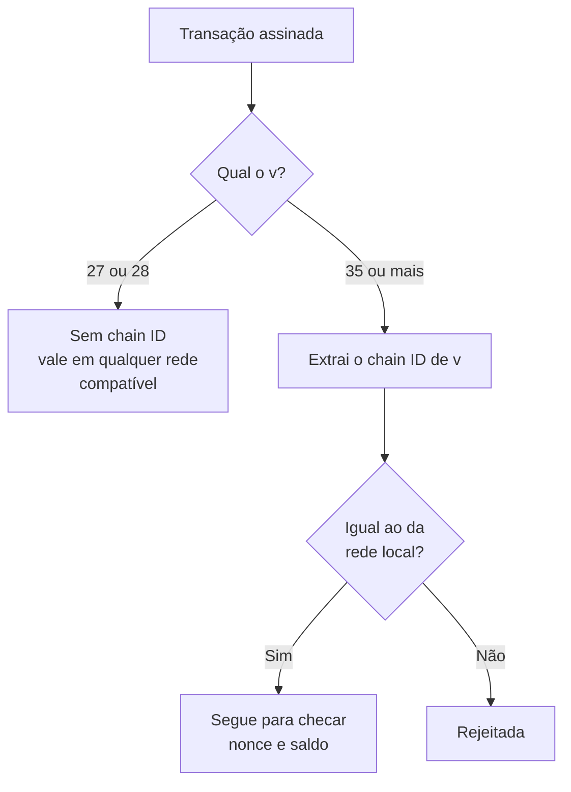

# Capítulo 77: Nonce, Chain ID e a Proteção contra Replay, Por que Uma Assinatura Só Vale Uma Vez

Uma transação no Ethereum é, no fundo, uma mensagem assinada que qualquer pessoa pode copiar e retransmitir. O Capítulo 26 mostrou que a assinatura prova quem autorizou, e o Capítulo 67 detalhou os campos que a transação carrega. Falta responder a uma pergunta de segurança básica: o que impede alguém de pegar uma transação já executada e enviá-la de novo, drenando a conta aos poucos? E, mais sutil, o que impede que uma assinatura feita para uma rede seja reaproveitada em outra rede que compartilha as mesmas chaves e o mesmo histórico? Este capítulo trata dessas duas defesas, o nonce e o chain ID, e de como a lógica delas reaparece em assinaturas fora da cadeia.

**O problema do replay.** Um ataque de replay (repetição) consiste em reapresentar uma mensagem válida para que ela seja aceita mais de uma vez. Como a assinatura de uma transação continua matematicamente válida para sempre, a defesa não pode estar na assinatura em si. Ela precisa estar nos dados que a assinatura cobre e nas regras que a rede aplica a esses dados. O Ethereum usa duas peças complementares: o nonce, que impede repetição dentro da mesma rede, e o chain ID, que impede repetição entre redes diferentes.

**O nonce, o contador de cada conta.** Segundo o ethereum.org, o nonce de uma conta externa (EOA) é um contador que indica quantas transações já saíram dela, e só uma transação com determinado nonce pode ser executada para cada conta. A regra prática: a primeira transação de uma conta usa nonce 0, a seguinte nonce 1, e assim por diante, sem pular. Uma transação já incluída deixa a conta com nonce maior, então reenviar a mesma mensagem falha, porque o nonce dela já foi consumido. Para contas de contrato, o ethereum.org descreve o nonce como o número de contratos criados por aquela conta, o que também entra no cálculo do endereço de um contrato criado com `CREATE`. O `CREATE2`, em contraste, deriva o endereço de um valor escolhido pelo criador (o "salt") e do hash do código de criação, sem usar o nonce.

O nonce tem um segundo efeito, tão importante quanto o primeiro: ele impõe ordem. Uma transação com nonce 5 não pode ser executada antes das de nonces 3 e 4. Se a de nonce 3 ficar presa por ter oferecido uma taxa baixa demais, as seguintes esperam atrás dela. É por isso que, como o Capítulo 35 apontou, a forma de destravar uma transação pendente é reenviar outra com o mesmo nonce e taxas maiores. Cancelar uma transação segue o mesmo princípio: manda-se, com o mesmo nonce e taxa superior, uma transação inofensiva (por exemplo, uma transferência de valor zero da conta para ela mesma). Quando uma delas for incluída, a outra deixa de ser válida, porque o nonce já foi usado.



*O desenho mostra o ciclo de uma transação do ponto de vista do nonce: enquanto está pendente, ela pode ser trocada por outra com o mesmo nonce, mas assim que alguma é incluída o nonce avança e a rival fica inválida.*

**Quão grande pode ser um nonce.** A EIP-2681 limitou o nonce a no máximo 2^64 menos 1, de forma retroativa desde a gênese. A justificativa é técnica: números de tamanho arbitrário complicam as provas de estado (um tema do Capítulo 37) e os clientes já tratavam o nonce como um inteiro de 64 bits. O texto da EIP calcula que alcançar esse teto por transações externas custaria pelo menos 21.000 vezes (2^64 menos 1) unidades de gás, um número da ordem de 10^23, ou seja, inatingível na prática. Na época da proposta, a maior contagem de nonce em uma conta real era de aproximadamente 29 milhões, segundo a própria EIP.

**O chain ID, a identidade da rede dentro da assinatura.** O nonce protege contra repetição na mesma cadeia, mas não contra o seguinte cenário: duas redes que partilham a mesma origem e os mesmos endereços. Foi exatamente o que ocorreu depois do hard fork da The DAO, descrito no Capítulo 20, que deixou Ethereum e Ethereum Classic com chaves e saldos idênticos no momento da divisão. Uma transação assinada para uma das redes era, em princípio, válida na outra. A EIP-155, de autoria de Vitalik Buterin, resolveu isso incorporando um identificador de rede ao que se assina. Seu texto afirma que a proposta oferece uma forma de enviar transações que funcionem no Ethereum sem funcionar no ETC, e encoraja outras redes a adotarem a mesma ideia com um valor de `CHAIN_ID` próprio.

Tecnicamente, a mudança foi pequena. Antes, o hash assinado cobria seis elementos codificados em RLP: `nonce`, `gasprice`, `startgas`, `to`, `value` e `data`. Com a EIP-155, passam a ser nove: os seis anteriores mais `chainid`, `0` e `0`. A assinatura também ganha uma marca: o campo `v` passa a valer `{0,1} + CHAIN_ID * 2 + 35`, em que `{0,1}` é a paridade do ponto da curva secp256k1, em vez do antigo `{0,1} + 27`. Dessa forma, quem verifica a transação consegue recuperar o chain ID a partir do próprio `v`, e uma assinatura feita para a cadeia 1 não confere com o hash de nenhuma outra cadeia.

```latex
v = \{0,1\} + 2 \times \text{CHAIN\_ID} + 35
```

*A fórmula mostra como o chain ID fica embutido no campo v da assinatura: para a mainnet, de chain ID 1, o valor de v é 37 ou 38.*

A própria EIP traz um exemplo numérico: uma transação com `nonce = 9`, `gasprice` de 20 gwei, `startgas` de 21.000, valor de 1 ETH e dados vazios, assinada com a chave de teste que ela indica, resulta em `v = 37`. A EIP-155 entrou na atualização Spurious Dragon, ativada no bloco 2.675.000 da mainnet, segundo a EIP-607, junto de outras três mudanças (EIP-160, EIP-161 e EIP-170). Ela foi uma proteção opcional: assinaturas antigas, com `v` igual a 27 ou 28, continuam válidas pelas regras de antes, e quem escolhe assinar do jeito antigo abre mão da proteção.



*O fluxograma resume a verificação: assinaturas no formato antigo não carregam identidade de rede, enquanto as do formato novo são descartadas por qualquer rede cujo chain ID seja diferente.*

**Hoje, o chain ID vem de fábrica.** Nos formatos modernos do Capítulo 67 (tipos 1, 2, 3 e 4), o `chain_id` é um campo explícito da transação, sem a codificação engenhosa dentro do `v`. A proteção deixou de ser uma opção que a carteira precisa lembrar de ligar e passou a fazer parte da estrutura. O mesmo vale para as autorizações da EIP-7702, em que cada tupla leva um `chain_id` (zero significa que a autorização vale em qualquer cadeia, o que explica o cuidado recomendado no Capítulo 24 ao assinar delegações). A tabela a seguir reúne as duas defesas.

| Aspecto | Nonce | Chain ID |
| --- | --- | --- |
| O que impede | Reuso da mesma transação na mesma rede | Reuso de uma assinatura em outra rede |
| Onde vive | Estado da conta, mais campo da transação | Configuração da rede, mais campo (ou parte do `v`) da transação |
| Quem confere | Cliente de execução, contra o estado atual | Cliente de execução, contra sua própria configuração |
| Efeito colateral | Impõe ordem e permite substituir pendentes | Separa redes com histórico comum |
| Limite | 2^64 menos 1 (EIP-2681) | Valor de 256 bits (EIP-1344) |

**Chain ID também dentro dos contratos.** A EIP-1344 acrescentou o opcode `CHAINID` (0x46), que devolve o identificador da cadeia atual e custa o gás base. A motivação é a mesma, só que para contratos que verificam assinaturas: se o chain ID fosse fixado no momento da compilação, uma mudança posterior, como a de uma divisão contenciosa da rede, deixaria o contrato com um valor desatualizado. Com o opcode, o contrato consulta o valor corrente. A EIP admite também um risco: em caso de divisão, as comunidades podem precisar alterar o chain ID de uma das cadeias, e aplicações que dependem dele devem estar preparadas.

**Replay fora da cadeia: o que a EIP-712 não faz por você.** Muitos protocolos usam mensagens assinadas que não são transações, como as permissões do Capítulo 22 (`permit`) e os pedidos de negociação do Capítulo 45. A EIP-712 define como hashear e assinar dados estruturados, o que inclui um domínio com nome, versão, chain ID e endereço do contrato verificador. Mas a própria EIP é explícita no aviso de segurança: o padrão trata apenas de assinar e verificar, e é "muito importante" que o aplicativo se comporte corretamente ao ver a mesma mensagem assinada duas vezes, rejeitando a repetição ou tornando a ação idempotente. Por isso, contratos que aceitam assinaturas costumam manter seu próprio contador de nonces por assinante, replicando em pequeno o mecanismo da camada base. A EIP também alerta para o front-running de assinaturas: quem intercepta uma assinatura pode submetê-la antes do dono, então o aplicativo deve se comportar bem mesmo quando a assinatura é enviada por terceiros.

**Lições práticas.** Primeiro, uma "transação travada" quase sempre é uma questão de nonce e taxa, e não de dinheiro perdido: a ordem do nonce é a explicação, e a substituição pelo mesmo nonce é o remédio. Segundo, ao adicionar uma rede nova na carteira, o chain ID é o que impede que uma assinatura feita para ela seja reutilizada em outra, e é um dos dados que vale conferir em fontes confiáveis. Terceiro, para quem desenvolve, toda mensagem assinada que não seja uma transação precisa de seu próprio mecanismo anti-repetição, porque a rede só protege o que ela mesma processa. O raciocínio geral, o de que uma assinatura deve cobrir o contexto em que vale, é o mesmo que separa um sistema de autorização robusto de um cheque que qualquer um pode descontar mais de uma vez.

**Glossário do capítulo.**

- **Replay (repetição)**: ataque que reapresenta uma mensagem assinada válida para que ela seja aceita de novo, na mesma rede ou em outra.
- **Nonce**: contador sequencial de uma conta, que numera suas transações e faz cada uma valer uma única vez, em ordem.
- **Chain ID**: identificador numérico de uma rede, incluído no que se assina para que a assinatura só valha naquela rede.
- **EIP-155**: proposta de proteção simples contra replay, que passou a incluir o chain ID no hash assinado e no campo `v`, ativada no Spurious Dragon.
- **Spurious Dragon**: atualização da mainnet ativada no bloco 2.675.000, que trouxe a EIP-155 e outras três mudanças.
- **Transação substituta**: nova transação com o mesmo nonce e taxa maior, usada para acelerar ou cancelar uma pendente.
- **CHAINID (opcode)**: instrução da EVM, de código 0x46, que devolve o chain ID da cadeia atual para uso em contratos.
- **EIP-712**: padrão para hashear e assinar dados estruturados, com um domínio que inclui o chain ID e o contrato verificador.
- **Idempotente**: diz-se de uma ação cujo efeito é o mesmo se for executada uma ou várias vezes.
- **Front-running de assinatura**: envio, por um terceiro, de uma assinatura interceptada antes que o titular a use.

**Fontes.**

- [EIP-155: Simple replay attack protection](https://raw.githubusercontent.com/ethereum/EIPs/master/EIPS/eip-155.md)
- [EIP-607: Hardfork Meta, Spurious Dragon](https://raw.githubusercontent.com/ethereum/EIPs/master/EIPS/eip-607.md)
- [EIP-2681: Limit account nonce to 2^64-1](https://raw.githubusercontent.com/ethereum/EIPs/master/EIPS/eip-2681.md)
- [EIP-1344: ChainID opcode](https://raw.githubusercontent.com/ethereum/EIPs/master/EIPS/eip-1344.md)
- [EIP-712: Typed structured data hashing and signing](https://raw.githubusercontent.com/ethereum/EIPs/master/EIPS/eip-712.md)
- [ethereum.org: Contas](https://raw.githubusercontent.com/ethereum/ethereum-org-website/dev/public/content/developers/docs/accounts/index.md)
- [ethereum.org: Transações](https://raw.githubusercontent.com/ethereum/ethereum-org-website/dev/public/content/developers/docs/transactions/index.md)
