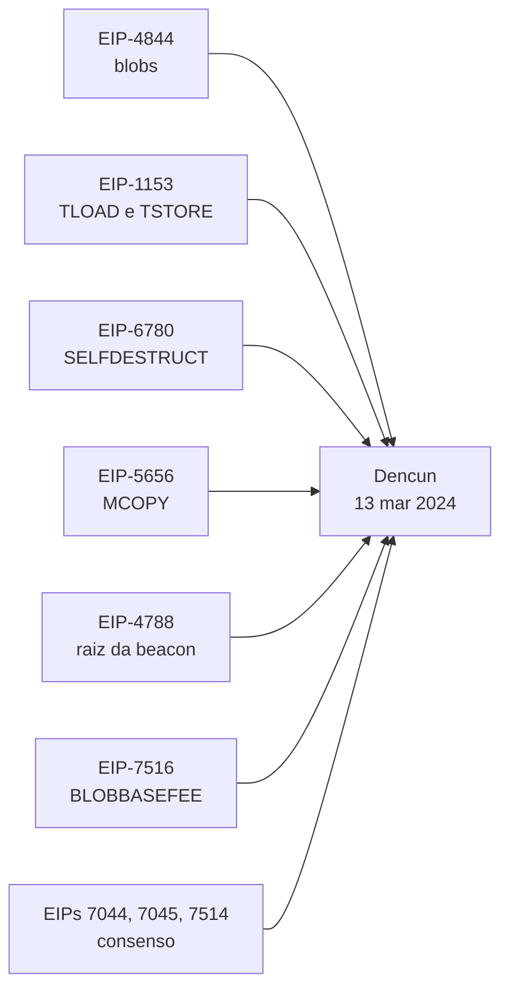
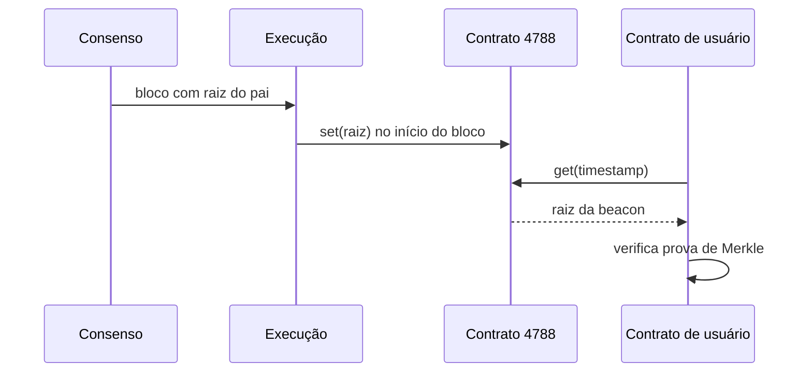

# Capítulo 78: Dencun além dos Blobs, TSTORE, SELFDESTRUCT e a Raiz da Beacon no EVM

Quando se fala da atualização Dencun, quase sempre o assunto é a EIP-4844 e os blobs que baratearam os rollups, tema do Capítulo 34. Mas o pacote ativado em março de 2024 tinha nove EIPs, e boa parte delas mexeu na própria EVM. Este capítulo olha para essas mudanças menos comentadas: o armazenamento transitório, a aposentadoria prática do `SELFDESTRUCT`, a cópia de memória, a ponte entre a camada de consenso e os contratos e o preço do blob visível dentro do código. São pequenas na manchete e grandes nas consequências para quem escreve ou audita contratos, como os do Capítulo 21.

**O pacote e a data.** A EIP-7569, que lista os conteúdos da atualização, enumera nove EIPs: 1153, 4788, 4844, 5656, 6780, 7044, 7045, 7514 e 7516. As EIPs 4788, 4844, 7044, 7045 e 7514 exigem mudanças na camada de consenso, e 1153, 4788, 4844, 5656, 6780 e 7516 mudam a camada de execução. Na mainnet, a ativação ocorreu na época 269568, com timestamp 1710338135, o que corresponde a 13 de março de 2024, às 13h55 UTC.

*O desenho mostra as nove propostas convergindo para uma única atualização, das quais seis alteram a camada de execução e são o foco deste capítulo.*

**Armazenamento transitório (EIP-1153).** Até então, um contrato tinha dois lugares para guardar dados: o armazenamento persistente (`SSTORE` e `SLOAD`), caro porque vai para o estado, e a memória, que morre ao fim de cada chamada. A EIP-1153 criou um terceiro, com dois opcodes, `TLOAD` (0x5c) e `TSTORE` (0x5d). Ele se comporta como o armazenamento, com endereçamento por palavras de 32 bytes e privado do contrato dono, mas é descartado ao fim de cada transação. Como nunca é gravado em disco, sai mais barato: tanto `TSTORE` quanto `TLOAD` custam 100 gás, segundo a EIP.

A motivação original é a comunicação entre quadros de execução dentro da mesma transação. O exemplo clássico é o trinco de reentrância (o tema do ataque da The DAO, no Capítulo 20): para impedir que um contrato seja reentrado, ele marca "ocupado" no começo e "livre" no fim. Com `SSTORE`, isso custa caro e o reembolso ficou limitado a 20% do gás pela EIP-3529 (ver Capítulo 35). Com o armazenamento transitório, o trinco some sozinho ao fim da transação, sem limpeza e sem reembolso. A EIP cita ainda aprovações de token válidas por uma única transação e o padrão em que o usuário faz tudo dentro de um callback e o contrato confere o saldo no final. Em caso de reversão de um quadro, as escritas transitórias também são revertidas, e `TSTORE` dentro de uma `STATICCALL` gera exceção.

**O fim prático do SELFDESTRUCT (EIP-6780).** O `SELFDESTRUCT` apagava código e armazenamento de um contrato. A EIP-6780 deixou de apagar: ele agora só envia todo o saldo ao destino, exceto quando é executado na mesma transação em que o contrato foi criado, caso em que o comportamento antigo é mantido. O motivo declarado é técnico: com as árvores Verkle (Capítulo 37), cada conta se espalharia por várias chaves sem ligação óbvia com a raiz, o que tornaria a remoção inviável. O custo está nos usos antigos. Contratos que se redeployavam no mesmo endereço via `CREATE2` depois de um `SELFDESTRUCT`, usado como forma de tornar um contrato atualizável, deixam de funcionar; a própria EIP recomenda proxies, assunto do Capítulo 69. Também deixou de ser possível queimar ether apontando o `SELFDESTRUCT` para o próprio contrato, salvo em contratos criados na mesma transação.

| Situação | Antes da Dencun | Depois (EIP-6780) |
| --- | --- | --- |
| Contrato antigo chama SELFDESTRUCT | Apaga código, storage e conta | Só transfere o saldo |
| Chamada na mesma transação da criação | Apaga tudo | Apaga tudo (igual) |
| Destino é o próprio contrato | Ether queimado | Sem efeito líquido, se não for recém-criado |
| Redeploy via CREATE2 no mesmo endereço | Possível | Deixa de funcionar |

**Copiar memória com uma instrução (EIP-5656).** O opcode `MCOPY` (0x5E) copia `length` bytes de `src` para `dst` na memória, tratando corretamente regiões sobrepostas. O custo segue a regra dos outros opcodes de cópia: 3 de gás base mais 3 por palavra copiada, mais a expansão de memória. A EIP dá um exemplo: copiar 256 bytes custava ao menos 157 gás com o precompile de identidade e ao menos 96 com pares de `MLOAD` e `MSTORE`, contra 27 com `MCOPY`. Também facilita a vida de otimizadores e analisadores estáticos, que sabem que a instrução só afeta memória.

**A raiz da beacon dentro do EVM (EIP-4788).** Os contratos viviam isolados da camada de consenso: não tinham como verificar um fato sobre os validadores sem confiar em um oráculo (Capítulo 25). A EIP-4788 acrescentou ao cabeçalho de execução o campo `parent_beacon_block_root`, a raiz de hash do bloco pai da beacon chain, e a guardou em um contrato de sistema no endereço `0x000F3df6D732807Ef1319fB7B8bB8522d0Beac02`. No início de cada bloco, o protocolo chama esse contrato para gravar a raiz, sem consumir o gás do bloco. Com ela, é possível provar via Merkle (Capítulo 70, e a merkleização do Capítulo 72) qualquer dado do estado de consenso, e a EIP cita ganhos para pools de staking, restaking (Capítulo 4), pontes e mitigação de MEV.

O contrato usa um buffer circular de 8191 posições, número primo escolhido para que nenhum valor seja sobrescrito antes de o buffer saturar. Com os parâmetros da mainnet, isso dá cobertura de aproximadamente um dia, segundo a EIP, tempo suficiente para o usuário incluir uma transação que verifique contra uma raiz específica.

*O diagrama mostra o caminho da raiz: o consenso a entrega à execução, o protocolo a grava no contrato de sistema, e qualquer contrato pode consultá-la e checar uma prova contra ela.*

**O preço do blob visível ao contrato (EIP-7516).** O opcode `BLOBBASEFEE` (0x4a) devolve a taxa-base dos blobs do bloco atual, análogo ao `BASEFEE` do Capítulo 16, e custa 2 de gás por apenas expor um dado já presente no cabeçalho. A EIP aponta como usos contratos de rollup que contabilizam o custo de dados e derivativos de preço de blob.

**As mudanças de consenso, em uma linha cada.** A EIP-7044 tornou perpetuamente válidas as saídas voluntárias assinadas, a EIP-7045 ampliou o prazo máximo de inclusão de atestações e a EIP-7514 limitou o churn máximo de entrada por época (ver Capítulo 40).

**O que fica de lição.** Primeiro, uma atualização de protocolo raramente é uma coisa só: o título costuma esconder mudanças que alteram hábitos de programação, como o trinco transitório e o fim dos contratos que se destroem. Segundo, vários itens aproximam as duas camadas do Ethereum, o que reduz a confiança em intermediários. Terceiro, a engenharia de gás continua sendo política: cada preço de opcode é uma escolha sobre o que o protocolo quer incentivar.

**Glossário do capítulo.**

- **Dencun**: nome combinado das atualizações Deneb (consenso) e Cancun (execução), ativada em 13 de março de 2024.
- **Armazenamento transitório**: área de dados do contrato que se comporta como o storage, mas é descartada ao fim da transação.
- **TLOAD e TSTORE**: opcodes que leem e gravam no armazenamento transitório, ambos a 100 de gás.
- **Trinco de reentrância**: marca que impede que um contrato seja chamado de novo antes de terminar uma execução.
- **SELFDESTRUCT**: opcode que enviava o saldo a um destino e, antes da EIP-6780, apagava o contrato.
- **MCOPY**: opcode que copia um trecho da memória para outro, inclusive com sobreposição.
- **Raiz do bloco da beacon**: hash de árvore que resume um bloco da camada de consenso.
- **Buffer circular**: estrutura de tamanho fixo em que as entradas novas sobrescrevem as mais antigas.
- **BLOBBASEFEE**: opcode que devolve a taxa-base de blobs do bloco atual.
- **Contrato de sistema**: contrato chamado pelo próprio protocolo, não por uma transação de usuário.

**Fontes.**

- [EIP-7569: Hardfork Meta, Dencun](https://raw.githubusercontent.com/ethereum/EIPs/master/EIPS/eip-7569.md)
- [EIP-1153: Transient storage opcodes](https://raw.githubusercontent.com/ethereum/EIPs/master/EIPS/eip-1153.md)
- [EIP-6780: SELFDESTRUCT only in same transaction](https://raw.githubusercontent.com/ethereum/EIPs/master/EIPS/eip-6780.md)
- [EIP-5656: MCOPY](https://raw.githubusercontent.com/ethereum/EIPs/master/EIPS/eip-5656.md)
- [EIP-4788: Beacon block root in the EVM](https://raw.githubusercontent.com/ethereum/EIPs/master/EIPS/eip-4788.md)
- [EIP-7516: BLOBBASEFEE instruction](https://raw.githubusercontent.com/ethereum/EIPs/master/EIPS/eip-7516.md)
