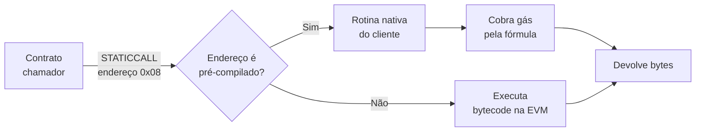

# Capítulo 79: Contratos Pré-Compilados, as Ferramentas Matemáticas Embutidas na EVM

No Capítulo 21, a EVM apareceu como uma máquina de pilha em que cada opcode tem um preço em gás. Só que existe uma classe de operações que seria inviável escrever em bytecode: verificar uma assinatura, multiplicar pontos de uma curva elíptica, checar um emparelhamento. Em Solidity, isso estouraria o limite de gás do bloco. A solução do protocolo foi embutir essas contas nos próprios clientes, endereçadas como se fossem contratos. São os contratos pré-compilados, ou *precompiles*. Este capítulo mostra como eles funcionam, quais existem hoje, como seus preços foram revistos ao longo do tempo e por que cada novo pré-compilado costuma ser a porta de entrada de uma tecnologia, como as provas de conhecimento zero e as passkeys.

**A ideia central.** Um pré-compilado é um endereço especial, de número muito baixo, para o qual se chama como para qualquer contrato (`CALL` ou `STATICCALL`). Em vez de executar bytecode, o cliente de execução (ver Capítulo 28) roda uma rotina nativa, escrita em linguagem de máquina otimizada, e devolve o resultado. Para o contrato chamador, a interface é a mesma de qualquer chamada: manda bytes, recebe bytes. A diferença está no custo, que é definido por uma fórmula fixada no protocolo e não pela soma de opcodes. Como o resultado precisa ser idêntico em todos os clientes, cada pré-compilado é, na prática, uma parte da especificação do consenso.



*O desenho mostra a bifurcação que o cliente faz a cada chamada: se o endereço é de um pré-compilado, roda código nativo com preço definido por fórmula; caso contrário, interpreta o bytecode normalmente.*

**Os primeiros da fila.** Os quatro primeiros endereços existem desde o início do Ethereum e cobrem o básico. O de endereço 0x01 é o `ecrecover`, que recupera o endereço de quem assinou uma mensagem a partir da assinatura ECDSA na curva secp256k1, a mesma usada nas carteiras do Capítulo 26. Na especificação de execução, ele custa 3.000 de gás e, quando a assinatura é válida, devolve o endereço preenchido com zeros à esquerda até 32 bytes. Os endereços 0x02 e 0x03 calculam SHA-256 e RIPEMD-160, funções de hash herdadas do mundo do Bitcoin, e o 0x04, chamado de *identity*, simplesmente copia a entrada para a saída. Os três últimos cobram uma base mais um valor por palavra de 32 bytes: SHA-256 custa 60 mais 12 por palavra, RIPEMD-160 custa 600 mais 120 por palavra e o identity custa 15 mais 3 por palavra. O `ecrecover` é o coração de padrões como o `permit` do Capítulo 22 e da validação de assinaturas fora da cadeia do Capítulo 77.

**Aritmética de números grandes: ModExp.** No endereço 0x05 mora a exponenciação modular de inteiros arbitrariamente grandes. Ela é a base de RSA, de funções de atraso verificável e de acumuladores. A EIP-2565 reconheceu que o preço original era alto demais e propôs uma fórmula nova: calcula-se uma complexidade de multiplicação (o quadrado do número de palavras de 8 bytes do maior entre base e módulo), uma contagem de iterações ligada ao tamanho do expoente, multiplica-se as duas e divide-se por 3, com piso de 200 de gás. Anos depois, a conta virou ao contrário: a EIP-7883, incluída na Fusaka, concluiu que o ModExp estava subprecificado em vários cenários e que isso atrapalhava um futuro aumento do limite de gás. Ela subiu o piso de 200 para 500, eliminou a divisão por 3 (o que na prática triplica o custo geral), dobrou o multiplicador de iterações para expoentes grandes e dobrou a complexidade para entradas acima de 32 bytes. A EIP-7823, também na Fusaka, impõe limites superiores ao tamanho dos operandos (ver Capítulo 41).

**A curva alt_bn128 e o nascimento do ZK na mainnet.** Os endereços 0x06, 0x07 e 0x08 foram criados pelas EIPs 196 e 197. Ambas partem da mesma motivação: a execução no Ethereum é totalmente transparente, o que impede casos de uso com informação privada, e provas zkSNARK ajudariam, mas verificá-las dentro da EVM custaria mais do que cabe num bloco. Os pré-compilados fornecem as peças. O 0x06 soma dois pontos da curva alt_bn128 (definida por Y² = X³ + 3 sobre um corpo primo), o 0x07 multiplica um ponto por um escalar e o 0x08 faz uma checagem de emparelhamento: recebe uma lista de pares de pontos e responde 1 se o produto dos emparelhamentos vale a identidade, e 0 caso contrário. É essa verificação que os verificadores de provas Groth16 e similares usam, e é por isso que muitos rollups de validade (Capítulo 9) e protocolos de privacidade (Capítulo 29) a chamam em cada prova.

Os preços originais eram 500 para a soma, 40.000 para a multiplicação e 100.000 mais 80.000 por par para o emparelhamento. A EIP-1108 os reduziu porque as bibliotecas dos clientes ficaram cerca de uma ordem de grandeza mais rápidas, citando a troca da biblioteca de curva do Geth e otimizações do cliente Parity. Os valores atuais, confirmados na especificação de execução, são 150, 6.000 e 45.000 mais 34.000 por par. Como exemplo, a própria EIP afirma que uma transação confidencial típica do protocolo AZTEC cairia de 820.000 para 197.000 de gás. O emparelhamento é calculado sobre pares de 192 bytes, e entrada com tamanho que não seja múltiplo disso faz a chamada falhar.

```latex
\text{gas}_{\text{pairing}} = 45\,000 + 34\,000 \cdot k
```

*A fórmula mostra que verificar uma prova com k pares custa uma base fixa mais uma parcela linear em k.*

**BLAKE2 e o sonho de conversar com a Zcash.** O endereço 0x09 aceita a função de compressão `F` do BLAKE2b. A motivação da EIP-152 era verificar a prova de trabalho Equihash da Zcash, algo que exigiria 512 iterações da função de hash e ficaria caro demais em Solidity, abrindo a possibilidade de um cliente leve da Zcash dentro do Ethereum e trocas atômicas entre as redes. A entrada tem exatamente 213 bytes (rodadas, estado, bloco de mensagem, contadores e uma flag de bloco final) e o gás é simplesmente igual ao número de rodadas: 12 rodadas custam 12 de gás.

**Provas de blob e a ponte com o consenso.** O endereço 0x0A, criado pela EIP-4844 (Capítulo 34), é o de avaliação de ponto. Ele recebe 192 bytes: o hash versionado, os valores z e y, o compromisso KZG e a prova. Confere que o compromisso corresponde ao hash versionado e que o polinômio do blob de fato vale y no ponto z. O custo é de 50.000 de gás. É por ele que rollups que usam blobs conseguem provar, no contrato da L1, afirmações sobre dados que a EVM não consegue ler diretamente.

**BLS12-381, sete endereços de uma vez.** A EIP-2537, incluída na Pectra, adicionou os endereços de 0x0b a 0x11: soma e multiplicação múltipla (MSM) em G1 e em G2, checagem de emparelhamento e duas funções que mapeiam elementos de corpo para pontos. A motivação declarada é oferecer uma curva com mais de 120 bits de segurança, contra cerca de 80 bits da alt_bn128. O emparelhamento custa 32.600 por par mais 37.700 de base. É a mesma família de curvas das assinaturas BLS dos validadores (Capítulo 73), o que permite, por exemplo, que um contrato verifique assinaturas agregadas do consenso.

**Passkeys na camada base: P256VERIFY.** O mais recente da lista, no endereço 0x100, veio com a Fusaka pela EIP-7951 (ver Capítulo 41). Ele verifica assinaturas ECDSA na curva secp256r1, também chamada P-256, que é a curva usada por hardware como o Secure Enclave da Apple, o Android Keystore, módulos de segurança e dispositivos FIDO2/WebAuthn. A entrada tem 160 bytes (hash, r, s e as duas coordenadas da chave pública) e a saída é um valor de 32 bytes terminado em 1 quando a assinatura é válida; em caso de falha, devolve saída vazia sem reverter. O gás é 6.900. A EIP substitui a RIP-7212, que já circulava em L2s, corrigindo duas vulnerabilidades (a checagem do ponto no infinito e a comparação de r módulo n) e usando preço diferente, o que significa que os custos nas L2s e na L1 deixam de coincidir. A utilidade está em contas abstratas (Capítulo 24): uma carteira pode aceitar a assinatura do celular do usuário como autorização nativa.

| Endereço | Nome | Função | Gás (resumo) | Chegada |
| --- | --- | --- | --- | --- |
| 0x01 | ecrecover | Recupera o signatário ECDSA (secp256k1) | 3.000 | Origem |
| 0x02 | SHA-256 | Hash | 60 + 12 por palavra | Origem |
| 0x03 | RIPEMD-160 | Hash | 600 + 120 por palavra | Origem |
| 0x04 | identity | Copia a entrada | 15 + 3 por palavra | Origem |
| 0x05 | ModExp | Exponenciação modular | Fórmula (EIP-2565, EIP-7883) | EIP-198, repreço em EIP-2565 e EIP-7883 |
| 0x06 a 0x08 | alt_bn128 | Soma, multiplicação e emparelhamento | 150, 6.000, 45.000 + 34.000 por par | EIPs 196, 197 e 1108 |
| 0x09 | BLAKE2f | Compressão do BLAKE2b | 1 por rodada | EIP-152 |
| 0x0A | Avaliação de ponto | Prova KZG de blob | 50.000 | EIP-4844 |
| 0x0b a 0x11 | BLS12-381 | Operações de curva e emparelhamento | Tabela da EIP | EIP-2537, Pectra |
| 0x100 | P256VERIFY | ECDSA em secp256r1 | 6.900 | EIP-7951, Fusaka |

**Por que preços de pré-compilado são política monetária em miniatura.** O gás de um pré-compilado só é justo se refletir o tempo real de CPU do cliente mais lento. Se for alto demais, desencoraja usos legítimos (foi o caso do emparelhamento antes da EIP-1108). Se for baixo demais, abre uma avenida de ataque de negação de serviço, em que alguém enche o bloco com chamadas baratas que demoram a validar (foi o argumento da EIP-7883 para o ModExp). Por isso as revisões de preço acompanham benchmarks entre clientes, e a diversidade de implementações discutida no Capítulo 28 entra como medida de segurança: a rotina mais lenta é a que define o preço.

**O custo de ter muitos.** Pré-compilados têm um custo de governança: cada um aumenta a superfície de especificação que todos os clientes precisam manter, e adicionar um novo exige hard fork. Ainda assim, são o caminho natural para novas primitivas criptográficas, como os verificadores baratos que esquemas pós-quânticos (Capítulo 44) vão exigir no nível do protocolo.

**Glossário do capítulo.**

- **Pré-compilado**: endereço especial cuja chamada executa uma rotina nativa do cliente, com preço de gás definido por fórmula.
- **ecrecover**: pré-compilado que recupera, de uma assinatura ECDSA em secp256k1, o endereço de quem a produziu.
- **ModExp**: pré-compilado de exponenciação modular com inteiros de tamanho arbitrário.
- **alt_bn128**: curva elíptica de 254 bits usada pelos pré-compilados de soma, multiplicação e emparelhamento anteriores ao BLS12-381.
- **Emparelhamento**: operação sobre pares de pontos de curvas especiais que permite verificar provas zkSNARK e assinaturas agregadas.
- **MSM**: multiplicação escalar múltipla, soma de vários pontos multiplicados cada um por seu escalar.
- **Avaliação de ponto**: pré-compilado da EIP-4844 que verifica que um blob, comprometido por KZG, vale y em um ponto z.
- **BLAKE2f**: função de compressão do BLAKE2b exposta pela EIP-152.
- **P256VERIFY**: pré-compilado de verificação de assinaturas na curva secp256r1, usada por passkeys e hardware seguro.
- **Negação de serviço**: ataque que tenta travar ou atrasar a rede com operações baratas para o atacante e caras para quem valida.

**Fontes.**

- [EIP-196: alt_bn128 precompiles (ADD and MUL)](https://raw.githubusercontent.com/ethereum/EIPs/master/EIPS/eip-196.md)
- [EIP-197: alt_bn128 pairing check](https://raw.githubusercontent.com/ethereum/EIPs/master/EIPS/eip-197.md)
- [EIP-1108: Reduce alt_bn128 gas costs](https://raw.githubusercontent.com/ethereum/EIPs/master/EIPS/eip-1108.md)
- [EIP-152: BLAKE2 compression function F precompile](https://raw.githubusercontent.com/ethereum/EIPs/master/EIPS/eip-152.md)
- [EIP-2565: ModExp gas cost](https://raw.githubusercontent.com/ethereum/EIPs/master/EIPS/eip-2565.md)
- [EIP-7883: ModExp gas cost increase](https://raw.githubusercontent.com/ethereum/EIPs/master/EIPS/eip-7883.md)
- [EIP-7951: secp256r1 precompile](https://raw.githubusercontent.com/ethereum/EIPs/master/EIPS/eip-7951.md)
- [EIP-2537: BLS12-381 precompiles](https://raw.githubusercontent.com/ethereum/EIPs/master/EIPS/eip-2537.md)
- [EIP-4844: Shard blob transactions](https://raw.githubusercontent.com/ethereum/EIPs/master/EIPS/eip-4844.md)
- [EIP-7600: Hardfork Meta, Pectra](https://raw.githubusercontent.com/ethereum/EIPs/master/EIPS/eip-7600.md)
- [EIP-7607: Hardfork Meta, Fusaka](https://raw.githubusercontent.com/ethereum/EIPs/master/EIPS/eip-7607.md)
- [execution-specs, constantes de gás (Osaka)](https://raw.githubusercontent.com/ethereum/execution-specs/master/src/ethereum/forks/osaka/vm/gas.py)
- [execution-specs, mapa de pré-compilados (Osaka)](https://raw.githubusercontent.com/ethereum/execution-specs/master/src/ethereum/forks/osaka/vm/precompiled_contracts/mapping.py)
- [execution-specs, ecrecover (Osaka)](https://raw.githubusercontent.com/ethereum/execution-specs/master/src/ethereum/forks/osaka/vm/precompiled_contracts/ecrecover.py)
