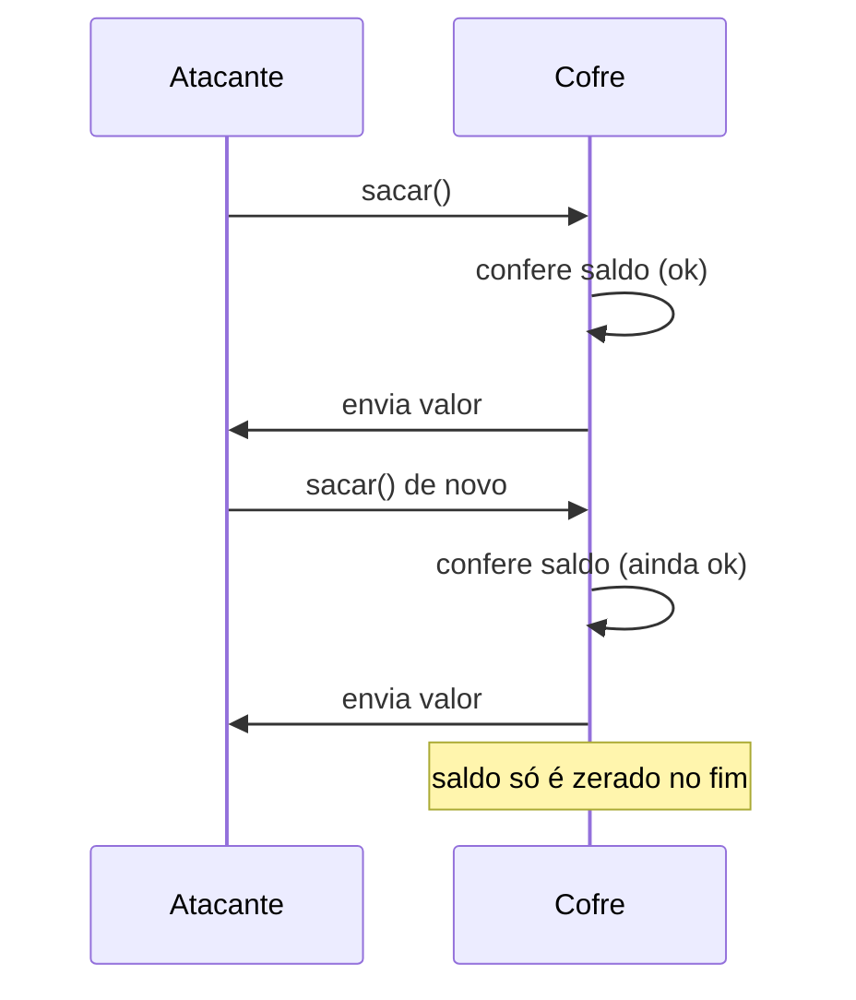
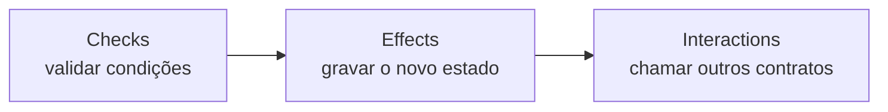

# Capítulo 80: Reentrância, o Padrão Checks-Effects-Interactions e as Travas de Reentrada

A reentrância é o defeito de contrato inteligente mais famoso da história do Ethereum. Foi ela que esvaziou a The DAO em 2016 (Capítulo 20) e continua aparecendo, em variações cada vez mais sutis, em incidentes como os do Capítulo 33. O interessante é que ela não nasce de um erro de criptografia nem de uma falha da rede: nasce de uma consequência direta de como a EVM (Capítulo 21) funciona. Este capítulo explica por que a reentrância é possível, qual é a disciplina de escrita que a neutraliza, como funcionam as travas prontas e por que nem elas resolvem tudo.

**Por que a reentrada existe.** Quando um contrato A chama um contrato B, o controle da execução passa para B. Enquanto B roda, A fica esperando, com o estado que tiver deixado gravado até aquele momento. Nada impede que B, em vez de apenas responder, chame de volta uma função de A. A documentação do Solidity descreve exatamente isso: qualquer transferência de Ether entrega o controle ao contrato destinatário, o que permite a ele chamar A de novo antes que a interação original termine. A mesma documentação lembra que o problema não se limita ao envio de Ether, pois qualquer chamada de função a outro contrato abre a mesma janela. Se A ainda não atualizou seus registros antes de chamar, a função de A será executada duas vezes sobre dados desatualizados.

**O exemplo clássico.** Imagine um cofre que guarda o saldo de cada usuário e oferece uma função de saque. Uma versão ingênua faz três coisas nesta ordem: confere se o usuário tem saldo, envia o valor a ele e só depois zera o saldo registrado. Se o destinatário for um contrato, o recebimento do valor dispara o código dele, que pode chamar o saque outra vez. Como o saldo ainda não foi zerado, a conferência passa de novo, o envio acontece de novo, e o ciclo se repete até o cofre secar ou o gás acabar.

*O desenho mostra o atacante chamando o saque de dentro do próprio recebimento do valor: como o cofre só atualiza o saldo depois de pagar, cada chamada aninhada enxerga o saldo antigo.*

**A disciplina que resolve: checks, effects, interactions.** A defesa mais simples não exige nenhuma ferramenta, só ordem. A documentação do Solidity chama de "checks-effects-interactions" o padrão em que a função primeiro valida tudo (checks), depois altera o estado do próprio contrato (effects) e só no fim chama outros contratos (interactions), "depois que todas as mudanças de estado planejadas foram gravadas". No exemplo do cofre, a versão corrigida lê o saldo do usuário, zera o registro e só então envia o valor. Se o atacante tentar reentrar, a conferência encontra saldo zero e a chamada reverte. A documentação descreve esse padrão como um caminho comum e à prova de falhas para evitar reentrância.

*A ordem importa mais que cada passo isolado: o estado já deve estar consistente no instante em que o controle sai do contrato.*

**O que `transfer` e `send` tentaram, e por que não bastam.** Durante anos, uma prática comum foi enviar Ether com `transfer` ou `send`, que repassam apenas uma quantia pequena e fixa de gás ao destinatário, em tese insuficiente para uma chamada de volta. A documentação do Solidity trata essa situação com cautela: diz que, com `send`, o problema é "não tão sério" justamente pelo gás limitado, mas deixa claro que o destinatário ainda pode reentrar e que a fragilidade continua. Já com `call`, que por padrão não limita o gás repassado, a janela fica aberta de verdade. Como o preço do gás por operação mudou ao longo dos anos (Capítulo 35), apostar num valor fixo de gás como defesa é frágil. A defesa correta é a ordem das operações, não a escassez de combustível.

**Reentrância entre funções e entre contratos.** O exemplo do cofre é a reentrância de função única. Mas o atacante pode reentrar por outra porta: se duas funções leem e escrevem o mesmo estado, chamar uma enquanto a outra está no meio do caminho produz o mesmo efeito. E o cenário se estende a vários contratos. A documentação do Solidity avisa que é preciso considerar o estado de contratos de que se depende, já que um contrato chamado pode modificar o estado de outro. Chamadas a contratos que se acreditam conhecidos podem, por sua vez, disparar chamadas a contratos desconhecidos, o que torna aconselhável aplicar o padrão de forma consistente.

**O caso dos ganchos de token.** Um ponto de reentrada fácil de esquecer é o próprio token. O padrão ERC-777 define dois ganchos: o `tokensToSend`, que o contrato do token deve chamar antes de atualizar o estado, e o `tokensReceived`, chamado depois. A especificação observa que, dentro de `tokensToSend`, uma consulta de saldo ainda devolve o saldo anterior ao envio. Quem escreve um protocolo achando que "transferir um token" é uma operação atômica e inofensiva, como no ERC-20 simples do Capítulo 22, pode ser surpreendido ao aceitar um token com ganchos. Em abril de 2020, o protocolo de empréstimos Lendf.Me foi drenado em algo da ordem de US$ 25 milhões num ataque descrito pelas análises da época como reentrância pelo gancho de um token do tipo ERC-777; o dinheiro acabou devolvido após negociação. A lição é de projeto: tokens e contratos externos são entradas não confiáveis, mesmo quando parecem rotineiros.

**As travas de reentrada.** Além da ordem das operações, existe uma segunda camada de defesa: a trava, ou *mutex*. A ideia é um indicador gravado no armazenamento que marca "esta função já está em execução"; se uma segunda entrada ocorrer enquanto o indicador está ligado, a chamada reverte. A biblioteca OpenZeppelin implementa isso no `ReentrancyGuard`. O modificador `nonReentrant` verifica e liga o indicador antes do corpo da função e o desliga depois. O indicador usa os valores 1 (não entrou) e 2 (entrou) em vez de um booleano, porque escrever de zero para um valor não nulo custa mais, e manter o valor sempre diferente de zero reduz o custo e o reembolso por chamada. Quando a reentrada ocorre, a chamada reverte com o erro `ReentrancyGuardReentrantCall()`.

Há limitações práticas. Como existe uma única trava por contrato, uma função `nonReentrant` não pode chamar outra função `nonReentrant` do mesmo contrato. O contorno recomendado é deixar o ponto de entrada `external` e protegido, e fazer com que ele chame uma função `private` que contém a lógica. Existe ainda o modificador `nonReentrantView`, que só consulta o indicador e nunca o altera, pensado para funções de leitura que não devem ser lidas no meio de uma atualização, o que ataca a chamada "reentrância somente de leitura".

**A trava ficou mais barata com o armazenamento transitório.** Gravar um indicador no armazenamento permanente é caro, e os reembolsos são limitados a uma fração do gás da transação. A EIP-1153 (ver Capítulo 78) criou o armazenamento transitório, com os opcodes `TSTORE` e `TLOAD`, ambos a 100 de gás, e usa a trava de reentrada como um dos exemplos centrais de motivação. A própria EIP nota que, com o armazenamento permanente, uma transação precisaria gastar cerca de 80 mil de gás em outras operações para colher o reembolso integral de uma única trava. Como o armazenamento transitório é limpo ao fim de cada transação, ele é a casa natural desse indicador. A OpenZeppelin oferece o `ReentrancyGuardTransient`, que guarda um booleano num espaço transitório e só funciona em redes que tenham a EIP-1153. A documentação do `ReentrancyGuard` clássico recomenda a versão transitória quando a rede a suporta e a marca como destinada a ser substituída numa versão futura.

| Defesa | Como funciona | Custo | Limite |
| --- | --- | --- | --- |
| Checks-effects-interactions | Grava o estado antes de qualquer chamada externa | Nenhum extra | Depende de disciplina em cada função |
| `ReentrancyGuard` | Indicador 1 ou 2 no armazenamento permanente | Escrita em armazenamento | Uma trava por contrato; não protege outros contratos |
| `ReentrancyGuardTransient` | Booleano em armazenamento transitório | 100 de gás por `TSTORE` ou `TLOAD` | Exige rede com EIP-1153 |
| Evitar gancho de token | Rejeitar ou tratar tokens com callbacks | Menos tokens aceitos | Exige conhecer o comportamento de cada token |

**Quando a própria trava falha: o caso Vyper.** Em 30 de julho de 2023, vários pools da Curve foram explorados por uma falha na trava de reentrada do compilador Vyper. O aviso de segurança oficial (CVE-2023-39363) explica a causa: as travas nomeadas eram alocadas de forma incorreta. Cada função que usava uma trava nomeada recebia a sua própria trava, mesmo quando várias funções declaravam a mesma chave, o que permitia reentrar numa função enquanto outra, supostamente protegida pela mesma trava, estava no meio de uma chamada externa. As versões afetadas foram a 0.2.15, a 0.2.16 e a 0.3.0, e a correção veio na 0.3.1. O episódio mostra uma terceira camada de risco além do código do contrato e da biblioteca: o compilador. As perdas variam conforme a fonte, na casa de dezenas de milhões de dólares, e por isso o capítulo prefere não cravar um número. A lição é que uma trava só protege se for, de fato, a mesma trava, e que bytecode gerado merece verificação independente (ver o papel de contratos atualizáveis no Capítulo 69).

**Boas práticas, em resumo.** Primeiro, escrever funções na ordem checks, effects, interactions, tratando como interação qualquer chamada para fora do contrato, inclusive a de tokens. Segundo, adicionar uma trava nas funções que movem valor, como segunda camada e não como substituta da primeira. Terceiro, pensar no estado compartilhado: se várias funções, ou vários contratos de um mesmo protocolo, leem os mesmos dados, a trava de uma única função não basta. Quarto, tratar leituras de preço ou saldo vindas de outro contrato como valores que podem estar em meio a uma atualização. Quinto, submeter o contrato a testes de reentrada com contratos atacantes escritos de propósito.

**Glossário do capítulo.**

- **Reentrância**: situação em que um contrato chamado volta a chamar o contrato original antes que a execução inicial termine, explorando estado ainda não atualizado.
- **Checks-effects-interactions**: padrão de escrita que valida condições, atualiza o estado e só então chama outros contratos.
- **Trava de reentrada (mutex)**: indicador que marca uma função como em execução e faz reverter qualquer segunda entrada.
- **nonReentrant**: modificador do `ReentrancyGuard` da OpenZeppelin que liga e desliga a trava ao redor da função.
- **Armazenamento transitório**: região de memória persistente apenas durante uma transação, criada pela EIP-1153, acessada por `TSTORE` e `TLOAD`.
- **Gancho de token (hook)**: função que o contrato do token chama no remetente ou no destinatário durante uma transferência, como no ERC-777.
- **Reentrância entre funções**: variação em que o atacante reentra por uma função diferente da original que lê ou escreve o mesmo estado.
- **Reentrância somente de leitura**: variação em que o contrato atacado é consultado por outro contrato enquanto seu estado ainda está inconsistente.
- **CVE**: identificador público de uma vulnerabilidade de segurança conhecida, como o CVE-2023-39363 do Vyper.

**Fontes.**

- [Solidity, considerações de segurança (reentrância e checks-effects-interactions)](https://raw.githubusercontent.com/ethereum/solidity/develop/docs/security-considerations.rst)
- [OpenZeppelin, ReentrancyGuard.sol](https://raw.githubusercontent.com/OpenZeppelin/openzeppelin-contracts/master/contracts/utils/ReentrancyGuard.sol)
- [OpenZeppelin, ReentrancyGuardTransient.sol](https://raw.githubusercontent.com/OpenZeppelin/openzeppelin-contracts/master/contracts/utils/ReentrancyGuardTransient.sol)
- [EIP-1153: Transient storage opcodes](https://raw.githubusercontent.com/ethereum/EIPs/master/EIPS/eip-1153.md)
- [ERC-777: Token Standard](https://raw.githubusercontent.com/ethereum/ercs/master/ERCS/erc-777.md)
- [Aviso de segurança do Vyper GHSA-5824-cm3x-3c38 (CVE-2023-39363)](https://github.com/vyperlang/vyper/security/advisories/GHSA-5824-cm3x-3c38)
