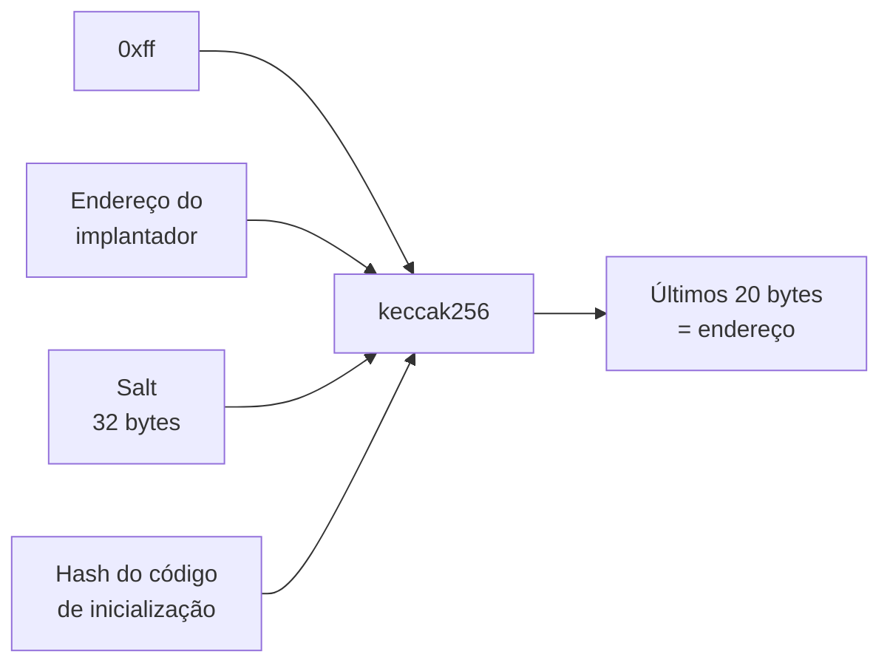
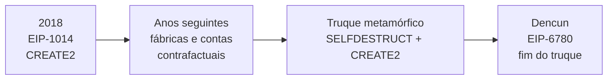

# Capítulo 81: CREATE2 e os Endereços Determinísticos, Como Saber Onde um Contrato Vai Morar Antes de Ele Existir

Em geral, o endereço de um contrato só é conhecido depois que ele é implantado. O opcode CREATE2 mudou isso: com ele, é possível calcular o endereço de um contrato antes de ele existir na cadeia. A ideia parece um detalhe técnico, mas sustenta carteiras que "já têm endereço" antes da primeira transação (Capítulo 24), fábricas de contratos, implantações com o mesmo endereço em várias redes e, também, um truque de atualização hoje bloqueado. Este capítulo explica como o endereço é calculado, para que serve a previsibilidade e o que a Dencun (Capítulo 78) mudou.

**Como um contrato ganha endereço com CREATE.** Quando uma conta ou um contrato cria outro contrato com o opcode CREATE, o endereço novo depende de quem criou e do nonce do criador (a contagem de ações já feitas, tema do Capítulo 77). Como o nonce avança a cada criação, o endereço só é conhecido na prática depois que a ordem das criações está definida. Se o criador fizer uma transação antes da esperada, todos os endereços seguintes mudam. Isso é um problema quando alguém precisa apontar para um contrato que ainda não foi criado.

**A fórmula do CREATE2.** A EIP-1014, chamada "Skinny CREATE2", acrescentou o opcode CREATE2 (0xf5), que recebe quatro argumentos da pilha: o valor a enviar, o início e o tamanho do código de inicialização na memória, e um **salt**, um número de 32 bytes escolhido por quem implanta. O endereço novo são os últimos 20 bytes de um hash que combina quatro ingredientes: o prefixo fixo 0xff, o endereço de quem implanta, o salt e o hash do código de inicialização.

```latex
endereco = ultimos_20_bytes( keccak256( 0xff || implantador || salt || keccak256(codigo_de_inicializacao) ) )
```

Nada nessa fórmula depende do nonce. Quem conhece o implantador, o salt e o código consegue calcular o endereço no papel, sem enviar transação alguma. A EIP-1014 explica a escolha do prefixo 0xff: ele garante que os endereços do CREATE2 não colidam com os do método antigo, baseado em remetente e nonce. O conteúdo hasheado tem sempre 85 bytes (1 do prefixo, 20 do endereço, 32 do salt e 32 do hash do código), o que mantém o cálculo previsível.



*O desenho mostra que o endereço é função apenas de quatro valores conhecidos de antemão; mudar qualquer um deles, inclusive um único byte do código, produz outro endereço.*

**Para que serve saber o endereço antes.** A motivação original da EIP-1014 foram os canais de estado, em que as partes precisam interagir com contratos que ainda não existem na cadeia, as chamadas interações contrafactuais. A ideia se generalizou. Uma carteira pode mostrar um endereço ao usuário, que recebe fundos ali, e só implantar o contrato quando houver necessidade de movimentá-los. Na ERC-4337 (Capítulo 24), o campo `initCode` de uma operação traz o endereço de uma fábrica e os dados da chamada; a especificação diz que se espera que a fábrica use CREATE2 em vez de CREATE para que a ordem de criação das contas não afete os endereços, e que a fábrica devolva o endereço da conta mesmo que ela já tenha sido criada. A carteira obtém o endereço contrafactual por uma chamada estática a `getSenderAddress()` do EntryPoint.

**Fábricas e o mesmo endereço em várias redes.** Há outro uso: fazer um contrato ter o mesmo endereço em todas as redes. A ERC-2470 descreve uma "fábrica singleton", um contrato que qualquer pessoa pode usar para implantar outros por CREATE2. Seu endereço, segundo a especificação, é 0xce0042B868300000d44A59004Da54A005ffdcf9f em toda rede onde foi implantada. Para que a própria fábrica tenha o mesmo endereço em todo lugar, usa-se o chamado método de Nick: uma transação pré-assinada com valores de assinatura arbitrários, de modo que ninguém detém a chave do remetente, e sem proteção de replay da EIP-155 (Capítulo 77), para que possa ser retransmitida em qualquer rede. A ERC-2470 fixa o preço de gás em 100 gwei e o limite em 247.000, o dobro do necessário, para a transação ser aceita em qualquer cadeia e sobreviver a futuras mudanças de preço de opcodes. Na prática, quem usa a mesma fábrica, o mesmo salt e o mesmo código obtém o mesmo endereço em todas as redes. O registro da ERC marca o status como "Stagnant", o que indica que o texto não avança, embora o contrato continue implantado.

| Aspecto | CREATE | CREATE2 |
| --- | --- | --- |
| Entradas do endereço | Criador e nonce do criador | 0xff, criador, salt e hash do código |
| Previsível antes da implantação | Só se a ordem das ações for conhecida | Sim, a qualquer momento |
| Muda se o código mudar | Não | Sim |
| Custo extra | Nenhum | Hash do código por palavra de 32 bytes |
| Uso típico | Implantação comum | Carteiras contrafactuais, fábricas, mesmo endereço entre redes |

**Colisões e proteções.** E se já houver algo no endereço calculado? A EIP-684 determina que, se a criação for tentada, por transação, CREATE, CREATE2 ou outro meio, num endereço com nonce diferente de zero ou código não vazio, a criação falha como se o primeiro byte do código fosse um opcode inválido. A motivação, segundo a EIP, é preservar o princípio de que o código implantado não muda: sem isso, um atacante com muito poder de computação poderia, em tese, criar uma conta num endereço que já guarda código e trocá-lo. A EIP-1014 acrescenta que o preço do CREATE2 inclui um custo de hash proporcional ao tamanho do código, para impedir que chamadas repetidas com código grande virem vetor de negação de serviço.

**O truque metamórfico e o fim dele.** Havia uma combinação engenhosa: um contrato executava SELFDESTRUCT, o endereço ficava livre, e um novo contrato era implantado no mesmo endereço por CREATE2, com código diferente. Como o endereço dependia do hash do código de inicialização, o truque exigia que esse código fosse o mesmo e que o código final saísse de outra fonte, por exemplo lida de outro contrato durante a inicialização. Era uma forma de "atualizar" um contrato sem proxy (Capítulo 69), mas minava a confiança: quem auditou um contrato num endereço não tinha garantia de que o código continuaria o mesmo. A EIP-6780, incluída na Dencun (Capítulo 78), alterou o SELFDESTRUCT: fora da transação que criou o contrato, ele só transfere o saldo e não apaga código, armazenamento nem a conta. O texto da EIP afirma que o uso de CREATE2 para reimplantar um contrato no mesmo lugar, visando atualização, "não é mais suportado", e recomenda proxies ou o padrão ERC-2535. A EIP-1014 já notava, desde o início, que o SELFDESTRUCT não limpava nonce e código de imediato, de modo que a destruição e a recriação nunca poderiam ocorrer na mesma transação.



*A linha do tempo mostra o ciclo de vida da ideia: nasce como ferramenta de previsibilidade e, ao ser usada para trocar código em silêncio, acaba limitada por uma mudança de protocolo.*

**Boas perguntas para quem avalia um contrato.** Primeiro: o endereço foi obtido por CREATE2, e qual fábrica o implantou? Segundo: se o código pode ser alterado, isso acontece por proxy declarado, com administração visível, e não por truque de reimplantação? Terceiro: um endereço calculado, mas ainda sem contrato, é só uma promessa; enviar fundos para ele é seguro apenas se o código de inicialização que o produzirá estiver definido e conhecido. Quarto: em implantações multi-rede, o mesmo endereço não significa o mesmo dono: quem controla o contrato em cada rede deve ser verificado separadamente.

**Glossário do capítulo.**

- **CREATE2**: opcode (0xf5) que cria um contrato num endereço calculável a partir do implantador, de um salt e do hash do código de inicialização.
- **Salt**: valor de 32 bytes escolhido por quem implanta, usado para obter endereços diferentes com o mesmo código.
- **Código de inicialização**: código executado uma única vez na criação do contrato, cujo resultado vira o código permanente.
- **Endereço contrafactual**: endereço calculado antes de o contrato ser implantado, no qual já é possível receber fundos.
- **Fábrica (factory)**: contrato que cria outros contratos, frequentemente via CREATE2.
- **Método de Nick**: técnica que implanta um contrato com transação pré-assinada e assinatura arbitrária, sem que ninguém detenha a chave do remetente.
- **Contrato singleton**: contrato implantado uma única vez, com endereço conhecido, usado por vários projetos.
- **SELFDESTRUCT**: opcode que, desde a EIP-6780, só apaga o contrato se for chamado na mesma transação em que ele foi criado.
- **Contrato metamórfico**: contrato que muda de código ao ser destruído e reimplantado no mesmo endereço, prática bloqueada pela EIP-6780.

**Fontes.**

- EIP-1014, Skinny CREATE2: https://github.com/ethereum/EIPs/blob/master/EIPS/eip-1014.md
- EIP-684, colisão na criação de contratos: https://github.com/ethereum/EIPs/blob/master/EIPS/eip-684.md
- ERC-2470, fábrica singleton: https://github.com/ethereum/ercs/blob/master/ERCS/erc-2470.md
- EIP-6780, SELFDESTRUCT apenas na mesma transação: https://github.com/ethereum/EIPs/blob/master/EIPS/eip-6780.md
- ERC-4337, abstração de contas: https://github.com/ethereum/ercs/blob/master/ERCS/erc-4337.md
