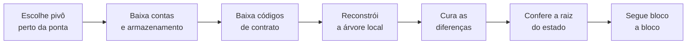
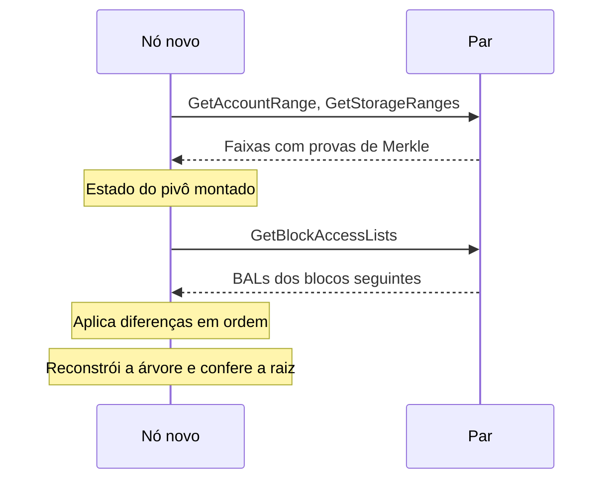

# Capítulo 82: Snap Sync e a Sincronização do Estado, Como um Nó Novo Chega ao Presente

Subir um nó de Ethereum do zero levanta uma pergunta prática: como uma máquina que não sabe nada chega ao estado atual da rede, com milhões de contas e contratos, sem repetir toda a história desde o bloco gênese? O Capítulo 65 mostrou como o nó descobre em quem confiar para começar (o checkpoint sync, na camada de consenso). Este capítulo trata da outra metade do problema, a camada de execução: como o estado é baixado, verificado e posto em dia. O nome da técnica atual é snap sync, e uma proposta em fase final, a EIP-8189, muda sua parte mais lenta usando as listas de acesso por bloco do Capítulo 39.

**Duas maneiras de chegar ao presente.** A forma mais direta é a sincronização completa: baixar todos os blocos desde o gênese e executar cada transação, reconstruindo o estado passo a passo. Ela dispensa confiar em terceiros, mas custa muito tempo e disco. A alternativa é baixar o estado já pronto de um ponto recente e verificá-lo contra a raiz do estado presente no cabeçalho de um bloco. Isso é possível porque o estado é organizado numa árvore de Merkle Patricia (Capítulo 70): se os dados baixados reproduzem a raiz do cabeçalho, estão corretos. O snap sync é a segunda abordagem, feita com ajuda dos pares da rede.

**O protocolo snap.** A especificação do protocolo snap, mantida no repositório devp2p, define que ele roda sobre o RLPx e serve para trocar "snapshots" de estado recente entre pares. Ele não funciona sozinho: deve operar ao lado do protocolo eth, que cuida de blocos e transações (Capítulo 66). A separação é intencional, pois permite que cada cliente decida se implementa o snap sem afetar sua participação no eth. O "snapshot" aqui é uma estrutura de aceleração que permite percorrer contas e posições de armazenamento de forma linear, ou seja, uma leitura plana em ordem de chave, e não a árvore em si. As mensagens principais pedem faixas de contas (GetAccountRange), faixas de armazenamento (GetStorageRanges) e códigos de contrato por hash (GetByteCodes). Cada resposta de faixa traz provas de Merkle das bordas, o que permite ao receptor verificar o trecho sem confiar em quem o enviou.

**O que muda em relação a pedir nó por nó.** O ponto central do desenho é baixar folhas, e não nós intermediários. O nó novo recebe trechos contíguos de contas e de armazenamento, sem os nós internos da árvore, e reconstrói a árvore localmente a partir deles. Em vez de percorrer a árvore de cima para baixo com uma ida e volta de rede por nó, ele consome blocos grandes de dados ordenados.

*O desenho mostra o roteiro do snap sync: baixar o estado de um bloco-pivô, reconstruir a árvore, corrigir o que mudou durante o download e só então conferir a raiz e passar a acompanhar a rede.*

**Por que existe a etapa de cura.** O download leva tempo, e a rede não para. Enquanto o nó baixa o estado do bloco-pivô, novos blocos chegam e alteram contas e posições. Parte dos dados recebidos fica, então, desatualizada em relação à ponta da cadeia. A cura (healing) é a fase que reconcilia essas diferenças. Na versão atual do protocolo (snap/1, introduzido em novembro de 2020 segundo a própria especificação), ela é iterativa: o nó descobre quais nós da árvore estão errados ou faltando e os pede, aos poucos, por mensagens do tipo GetTrieNodes. O protocolo snap/1 depende de muitas idas e voltas para isso, e a especificação do snap/2 reconhece que a cura é justamente o trecho que será substituído.

**A proposta da EIP-8189, o snap/2.** A EIP-8189, de Toni Wahrstätter e Gary Rong, está com status Last Call, com prazo de revisão final em 1º de novembro de 2026, e exige a EIP-7928. A ideia é trocar a cura por nós da árvore pela aplicação de listas de acesso por bloco (BALs). Como visto no Capítulo 39, cada bloco passa a carregar no cabeçalho o hash de uma lista com o que foi tocado e os valores finais após a execução. Um nó em sincronização, em vez de caçar nós da árvore, baixa as BALs dos blocos que avançaram durante o download e aplica as diferenças de estado em ordem. Cada BAL é verificada comparando o keccak256 da sua codificação RLP com o hash no cabeçalho, e o conjunto de blocos a recuperar é conhecido de antemão.

Na prática, o snap/2 remove as mensagens GetTrieNodes e TrieNodes (os códigos 0x06 e 0x07 ficam reservados) e acrescenta GetBlockAccessLists (0x08) e BlockAccessLists (0x09). As mensagens 0x00 a 0x05 permanecem iguais. A EIP sugere um limite flexível de resposta de 2 MiB e usa como exemplo um pivô a 64 blocos da ponta. Se ocorre uma reorganização (Capítulo 62) que passa do pivô, o nó encontra o ancestral comum, remove o que só a bifurcação abandonada mudou, baixa de novo esses trechos e aplica as BALs da cadeia nova. Para isso, os pares devem guardar BALs mesmo de blocos órfãos dentro da janela de retenção da EIP-7928; se nenhum par as tiver, o nó precisa recomeçar a sincronização.

*O diagrama mostra a conversa entre o nó novo e um par no snap/2: primeiro o estado do pivô, depois as BALs dos blocos que passaram, e por fim a conferência da raiz.*

**Comparação entre as estratégias.**

| Estratégia | O que se baixa | Como se verifica | Ponto fraco |
| --- | --- | --- | --- |
| Sincronização completa | Todos os blocos desde o gênese | Executando cada transação | Muito tempo e processamento |
| Snap sync (snap/1) | Folhas do estado e, na cura, nós da árvore | Provas de Merkle das faixas e raiz final | Cura iterativa com muitas idas e voltas |
| Snap sync (snap/2, EIP-8189) | Folhas do estado e BALs dos blocos seguintes | Provas das faixas, hash da BAL e raiz final | Depende de pares que retenham BALs |

**O que a EIP-7928 prevê sobre retenção.** Pela EIP-7928, a camada de execução deve manter as BALs disponíveis pelos métodos engine_getPayloadBodiesBy*V2 por pelo menos HISTORY_PRUNE_EPOCHS, definido como 14.299 épocas, o mesmo prazo dos corpos de bloco. Para armazenamento de longo prazo, os bytes completos podem ser descartados e substituídos pelo hash_tree_root do campo, preservando o compromisso de Merkle. A motivação declarada da EIP inclui justamente a reconstrução de estado sem executar transações e sem provas individuais contra a raiz.

**Onde está a confiança.** O snap sync não pede confiança cega nos pares: toda faixa vem com prova, e o estado final é conferido contra a raiz de um cabeçalho. A confiança restante está na escolha desse cabeçalho. É aqui que o checkpoint sync do Capítulo 65 e o sistema de consenso entram: o nó de execução recebe do cliente de consenso (Capítulo 28) a indicação da cabeça da cadeia e do bloco finalizado, de modo que a raiz que ele usa como alvo não vem de um par qualquer. A comparação com os clientes leves (Capítulo 60) ajuda a ver a diferença: o cliente leve não guarda o estado e pede provas a cada consulta, enquanto o nó que fez snap sync passa a ter o estado inteiro e a servir outros.

**Perguntas para quem sobe um nó.** Primeiro: qual modo de sincronização o cliente usa por padrão, e o que acontece se o processo for interrompido? Segundo: há espaço em disco e banda suficientes, lembrando que o estado cresce com o uso da rede (Capítulo 37)? Terceiro: o cliente de consenso já está sincronizado e conectado, já que o nó de execução depende dele para saber onde está a ponta? Quarto: a versão do cliente suporta o snap/2 quando a rede passar a adotá-lo, ou ainda depende da cura antiga? A EIP-8189 ainda está em revisão e não deve ser tratada como funcionalidade ativa.

**Glossário do capítulo.**

- **Snap sync**: modo de sincronização que baixa o estado recente de pares, com provas, em vez de reexecutar toda a história.
- **Protocolo snap**: protocolo sobre o RLPx, usado junto com o eth, que serve faixas de contas, armazenamento e códigos de contrato.
- **Pivô**: bloco recente escolhido como referência para baixar o estado.
- **Snapshot (estrutura plana)**: representação do estado que permite percorrer contas e posições em ordem de chave, sem navegar pela árvore.
- **Prova de faixa**: prova de Merkle das bordas de um trecho, que permite verificar um bloco de dados recebido.
- **Cura (healing)**: fase em que o nó corrige o que ficou desatualizado porque a cadeia avançou durante o download.
- **Lista de acesso por bloco (BAL)**: lista, com hash no cabeçalho do bloco, das contas e posições tocadas e seus valores finais (EIP-7928).
- **snap/2**: versão do protocolo proposta na EIP-8189, que troca a cura por nós pela aplicação de BALs.
- **Janela de retenção**: período em que os nós devem manter dados como as BALs disponíveis para os pares.

**Fontes.**

- Especificação do protocolo snap (devp2p): https://github.com/ethereum/devp2p/blob/master/caps/snap.md
- EIP-8189, snap/2, cura de estado baseada em BAL: https://github.com/ethereum/EIPs/blob/master/EIPS/eip-8189.md
- EIP-7928, listas de acesso por bloco: https://github.com/ethereum/EIPs/blob/master/EIPS/eip-7928.md
