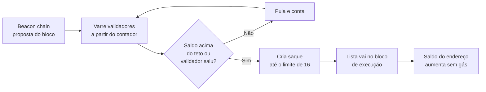
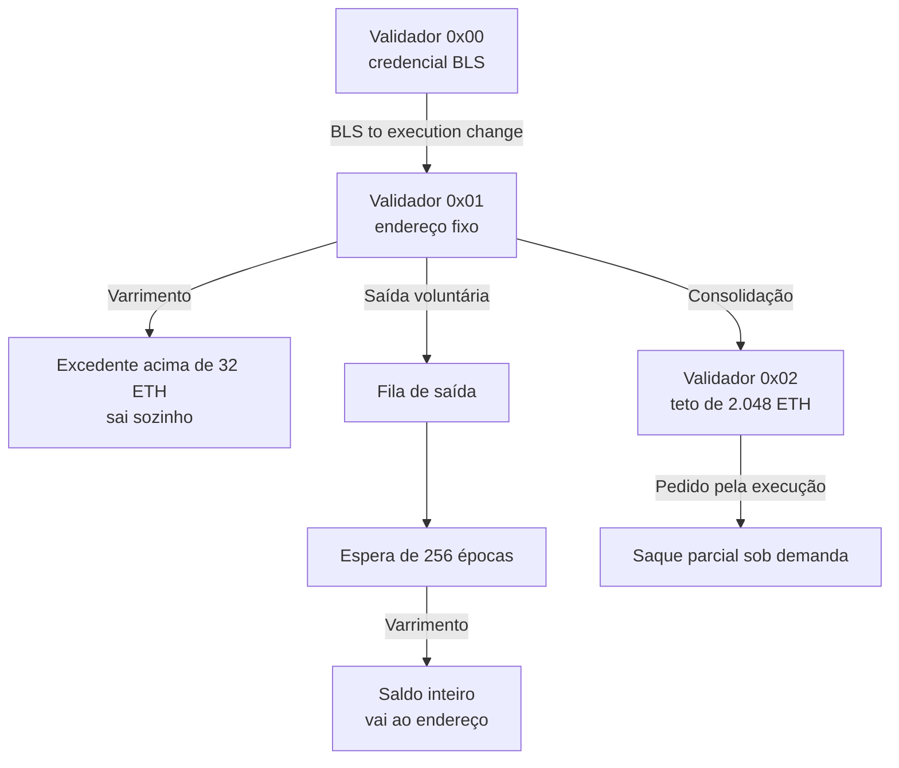

# Capítulo 83: Saques do Staking, a Shapella e o Varrimento (Sweep) que Devolve o ETH

Durante mais de dois anos, o ETH depositado no staking só andava em uma direção. Desde o contrato de depósito (Capítulo 71), o valor entrava na camada de consenso e não havia caminho de volta, porque a camada de consenso não tinha como empurrar saldo para a camada de execução. Isso mudou com a atualização Shapella, ativada em 12 de abril de 2023. Este capítulo mostra como funcionam os saques: o que a Capella e a Shanghai trouxeram, quem é varrido e quando, qual a diferença entre saque parcial e saque total, e o que a Pectra (Capítulo 40) alterou nessa mecânica.

**Um nome, duas camadas.** Shapella junta dois nomes: Shanghai, a atualização da camada de execução, e Capella, a da camada de consenso. Cada lado cuidou de uma parte do problema. A Capella ensinou a beacon chain a decidir quais saques acontecem e quando. A Shanghai ensinou a camada de execução a receber esses saques como uma nova espécie de operação. Segundo a EIP-4895, a ativação na camada de execução ocorreu no timestamp 1681338455, que corresponde a 12 de abril de 2023, no fim do dia em UTC.

**Empurrar em vez de puxar.** A EIP-4895, de Alex Stokes e Danny Ryan, descreve o desenho: os saques são empurrados (push) da beacon chain para o EVM assim que a camada de consenso os tira da fila, em vez de o usuário precisar enviar uma transação para puxá-los. Cada saque é um objeto próprio, e não uma transação, o que separa o processamento de sistema dos dados do usuário e simplifica testes e revisão de segurança. A estrutura é uma lista com quatro campos:

| Campo | Tipo | Significado |
| --- | --- | --- |
| index | uint64 | Contador global de saques, começa em 0 e sobe de 1 em 1 |
| validator_index | uint64 | Validador da camada de consenso a que o saque se refere |
| address | 20 bytes | Endereço que recebe o valor |
| amount | uint64, em Gwei | Quantia, sempre maior que zero |

O bloco de execução ganha uma lista de saques e o cabeçalho ganha um `withdrawals_root`, uma raiz de árvore de Merkle Patricia (Capítulo 70) calculada como a raiz das transações. Os saques são processados depois de todas as transações do usuário, e cada um aumenta o saldo do destinatário, convertendo Gwei em wei. O aumento é incondicional e não pode falhar. Isso explica um detalhe prático: um saque não executa código no destinatário, então um contrato que recebe saques não é chamado e não pode barrá-los (compare com os ganchos de chamada do Capítulo 80). Os saques também não consomem gás, pois a camada de consenso limita quantos chegam por bloco.

**Quem recebe: as credenciais de saque.** Cada validador tem uma credencial de saque registrada no depósito. As credenciais de prefixo 0x00 são antigas e apontam para uma chave BLS, sem endereço de execução. As de prefixo 0x01 carregam um endereço de execução. Para que o ETH de um validador 0x00 pudesse sair, a Capella criou uma mensagem assinada, a BLS-to-execution-change, que troca a credencial pelo prefixo 0x01 mais o endereço escolhido. Pela especificação, a mudança só vale se a credencial atual for do tipo BLS, se o restante dos bytes bater com o hash da chave BLS informada e se a assinatura verificar no domínio próprio da operação, que não depende da versão do fork. Cada bloco pode trazer até 16 dessas mudanças. A troca é feita uma única vez, e depois o endereço fica fixo. Enquanto não houver um endereço de saque, o saldo permanece preso na conta do validador. Esse risco fica contido enquanto a frase-semente (Capítulo 26) continuar segura.

**O varrimento (sweep).** Quem decide os saques de cada bloco é uma função da especificação, `get_expected_withdrawals`. Ela parte de um contador de validador e percorre a lista de validadores em ordem, dando a volta ao chegar ao fim. Em cada bloco, examina no máximo 16.384 validadores e para ao juntar 16 saques, que é o limite por bloco. Para cada validador, há dois casos:

- **Saque parcial.** O validador tem credencial 0x01, o saldo efetivo está no teto de 32 ETH e o saldo real passa de 32 ETH. A quantia sacada é só o excedente. O validador continua ativo.
- **Saque total.** O validador tem credencial 0x01, já chegou à época em que se torna sacável e ainda tem saldo. A quantia é o saldo inteiro.

Um validador que não se encaixa em nenhum dos casos é só contado e pulado. Como o varrimento anda sempre para a frente, ninguém fura fila: o que importa é a posição do validador no ciclo.



*O desenho mostra o ciclo de cada bloco: a camada de consenso varre os validadores, seleciona os que têm algo a sacar, monta uma lista de até 16 e a execução apenas credita os endereços.*

**Quanto tempo leva uma volta.** Com 16 saques por bloco e 7.200 slots por dia, o teto é de 115.200 saques por dia, se nenhum slot falhar. A página de saques da ethereum.org usa esse número para dar ordens de grandeza: 400 mil saques levam cerca de 3,5 dias, e 800 mil, cerca de 7 dias. Slots perdidos alongam o prazo. Por isso, um excedente de recompensa chega ao endereço a cada poucos dias, e não a cada bloco. O conteúdo da fórmula é simples:

```latex
saques_por_dia = 16 x 7200 = 115200
dias_para_varrer(N) = N / 115200
```

**Sair é diferente de sacar.** Um saque total só acontece depois de um processo de saída em duas etapas. O validador faz uma saída voluntária (ou é ejetado, no caso de o saldo efetivo cair a 16 ETH ou menos, o valor de `EJECTION_BALANCE`), entra na fila de saída (Capítulo 49 mostra o cálculo dessa fila) e, ao receber sua época de saída, ganha também uma época em que fica sacável. Pela especificação, `withdrawable_epoch` é a época de saída somada a `MIN_VALIDATOR_WITHDRAWABILITY_DELAY`, definido como 256 épocas, o que dá cerca de 27 horas (256 épocas de 384 segundos). Só depois disso o varrimento chega ao validador e envia o saldo inteiro. A soma dos prazos varia com o tamanho da fila de saída e com a posição do varrimento.

**O que a Pectra alterou.** Com a EIP-7251 (Capítulo 40), surgiram validadores de credencial 0x02, os compostos, com teto de 2.048 ETH. A página da ethereum.org resume o efeito sobre os saques: nos validadores 0x01, o excedente acima de 32 ETH continua sendo varrido automaticamente. Nos 0x02, o varrimento só tira o que passa de 2.048 ETH, e quem quiser sacar uma quantia menor precisa pedir pela camada de execução (EIP-7002), pagando gás. A especificação da Electra adiciona uma fila de saques parciais pendentes: a função passa a atender primeiro esses pedidos, até 8 por bloco (`MAX_PENDING_PARTIALS_PER_WITHDRAWALS_SWEEP`), e depois roda o varrimento com o restante da capacidade. Cada pedido paga o menor valor entre o solicitado e o saldo acima de 32 ETH. As trocas de 0x01 para 0x02 não são reversíveis.



*O desenho mostra os caminhos possíveis de um validador: de 0x00 para 0x01, o excedente automático, a saída completa e, desde a Pectra, o modelo composto com saque sob demanda.*

**Por que isso importa para quem estuda o ecossistema.** Os saques fecharam o ciclo do staking e alteraram dois debates. No primeiro, o staking líquido (Capítulo 3) deixou de depender apenas do mercado secundário para o resgate do token, porque o ETH subjacente passou a ter uma saída garantida pelo protocolo, ainda que com fila. No segundo, o rendimento do staking (Capítulo 48) passou a ter parte entregue com regularidade, em vez de acumulada indefinidamente no saldo do validador. Ainda é preciso lembrar que um saque não é uma venda: o ETH volta para um endereço de execução e o que se faz com ele é outra decisão. Este material é educacional e não recomenda comprar, vender ou fazer staking.

**Perguntas para avaliar a própria situação de staking.** Primeiro: a credencial de saque é 0x01 ou 0x02, e o endereço registrado é controlado por quem deveria controlá-lo, lembrando que ele não pode ser trocado depois (Capítulo 49 mostra o que acontece quando o operador é comprometido)? Segundo: o prazo entre pedir a saída e ver o saldo inclui a fila de saída, as 256 épocas e a posição do varrimento? Terceiro: o saque parcial está sendo recebido de forma automática ou precisa ser pedido pela execução, e quanto gás isso custa? Quarto: o endereço de destino é uma conta externa ou um contrato, e o contrato está preparado para receber ETH sem executar código?

**Glossário do capítulo.**

- **Shapella**: nome combinado da Shanghai (execução) e da Capella (consenso), a atualização que habilitou os saques em 12 de abril de 2023.
- **Saque (withdrawal)**: operação de sistema que credita ETH da camada de consenso a um endereço de execução, sem gás e sem poder falhar.
- **Credencial de saque**: campo do validador que define para onde o saldo pode sair; prefixo 0x00 (BLS), 0x01 (endereço) ou 0x02 (composto).
- **BLS-to-execution-change**: mensagem assinada que troca uma credencial 0x00 por uma 0x01 com endereço de execução.
- **Varrimento (sweep)**: percurso cíclico pela lista de validadores que escolhe quem recebe saque em cada bloco, até 16 por bloco.
- **Saque parcial**: envio apenas do excedente acima do teto de saldo efetivo, sem sair do staking.
- **Saque total**: envio do saldo inteiro de um validador que já saiu e se tornou sacável.
- **withdrawable_epoch**: época a partir da qual o validador pode ter o saldo inteiro sacado, igual à época de saída mais 256 épocas.
- **withdrawals_root**: raiz de Merkle Patricia das retiradas, incluída no cabeçalho do bloco de execução.
- **Saque parcial pendente**: pedido feito pela camada de execução (EIP-7002) para validadores compostos, atendido antes do varrimento.

**Fontes.**

- EIP-4895, saques empurrados pela beacon chain: https://raw.githubusercontent.com/ethereum/EIPs/master/EIPS/eip-4895.md
- Especificação da Capella (consenso): https://raw.githubusercontent.com/ethereum/consensus-specs/master/specs/capella/beacon-chain.md
- Especificação da Electra (consenso): https://raw.githubusercontent.com/ethereum/consensus-specs/master/specs/electra/beacon-chain.md
- Especificação da fase 0 (consenso): https://raw.githubusercontent.com/ethereum/consensus-specs/master/specs/phase0/beacon-chain.md
- ethereum.org, saques do staking: https://raw.githubusercontent.com/ethereum/ethereum-org-website/dev/public/content/staking/withdrawals/index.md
