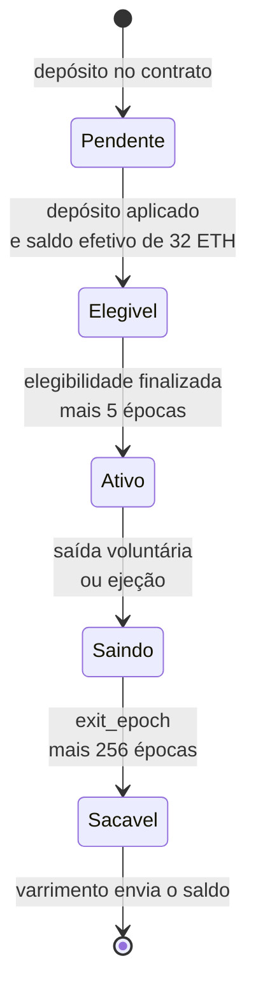

# Capítulo 84: O Ciclo de Vida do Validador, Saldo Efetivo e Histerese

Um validador não nasce no instante em que o depósito aparece no contrato (Capítulo 71), e também não desaparece quando o saldo sai (Capítulo 83). Entre uma coisa e outra existe uma máquina de estados, com épocas marcadas no registro de cada validador, e um segundo número que importa mais que o saldo: o saldo efetivo. Este capítulo percorre essa máquina, explica por que o saldo efetivo muda tão pouco e mostra a regra de histerese que evita que ele fique oscilando a cada centavo de recompensa.

**Quatro datas no registro.** Pela especificação da camada de consenso, cada validador carrega quatro campos de época: `activation_eligibility_epoch`, `activation_epoch`, `exit_epoch` e `withdrawable_epoch`. Todos começam com o valor `FAR_FUTURE_EPOCH`, que é 2^64 - 1 e funciona como "ainda não definido". O estado de um validador (pendente, ativo, saindo, sacável) é lido comparando a época atual com essas datas, e não gravado num rótulo. Isso explica por que a máquina é simples de verificar: cada transição só preenche um campo que estava vazio.

**Da entrada até atestar.** Desde a Pectra (Capítulo 40), o depósito vira uma entrada numa fila de depósitos pendentes. Pela função `process_pending_deposits`, uma entrada só é processada depois que o slot em que ela foi registrada está finalizado (Capítulo 63), e há um teto de 16 depósitos por época. Ao ser aplicado, um depósito de chave nova cria o validador no registro, depois de conferir a assinatura de posse (Capítulo 73). Na época seguinte, o validador com saldo efetivo de pelo menos 32 ETH recebe a data de elegibilidade. Para virar ativo, a elegibilidade precisa ser anterior ou igual à última época finalizada. Cumprido isso, a `activation_epoch` é fixada em `epoch + 1 + MAX_SEED_LOOKAHEAD`, ou seja, mais cinco épocas, já que `MAX_SEED_LOOKAHEAD` vale 4. Esse atraso fixo existe para que a semente dos sorteios (Capítulo 64) seja conhecida antes de o novo validador poder ser sorteado. Cinco épocas de 384 segundos somam 32 minutos.



*O desenho mostra o caminho de um validador comum: cada seta preenche uma das datas do registro, e só o varrimento do Capítulo 83 encerra a história.*

**O gargalo ficou na porta de entrada.** Antes da Pectra, a fila de ativação ficava no registro de validadores. Na Electra, a limitação de ritmo passou para a fila de depósitos, e o trecho de `process_registry_updates` só marca elegibilidade, ejeta e fixa a data de ativação. O limite continua sendo medido em ETH, e não em número de validadores. A função `get_balance_churn_limit` calcula o maior valor entre 128 ETH e o total ativo dividido por 65.536, arredondado para múltiplos de 1 ETH. Para ativações e saídas, `get_activation_exit_churn_limit` aplica ainda um teto de 256 ETH por época. A diferença entre o limite total e esse teto fica reservada às consolidações. Como o teto bate com 256 ETH quando o total ativo passa de cerca de 16,8 milhões de ETH (256 vezes 65.536), o ritmo máximo é de 256 ETH por época, ou 57.600 ETH por dia (225 épocas). A mesma conta, vista do lado das saídas, é a do Capítulo 49.

```latex
churn_total = max(128 ETH, total_ativo / 65536)
churn_ativacao_saida = min(256 ETH, churn_total)
dias_para_entrar(X) = X / (225 x churn_ativacao_saida)
```

**Saldo real e saldo efetivo.** O registro guarda dois números por validador. O saldo (`balance`) muda a cada época com recompensas e penalidades, em unidades de Gwei. O saldo efetivo (`effective_balance`) é o que o protocolo usa para quase tudo: peso nos votos, chance de proposer, tamanho das recompensas (Capítulo 48), penalidades de slashing e a elegibilidade para a fila de saída. Ele é sempre múltiplo de `EFFECTIVE_BALANCE_INCREMENT`, que vale 1 ETH, e tem teto de 32 ETH para credenciais 0x00 e 0x01, ou 2.048 ETH para o prefixo 0x02, como mostrou o Capítulo 40. Há uma razão prática para essa separação: o saldo mexe toda época, em cada um dos validadores, enquanto o efetivo mexe raramente. Isso permite que o cálculo de pesos e de comitês (Capítulo 62) reutilize os mesmos números por longos períodos, em vez de recalculá-los continuamente.

**A histerese.** Se o saldo efetivo seguisse o saldo real de perto, qualquer recompensa de uns poucos Gwei faria o validador "subir de degrau", e uma penalidade pequena o faria "descer". A solução é a histerese: o saldo efetivo só muda quando o saldo real se afasta dele além de uma folga. A especificação define `HYSTERESIS_QUOTIENT` como 4, o multiplicador para baixo como 1 e o multiplicador para cima como 5. Com o incremento de 1 ETH, o incremento de histerese é 0,25 ETH, o limite inferior é 0,25 ETH e o superior é 1,25 ETH. No fim de cada época, o código de `process_effective_balance_updates` recalcula o saldo efetivo apenas se uma das condições abaixo valer:

```latex
saldo + 0,25 ETH < efetivo      (queda)
efetivo + 1,25 ETH < saldo      (alta)
novo_efetivo = min(saldo - saldo mod 1 ETH, teto)
```

Um exemplo com valores simples ajuda. Um validador 0x01 com saldo efetivo de 32 ETH só terá o efetivo reduzido se o saldo real cair abaixo de 31,75 ETH, e então o novo valor será o arredondamento para baixo, 31 ETH. Para voltar a 32 ETH, o saldo real precisa passar de 32,25 ETH, e o efetivo sobe para 32 (o teto). Já num validador 0x02 com efetivo de 32 ETH, o efetivo só sobe para 33 ETH quando o saldo real passa de 33,25 ETH. Por isso, a assimetria entre os limites (folga menor para baixo e maior para cima) significa que o protocolo reage rápido a perdas e devagar a ganhos.

| Situação | Saldo real | Saldo efetivo antes | Saldo efetivo depois |
| --- | --- | --- | --- |
| Pequena recompensa | 32,10 ETH | 32 ETH | 32 ETH (sem mudança) |
| Penalidade pequena | 31,80 ETH | 32 ETH | 32 ETH (sem mudança) |
| Penalidade que passa da folga | 31,70 ETH | 32 ETH | 31 ETH |
| Recuperação até a folga | 32,20 ETH | 31 ETH | 31 ETH (sem mudança) |
| Recuperação além da folga | 32,30 ETH | 31 ETH | 32 ETH |
| Validador 0x02 acumulando | 33,30 ETH | 32 ETH | 33 ETH |

*A tabela mostra que o efetivo só se move quando o saldo atravessa a folga, o que mantém o registro estável mesmo com o saldo variando a cada época.*

**Ejeção, o piso do sistema.** O mesmo passo de atualização do registro vigia o piso. Se um validador ativo tem saldo efetivo igual ou menor que `EJECTION_BALANCE`, que é 16 ETH, a função `initiate_validator_exit` é chamada. É por isso que quem perde muito por punições ou longos períodos offline acaba removido, em vez de continuar com peso reduzido no consenso. O Capítulo 61 mostra como o vazamento por inatividade empurra o saldo nessa direção. A saída entra na fila de saída com o peso do saldo efetivo do validador, consumindo o churn de saída. Na Electra, `compute_exit_epoch_and_update_churn` avança a época de saída conforme o saldo efetivo consome o churn, e o `withdrawable_epoch` fica 256 épocas depois, como no Capítulo 83.

**O que isso muda na prática.** Primeiro, a conta do rendimento (Capítulo 48) é feita sobre o saldo efetivo, não sobre o real: quem acumula 0,9 ETH acima de 32 num validador 0x02 ainda não está ganhando sobre esse excedente, até o saldo passar o limite de 1,25 ETH acima do efetivo. É uma razão para a Pectra ter reservado o saque sob demanda a quem prefere não deixar capital parado. Segundo, uma entrada em massa (Capítulo 53 trata de demanda institucional) leva tempo por construção, porque o ritmo é limitado em ETH por época. Terceiro, o atraso de cinco épocas e a exigência de finalidade mostram que o consenso trata a mudança de conjunto de validadores como algo que não pode ser instantâneo. O material é educacional e não recomenda comprar, vender ou fazer staking.

**Glossário do capítulo.**

- **FAR_FUTURE_EPOCH**: constante igual a 2^64 - 1, usada nos campos de época de um validador para indicar "ainda não definido".
- **activation_eligibility_epoch**: época em que o validador entrou na lista de elegíveis para ativação; precisa estar finalizada para a ativação prosseguir.
- **activation_epoch**: época a partir da qual o validador passa a atestar e a ser sorteado, fixada em `epoch + 1 + MAX_SEED_LOOKAHEAD`.
- **MAX_SEED_LOOKAHEAD**: constante de valor 4, que adia por épocas a validade de ativações e saídas para que a semente dos sorteios seja conhecida antes.
- **Saldo efetivo (effective_balance)**: saldo arredondado em múltiplos de 1 ETH, com teto, usado pelo protocolo para pesos, recompensas e penalidades.
- **Histerese**: regra que só altera o saldo efetivo quando o saldo real se afasta dele além de uma folga (0,25 ETH para baixo e 1,25 ETH para cima).
- **Churn (limite de rotatividade)**: teto de quantos ETH podem ser ativados ou sair por época; vale o maior entre 128 ETH e o total ativo dividido por 65.536, limitado a 256 ETH para ativações e saídas.
- **Depósito pendente**: entrada na fila da camada de consenso que aguarda finalização e espaço no churn antes de ser aplicada ao registro.
- **Ejeção**: saída forçada de um validador ativo cujo saldo efetivo caiu a 16 ETH ou menos.
- **withdrawable_epoch**: época a partir da qual o saldo do validador que saiu pode ser sacado por inteiro.

**Fontes.**

- Especificação da fase 0 (consenso), constantes, registro de validadores e atualização do saldo efetivo: https://raw.githubusercontent.com/ethereum/consensus-specs/master/specs/phase0/beacon-chain.md
- Especificação da Electra (consenso), churn por saldo, depósitos pendentes, saldo efetivo máximo e saída: https://raw.githubusercontent.com/ethereum/consensus-specs/master/specs/electra/beacon-chain.md
- ethereum.org, staking solo e fila de ativação: https://raw.githubusercontent.com/ethereum/ethereum-org-website/dev/public/content/staking/solo/index.md
