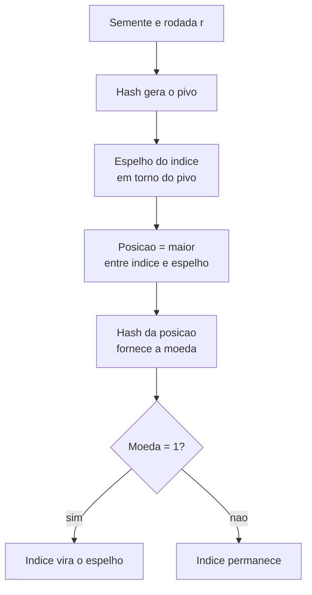

# Capítulo 86: O Embaralhamento Swap-or-Not, Como os Validadores Viram Comitês

O Capítulo 2 explicou que os validadores são divididos em comitês a cada época, e o Capítulo 64 mostrou de onde vem a semente aleatória que alimenta o sorteio. Falta o elo do meio: como uma lista de centenas de milhares de validadores, mais uma semente de 32 bytes, vira uma ordem embaralhada que todos os nós da rede calculam exatamente igual, sem conversar entre si? A resposta é um algoritmo de embaralhamento chamado swap-or-not, escolhido pela especificação da camada de consenso. Este capítulo percorre a ideia, as 90 rodadas, a conta que decide quantos comitês existem e o que o desenho garante e não garante.

**O problema a resolver.** O embaralhamento precisa de três propriedades ao mesmo tempo. Precisa ser determinístico, porque milhares de nós independentes têm de chegar à mesma ordem usando só a semente e a lista de validadores ativos. Precisa ser uma permutação de verdade, isto é, cada validador aparece exatamente uma vez, sem repetições nem omissões. E precisa parecer aleatório para quem não conhece a semente, para que ninguém consiga prever ou escolher em qual comitê vai cair. Um baralho embaralhado por uma pessoa não serve, porque cada nó teria um resultado diferente. Serve uma receita fixa, em que a única parte imprevisível é a semente.

**A ideia do swap-or-not.** O comentário da própria função na especificação indica a origem: o algoritmo vem de um artigo acadêmico sobre cifragem de domínios pequenos baseada em embaralhamento de cartas, e a implementação segue a versão chamada de "domínio generalizado". A ideia, em linguagem de baralho, é esta. A cada rodada, sorteia-se um pivô. Cada posição é emparelhada com a sua imagem espelhada em torno do pivô. Para cada par, uma moeda decide se os dois trocam de lugar ou ficam como estão. Repete-se isso 90 vezes, com um pivô e moedas novos em cada rodada.

O ponto engenhoso é que a moeda de um par é a mesma para os dois membros. Isso garante que, quando um troca com o outro, o outro também troca com o primeiro, de modo que nenhuma posição acaba ocupada por dois validadores e nenhuma fica vazia. O resultado de cada rodada é sempre uma permutação, e a composição de permutações também é uma permutação.

**Uma rodada por dentro.** Para um validador na posição `i`, entre `N` validadores ativos, a rodada `r` calcula o seguinte, conforme o código da especificação.

```latex
pivo     = primeiros 8 bytes de SHA256(semente + r)  mod  N
espelho  = (pivo + N - i)  mod  N
posicao  = max(i, espelho)
moeda    = bit numero (posicao mod 8) do byte (posicao mod 256) / 8
           de SHA256(semente + r + posicao / 256)
nova_i   = espelho  se moeda = 1,  senão  i
```

Há dois detalhes que explicam por que isso funciona. O primeiro é que o espelho do espelho é a posição original, e ambos têm o mesmo `max`, portanto leem o mesmo bit da mesma moeda: o par decide em conjunto. O segundo é que a posição de referência é sempre a maior do par, o que fixa qual bit da sequência de hashes será usado, sem ambiguidade. Um hash de 32 bytes fornece 256 bits, e por isso cada bloco de 256 posições consecutivas compartilha um mesmo hash, o que reduz o custo computacional.

Um exemplo pequeno ajuda. Com `N = 5` e pivô igual a 3, os pares da rodada são 0 com 3 e 1 com 2. A posição 4 é espelho de si mesma, já que `(3 + 5 - 4) mod 5 = 4`, e portanto fica onde está. A moeda do par (0, 3) é lida na posição 3, e a do par (1, 2), na posição 2.



*O desenho mostra uma rodada para um único índice: o pivô e a moeda vêm de hashes da semente, e a moeda decide se o índice troca de lugar com o seu espelho.*

**Por que 90 rodadas.** A constante `SHUFFLE_ROUND_COUNT` vale 90 na especificação. Uma rodada isolada embaralha muito pouco, porque cada posição só pode ir para um único lugar. O artigo que originou o método mostra que, com rodadas suficientes, a permutação resultante fica estatisticamente muito próxima de uma permutação uniformemente aleatória. A especificação não detalha a demonstração no texto que abri; o número de rodadas é uma escolha de projeto com folga de segurança, não um valor derivado na própria especificação.

**Do embaralhamento ao comitê.** Com a lista de validadores ativos embaralhada, formar comitês é cortar a lista em fatias consecutivas de tamanho quase igual. A função `compute_committee` faz exatamente isso: o comitê de número `k`, entre `C` comitês no total, ocupa as posições de `N * k / C` até `N * (k + 1) / C`, com divisão inteira, e cada posição é traduzida para o validador correspondente pelo embaralhamento.

```latex
inicio = (N * k) // C
fim    = (N * (k + 1)) // C
comite_k = [ ativos[ embaralhar(j) ]  para j de inicio ate fim - 1 ]
```

A conta que decide `C` está em `get_committee_count_per_slot`: o número de comitês por slot é o número de validadores ativos dividido pelo número de slots por época e pelo tamanho-alvo do comitê, limitado entre 1 e 64. Como são 32 slots por época e o tamanho-alvo é 128, a tabela abaixo mostra como a rede se adapta a diferentes populações. Os valores de `N` são hipotéticos, escolhidos só para ilustrar a fórmula.

| Validadores ativos (hipotético) | Comitês por slot | Comitês por época | Tamanho aproximado de cada comitê |
| --- | --- | --- | --- |
| 4.096 | 1 | 32 | 128 |
| 65.536 | 16 | 512 | 128 |
| 262.144 | 64 | 2.048 | 128 |
| 1.000.000 | 64 (teto) | 2.048 | cerca de 488 |

*A tabela mostra que o tamanho do comitê fica em torno de 128 enquanto a rede é pequena e passa a crescer quando o teto de 64 comitês por slot é atingido.*

O limite inferior, de 4.096 validadores, é o ponto em que cabe pelo menos um comitê de 128 em cada um dos 32 slots. A especificação comenta que o tamanho-alvo de 128 supera o mínimo de 111 recomendado em trabalhos anteriores sobre segurança de comitês, e que, com validadores suficientes, o algoritmo garante comitês de pelo menos esse tamanho. Já o limite superior de 64 comitês por slot existe para limitar a quantidade de sub-redes e mensagens da camada de rede (Capítulo 66); o efeito colateral é que, numa rede muito grande, os comitês engordam em vez de se multiplicarem.

**A semente e a antecedência.** A semente de uma época é calculada por `get_seed`, que mistura um tipo de domínio, o número da época e uma mistura RANDAO lida com defasagem: a mistura de duas épocas antes. Essa defasagem, somada ao atraso na entrada e na saída de validadores (a ativação só acontece cinco épocas depois, como visto no Capítulo 84), faz com que os comitês de uma época possam ser conhecidos com antecedência. Isso tem uma utilidade prática grande: os validadores sabem com folga a quais sub-redes precisam se conectar, e os agregadores se preparam. Também tem um custo: a previsibilidade abre espaço para ataques direcionados a quem vai atestar, e é uma das razões de pesquisa sobre melhorar a aleatoriedade, tema que a própria especificação menciona ao falar de funções de atraso verificável.

**O proponente reaproveita o embaralhamento.** O sorteio do proponente do slot também usa o mesmo índice embaralhado. Na versão da fase 0, `compute_proposer_index` percorre candidatos na ordem do embaralhamento e aceita cada um com probabilidade proporcional ao saldo efetivo, tirada de um byte aleatório derivado do hash. Quem tem saldo efetivo máximo é sempre aceito, e quem tem saldo menor é aceito proporcionalmente menos vezes. É a ponte com o Capítulo 40: o teto de 2.048 ETH da Pectra mudou o que significa "saldo máximo", e as versões posteriores da especificação adaptam esse sorteio. O capítulo descreve a mecânica da fase 0 como base.

**Custo e implementação.** Calcular o destino de um índice isolado custa 90 rodadas de hashes. Calcular a lista inteira de uma vez é muito mais barato por validador, porque os hashes de moedas são compartilhados por blocos de 256 posições. É por isso que a versão atual da especificação descreve uma função que devolve a permutação completa, e os clientes embaralham a lista uma vez por época e a guardam em cache. Para uma população hipotética de um milhão de validadores, são cerca de 3.907 hashes de moedas e 1 hash de pivô por rodada, ou algo na casa de 350 mil hashes por época, uma conta modesta para qualquer computador.

**O que o desenho garante e o que não garante.** Garante que o resultado é o mesmo em qualquer nó, que é uma permutação válida e que, sem a semente, o destino de cada validador é imprevisível. Não garante que a semente seja perfeita: o viés de um bit do RANDAO (Capítulo 64) continua valendo, e quem influencia a semente influencia, em pequena escala, a distribuição dos comitês. Também não elimina o risco de captura de um comitê por quem controla muitos validadores, já que o sorteio é uniforme sobre os validadores e não sobre as pessoas ou empresas por trás deles. Essa é a razão econômica de a concentração de stake (Capítulos 3 e 57) importar também para a segurança dos comitês. O conteúdo é educacional e não recomenda compra, venda ou staking.

**Resumo.** O swap-or-not embaralha a lista de validadores ativos em 90 rodadas de trocas decididas por hashes, o que dá uma permutação determinística e uniforme a partir de uma semente. A lista embaralhada é fatiada em comitês, e a quantidade deles depende de quantos validadores existem, com o piso de um e o teto de 64 por slot. O mesmo embaralhamento alimenta o sorteio do proponente, ponderado pelo saldo efetivo.

**Glossário do capítulo.**

- **Swap-or-not**: algoritmo de embaralhamento em rodadas, em que cada posição é emparelhada com um espelho e uma moeda decide se o par troca de lugar.
- **Permutação**: reordenação em que cada elemento aparece exatamente uma vez.
- **Pivô**: valor sorteado a cada rodada a partir da semente, em torno do qual as posições são espelhadas.
- **SHUFFLE_ROUND_COUNT**: constante que define o número de rodadas do embaralhamento, igual a 90.
- **Semente (seed)**: valor de 32 bytes derivado da mistura RANDAO que alimenta todos os sorteios de uma época.
- **Comitê**: grupo de validadores que atesta no mesmo slot, formado por uma fatia da lista embaralhada.
- **TARGET_COMMITTEE_SIZE**: tamanho-alvo do comitê, igual a 128 na especificação.
- **MAX_COMMITTEES_PER_SLOT**: teto de comitês por slot, igual a 64.
- **Saldo efetivo**: saldo arredondado usado como peso, entre outros usos, na escolha do proponente.

**Fontes.**

- Especificação da fase 0 (consenso), constantes de comitê, `compute_shuffled_permutation`, `compute_committee`, `get_committee_count_per_slot`, `get_seed` e `compute_proposer_index`: https://raw.githubusercontent.com/ethereum/consensus-specs/master/specs/phase0/beacon-chain.md
